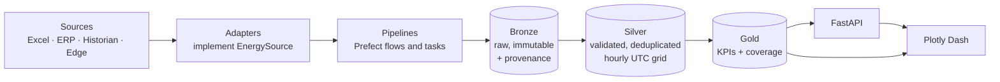

# Clarios Energy

**An industrial energy and gas consumption monitoring platform for multi-plant
operations.** It ingests meter readings, sensor streams, ERP production records
and hand-maintained spreadsheets from every plant in the estate; reconciles them
onto a single canonical hourly UTC timeline; and publishes efficiency KPIs —
specific energy consumption, load factor, baseline deviation — to an API and a
dashboard. It is built for energy managers who need to compare plants fairly,
operations engineers who need to know why last Tuesday cost more than the
Tuesday before, and the data stewards in between who need to know exactly which
spreadsheet cell produced a disputed number.

[](https://github.com/clarios/clarios-energy/actions/workflows/ci.yml)
[](https://github.com/clarios/clarios-energy/actions/workflows/security.yml)
[](https://github.com/clarios/clarios-energy/actions/workflows/ci.yml)
[](https://www.python.org/downloads/release/python-3120/)
[](LICENSE)
[](https://docs.astral.sh/ruff/)
[](https://mypy-lang.org/)

> **Phase 1 (Foundations) is complete.** The repository structure, tooling,
> Docker environment, database schema, CI and documentation are all in place and
> verified. Functional modules are deliberately placeholders whose docstrings
> specify what each will do — see the [Roadmap](#-roadmap).

---

## Key features

- **Seven heterogeneous sources, one timeline.** Historians at 1-minute cadence,
  ERP extracts, and monthly workbooks are resampled onto a canonical hourly UTC
  grid, with timezone conversion applied *before* resampling so daylight-saving
  transitions do not misplace intervals.
- **Every number is traceable.** A Gold KPI resolves to Silver readings, which
  resolve to Bronze rows carrying `source_uri`, `source_row` and `content_hash`,
  which resolve to the exact bytes a plant uploaded — archived immutably in
  object storage.
- **Missing is never zero.** An interval nobody reported is stored explicitly as
  `missing` with a null value, enforced by a database constraint. Zeros stay
  meaningful.
- **Nothing is silently dropped.** Rows failing validation land in a quarantine
  table with the rule they broke, so rows in always equals rows landed plus rows
  quarantined.
- **Every KPI carries its coverage.** The fraction of the period actually backed
  by reliable readings ships with the value, so a figure computed from two hours
  of data is distinguishable from one computed from a full month.
- **Conflicts are audited, not resolved in silence.** When two sources disagree
  about an interval, the winner, the losers, and the divergence are all recorded.
- **Corrections supersede, never overwrite.** History stays reconstructible.
- **Idempotent ingestion.** Re-uploading a file or replaying a window is a no-op,
  not a duplicate — which makes retrying a failed nightly run safe.
- **Architecture enforced by tests, not convention.** The layer dependency rule
  is checked by parsing every import statically.

---

## Architecture



### Medallion: Bronze → Silver → Gold

Each layer makes a strictly stronger promise than the one before it, so a
consumer knows what it may assume and a producer knows what it must guarantee.

| Layer | Contains | Promise |
|---|---|---|
| **Bronze** | Raw records exactly as received, in a JSONB payload, plus full provenance | Immutable and append-only. Validates only the provenance envelope — rejecting a malformed value here would destroy the evidence needed to diagnose it. |
| **Silver** | Typed, deduplicated readings on the canonical hourly UTC grid | One *live* row per `(meter, interval)`. Missing is distinct from zero. Rejected rows are quarantined with their reason, never dropped. |
| **Gold** | KPI tables ready for dashboards and modelling | Replaced per period rather than mutated. Every row carries `coverage` and the `run_id` that produced it. |

### Hexagonal: ports and adapters

The core knows nothing about the outside world. Everything external is reached
through a **port** — a `typing.Protocol` expressed in domain terms — implemented
by an **adapter**.

### The layer dependency rule

```
domain  ← depends on NOTHING
ports   ← depends on domain
adapters← implements ports
api / dashboards / pipelines  ← depend on domain + ports + services, NEVER on each other
```

| Layer | May import from `energy` |
|---|---|
| `core`, `domain` | *nothing* |
| `ports` | `domain` |
| `schemas`, `db` | `domain`, `core` |
| `adapters` | `domain`, `ports`, `core`, `db` |
| `services` | `domain`, `ports`, `core` |
| `analytics` | `domain`, `core` |
| `pipelines` | `domain`, `ports`, `adapters`, `services`, `schemas`, `core`, `db` |
| `api` | `domain`, `ports`, `services`, `schemas`, `db`, `core` |
| `dashboards` | `domain`, `ports`, `services`, `core` |

Two consequences matter most. **`domain` depends on nothing**, which is what lets
every business rule be tested without a database, a container, or a network call.
And **`api`, `dashboards` and `pipelines` are siblings** that may never import
one another, which is what keeps the monolith modular — any one of them could be
extracted into its own deployable without untangling an import.

The rule is enforced by [`tests/unit/test_architecture.py`](tests/unit/test_architecture.py),
which parses imports with `ast` rather than observing them at runtime, so a
violation hidden inside a `TYPE_CHECKING` block is caught too.

Full detail: **[docs/architecture.md](docs/architecture.md)**.

---

## Technology stack

| Component | Technology | Purpose |
|---|---|---|
| Language | Python 3.12 | Single implementation language |
| Dependency management | [uv](https://docs.astral.sh/uv/) | Fast, lockfile-based resolution and virtualenv management |
| API | FastAPI + Uvicorn | HTTP interface, OpenAPI docs, async request handling |
| Models & configuration | Pydantic v2, pydantic-settings | Validated request/response contracts and typed env config |
| ORM / DB access | SQLAlchemy 2.x + SQLModel | Query construction and table mapping |
| Migrations | Alembic | Versioned, reversible schema changes |
| Database | PostgreSQL 16 + TimescaleDB | Relational integrity *and* time-series partitioning, compression, retention |
| Object storage | MinIO (S3-compatible) | Immutable archive of original uploaded files |
| Orchestration | Prefect 3 | Flow scheduling, retries, run observability |
| Dataframes | Polars (primary), Pandas (interop) | Fast columnar transforms; Pandas only where a library requires it |
| Data validation | Pandera | Executable per-layer dataframe contracts |
| Dashboards | Plotly Dash | Interactive charts over the Gold layer |
| Web app | React, TypeScript, Vite, Mantine | The app users open: the Power BI dashboard and data loading. Checked by Biome, `tsc` and Vitest |
| Testing | pytest, pytest-cov, pytest-asyncio, Hypothesis, testcontainers | Unit, property, integration and container-backed tests |
| Linting / formatting | Ruff | One tool for lint and format |
| Type checking | mypy (strict) | Full static typing across `src/energy` |
| Security | bandit, pip-audit, gitleaks | Code patterns, dependency CVEs, committed secrets |
| Git hooks | pre-commit | Runs the gate before a commit is made |
| Logging | structlog | Structured logs with request-id correlation |
| CI | GitHub Actions | Runs exactly what `make check` runs |
| Reverse proxy | Caddy | The single ingress; the only service publishing ports |

---

## Project structure

```
clarios-energy/
├── .github/workflows/      CI, security scanning, image publishing
├── config/                 Declarative configuration, versioned with the code
│   ├── kpis.yaml               KPI formulas, units, roll-up rules
│   ├── equivalent_units.yaml   Production equivalence factors (time-versioned)
│   ├── sources.yaml            Per-plant sources, priorities, resampling rules
│   └── logging.yaml            Logger levels and handlers
├── docs/                   Architecture, data dictionary, ADRs, ops runbook
├── frontend/               The web app (React, TypeScript, Vite) Caddy serves at /
├── migrations/             Alembic revisions - the source of truth for all DDL
│   └── versions/               0001 extensions → 0005 hypertables
├── scripts/                Operational tooling (seeding, synthetic data, waits)
├── src/energy/
│   ├── domain/             Pure business logic. Zero I/O. Depends on nothing.
│   ├── ports/              Protocol interfaces to the outside world
│   ├── adapters/           Concrete implementations of those ports
│   ├── schemas/            Pandera dataframe contracts, one per medallion layer
│   ├── db/                 Engine, session factory, ORM models, health probes
│   ├── pipelines/          Prefect flows and tasks (entry point)
│   ├── services/           Application use cases, orchestrating the domain
│   ├── analytics/          Baseline, decomposition, anomaly, attribution
│   ├── api/                FastAPI application (entry point)
│   ├── dashboards/         Plotly Dash application (entry point)
│   └── core/               Settings, logging, constants. Depends on nothing.
└── tests/
    ├── unit/               Fast, no containers. Includes the architecture test.
    ├── integration/        Requires PostgreSQL
    └── e2e/                Requires the full compose stack
```

Why it is shaped this way: the directory layout *is* the dependency graph.
`domain` and `core` sit at the bottom and import nothing; `ports` declares what
the application needs; `adapters` supplies it; and the three entry points sit at
the top as peers. See [docs/architecture.md](docs/architecture.md).

---

## ⭐ Getting Started

Follow these steps in order. They take a new machine from a clone to a running,
tested stack without needing anything that is not listed here.

### Prerequisites

| Tool | Minimum version | Check with | Notes |
|---|---|---|---|
| Docker Engine | 24.0 | `docker --version` | Docker Desktop on macOS/Windows |
| Docker Compose | v2.22 | `docker compose version` | The `--wait` flag needs ≥ 2.17 |
| uv | 0.5 | `uv --version` | Installs and manages Python itself |
| Python | 3.12 | `uv python list` | **uv installs this for you** — no system Python 3.12 needed |
| make | 3.81 | `make --version` | GNU Make |
| git | 2.30 | `git --version` | |
| Node.js | 22.22; 24 LTS recommended | `node --version` | Only to work on `frontend/` or run `make check`. `make up` builds the web app inside Docker and needs no Node on the host |

Installing uv, if you do not have it:

```bash
# macOS / Linux
curl -LsSf https://astral.sh/uv/install.sh | sh

# Windows (PowerShell)
powershell -c "irm https://astral.sh/uv/install.ps1 | iex"
```

> **Windows users:** `make` works from PowerShell, cmd or Git Bash. GNU Make
> defaults to `cmd.exe`, which cannot run POSIX recipes, so the Makefile locates
> Git Bash itself through `git --exec-path` — no `PATH` changes needed.

### Step 1 — Clone the repository

```bash
git clone https://github.com/clarios/clarios-energy.git
cd clarios-energy
```

### Step 2 — Create your environment file

```bash
cp .env.example .env
```

Then edit `.env` and replace every `change-me` value. Generate a real secret key
with `openssl rand -hex 32`.

> `.env` is gitignored and must never be committed. `.env.example` is the
> template and documents every variable — the CI `Security` workflow fails if a
> real-looking credential appears in it.

**Every environment variable:**

| Variable | Description | Default | Required |
|---|---|---|---|
| `COMPOSE_PROJECT_NAME` | Prefix for container and volume names | `clarios-energy` | No |
| **Application** |
| `APP_NAME` | Service name in logs and health responses | `clarios-energy` | No |
| `APP_ENV` | `local`, `ci`, `staging`, or `production` | `local` | No |
| `APP_DEBUG` | Verbose errors and auto-reload. Never enable in production | `true` | No |
| `APP_VERSION` | Version reported by `/health` | `0.1.0` | No |
| **Logging** |
| `LOG_LEVEL` | `CRITICAL`…`DEBUG` | `INFO` | No |
| `LOG_FORMAT` | `console` (human) or `json` (aggregators) | `console` | No |
| `LOG_CONFIG_FILE` | Path to the stdlib logging config | `config/logging.yaml` | No |
| **Database** |
| `POSTGRES_USER` | Database role | `energy` | **Yes** |
| `POSTGRES_PASSWORD` | Database password | *(none)* | **Yes** — compose refuses to start without it |
| `POSTGRES_DB` | Database name | `energy` | **Yes** |
| `POSTGRES_HOST` | Hostname. `db` inside compose, `localhost` from the host | `db` | No |
| `POSTGRES_PORT` | Port | `5432` | No |
| `DATABASE_URL` | Full SQLAlchemy DSN. Overrides the parts above when set | *assembled* | No |
| `DB_POOL_SIZE` | Connections kept open per process | `5` | No |
| `DB_MAX_OVERFLOW` | Extra connections under load | `10` | No |
| `DB_POOL_TIMEOUT` | Seconds to wait for a connection | `30` | No |
| `DB_ECHO` | Log every SQL statement. Debugging only | `false` | No |
| **API** |
| `API_HOST` | Bind interface | `0.0.0.0` | No |
| `API_PORT` | Bind port | `8000` | No |
| `API_WORKERS` | Uvicorn worker processes | `2` | No |
| `API_ROOT_PATH` | External prefix Caddy serves it under | `/api` | No |
| `API_CORS_ORIGINS` | Comma-separated allowed origins | `http://localhost` | No |
| `API_SECRET_KEY` | Token signing key. `openssl rand -hex 32` | *(none)* | **Yes** |
| `API_KEY_HEADER` | Header carrying the API key | `X-API-Key` | No |
| **Dashboards** |
| `DASH_HOST` | Bind interface | `0.0.0.0` | No |
| `DASH_PORT` | Bind port | `8050` | No |
| `DASH_URL_BASE_PATHNAME` | Base path when Dash runs outside the stack. In the stack `docker-compose.yml` fixes it to `/dash/`, the path the Caddyfile routes | `/` | No |
| **Object storage** |
| `MINIO_ENDPOINT` | MinIO host and port | `minio:9000` | No |
| `MINIO_ROOT_USER` | Access key | `minioadmin` | **Yes** |
| `MINIO_ROOT_PASSWORD` | Secret key | *(none)* | **Yes** — compose refuses to start without it |
| `MINIO_REGION` | S3 region | `us-east-1` | No |
| `MINIO_SECURE` | Use TLS to reach MinIO | `false` | No |
| `MINIO_BUCKET_BRONZE` | Bucket for archived source files | `bronze-raw` | No |
| `MINIO_BUCKET_REPORTS` | Bucket for generated reports | `reports` | No |
| `ARCHIVE_BACKEND` | Where source files are archived: `minio`, or `local` for a directory | `minio` | No |
| `ARCHIVE_DIR` | Directory used when `ARCHIVE_BACKEND=local` | `data/bronze_archive` | No |
| **Power BI (reporting)** |
| `REPORTING_DB_USER` | Read-only login Power BI connects with | `powerbi` | No |
| `REPORTING_DB_PASSWORD` | Its password | *(none)* | For `make powerbi` |
| `REPORTING_BIND_ADDRESS` | Where the opt-in bridge listens | `127.0.0.1` | No |
| `REPORTING_PORT` | Host port of the bridge | `5433` | No |
| **Orchestration** |
| `PREFECT_API_URL` | Prefect API the worker talks to | `http://prefect-server:4200/api` | No |
| `PREFECT_SERVER_API_HOST` | Server bind interface | `0.0.0.0` | No |
| `PREFECT_SERVER_API_PORT` | Server bind port | `4200` | No |
| `PREFECT_WORK_POOL` | Work pool the worker polls | `energy-pool` | No |
| **Reverse proxy** |
| `CADDY_HTTP_PORT` | Host HTTP port — **the only published port** | `8080` | No |
| `CADDY_HTTPS_PORT` | Host HTTPS port | `8443` | No |
| `CADDY_DOMAIN` | Hostname Caddy serves | `localhost` | No |
| **Data platform** |
| `CANONICAL_TIMEZONE` | Storage timezone. **Must be `UTC`** — validated at startup | `UTC` | No |
| `CANONICAL_GRID_FREQUENCY` | Grid interval | `1h` | No |
| `DATA_FRESHNESS_MAX_LAG_HOURS` | Lag above which `/ready` reports degraded | `6` | No |
| `CONFIG_DIR` | Directory holding the YAML configuration | `config` | No |

### Step 3 — Install dependencies

```bash
make install
```

This installs Python 3.12 via uv, syncs every dependency from `uv.lock`, and
installs the pre-commit hooks. Expect about a minute on a cold cache.

### Step 4 — Start the stack

```bash
make up
```

`make up` builds the application images and waits for **every** service to report
healthy before returning, so a successful exit means the stack is genuinely
usable rather than merely started. Expect several minutes on the first run while
images are pulled and built.

Verify:

```bash
docker compose ps
```

All seven services should show `(healthy)`:

```
NAME                             SERVICE          STATUS
clarios-energy-api-1             api              Up 2 minutes (healthy)
clarios-energy-caddy-1           caddy            Up 2 minutes (healthy)
clarios-energy-dash-1            dash             Up 2 minutes (healthy)
clarios-energy-db-1              db               Up 2 minutes (healthy)
clarios-energy-minio-1           minio            Up 2 minutes (healthy)
clarios-energy-prefect-server-1  prefect-server   Up 2 minutes (healthy)
clarios-energy-prefect-worker-1  prefect-worker   Up 2 minutes (healthy)
```

| Service | URL | Check |
|---|---|---|
| API health | <http://localhost:8080/api/health> | `{"status":"ok",...}` |
| API readiness | <http://localhost:8080/api/ready> | Per-dependency health |
| **API docs** | <http://localhost:8080/api/docs> | Interactive OpenAPI UI |
| **Web app** | <http://localhost:8080/> | The app's shell, with its two sections; the footer shows the API's version |
| **Dash** | <http://localhost:8080/dash/> | Holding page until the Phase 5 energy charts |
| **Prefect UI** | <http://localhost:8080/prefect/> | Flow runs and work pools |
| **MinIO console** | <http://localhost:8080/minio/> | Log in with `MINIO_ROOT_USER` / `MINIO_ROOT_PASSWORD` |

Substitute your `CADDY_HTTP_PORT` if you changed it.

```bash
curl -fsS localhost:8080/api/health
curl -fsS localhost:8080/api/ready | jq
```

> **Only Caddy publishes ports.** The database, MinIO's S3 API, and the
> application containers are reachable only on the internal network. That is why
> `make db-upgrade` runs Alembic inside the api container rather than from your
> shell. To reach them directly while developing, copy
> `docker-compose.override.yml.example` to `docker-compose.override.yml`. The
> one opt-in exception is the read-only port for Power BI that `make powerbi`
> opens; see [docs/powerbi.md](docs/powerbi.md).

### Step 5 — Apply migrations and load data

```bash
make db-upgrade
```

This applies revisions 0001–0006: the extensions, the four schemas of the
medallion, the TimescaleDB hypertables with their compression and retention
policies, and the read-only `reporting` views BI tools connect to.

```bash
make seed
```

Loads reference dimensions and synthetic sample data.

> `make seed` runs `scripts/seed_reference_data.py` and
> `scripts/generate_synthetic_data.py`, which are **Phase 2 placeholders** and
> currently raise `NotImplementedError`. The target and its wiring are in place;
> the data generation arrives with Phase 2.

```bash
make equs-load
```

Lands the equivalent-batteries (EQUS) workbooks found in `data/raw_excels/` in
the Bronze layer: about 205,000 rows from six workbooks, in under a minute. The
originals are archived in MinIO and never modified. Running it again lands
nothing, because every sheet a completed run already landed is skipped.

The loader assumes no year. It lands whatever dates an export holds, and each run
records the first and last *Fecha Efectiva* it found. To add the export of
another period, put it in the same folder under the usual name followed by
anything, and run `make equs-load` again; only the new file is landed:

```text
data/raw_excels/Calculo de equivalente - Explorar transacciones por art.xlsx
data/raw_excels/Calculo de equivalente - Explorar transacciones por art FY24.xlsx
```

That applies to the transactions and invoices exports. The structure and
catalogue workbooks are snapshots: there is one of each, under its exact name,
and a newer version replaces the file. A workbook the loader does not recognise
is listed at the end of the output as not loaded.

The target runs `energy equs load-all` inside the api container, with the
workbook directory mounted read-only, because that is where the database and
MinIO can be reached. `energy equs load` lands one workbook, or some of its
sheets, and runs the same way (from Git Bash on Windows, prefix the command with
`MSYS_NO_PATHCONV=1` so the container paths are left alone):

```bash
docker compose run --rm --no-deps \
  -v "$(pwd -W 2>/dev/null || pwd)/data/raw_excels:/app/data/raw_excels:ro" api \
  energy equs load manual_sheets "/app/data/raw_excels/EQUS BATT.xlsx" \
  --sheet "Clasif_Poly=clasif_poly" --sheet "INSTRUCC=instrucc:0"
```

| Form | Meaning |
|---|---|
| `energy equs load SOURCE_KEY FILE` | Land the source's default sheets. Source keys: `qad_rct_wo`, `qad_facturas`, `qad_product_struc`, `item_master`, `manual_sheets` |
| `--sheet NAME` | Land this sheet; repeat for several |
| `--sheet NAME=dataset_key` | A hand-made catalogue, with the name of its dataset |
| `--sheet NAME:N` | The header is on row `N`; `0` means the sheet has no header row |
| `--force` | Land the sheets again under a new run |
| `--window-start`, `--window-end` | State the business period yourself; it replaces the dates found in the rows |

`energy equs load --help` lists every option. On a machine that can reach the
database but not MinIO, pass `--archive-dir <directory>` (or set
`ARCHIVE_BACKEND=local`) to archive the originals in a directory instead. What
each table receives is described in
**[docs/database_overview.md](docs/database_overview.md)**.

```bash
make equs-silver
```

Builds the EQUS Silver layer from what was landed: typed and deduplicated tables
for items, product structures, production receipts and invoice lines, plus the
two conversion tables the calculation needs (kg of paste per formed battery,
decoration pieces per decorated battery). It takes about half a minute and
prints a data-quality report: rows per table, what was dropped from each
structure sheet, and what needs a person to look at.

The build is one transaction, so Silver is never left half built, and running it
again changes nothing. Run it after every `make equs-load`. The target runs
`energy equs build-silver` inside the api container; `--examples N` sets how many
examples of each finding are listed.

#### Equivalent batteries: refresh, read, close, report

Gold computes the equivalent batteries (EQ) as views over Silver, so after new
workbooks arrive **one command** brings everything up to date:

```bash
make refresh-all            # land data/raw_excels, build Silver, refresh Gold, print column H
make refresh                # only refresh Gold: the two conversion tables and their statistics
```

Both print the time of each step and then column H of RESUMEN EQU for the latest
month with production (`MONTH=YYYY-MM` picks another). `make refresh` takes a few
seconds; `make refresh-all` a few minutes, most of it the load and the Silver
build. A refresh never changes a closed month, takes a lock so two never overlap,
and does not block anyone reading meanwhile.

| Target | Runs | What for |
|---|---|---|
| `make refresh` | `energy equs refresh-gold` | Bring `gold.v_resumen_equ` (column H) up to date |
| `make refresh-all` | `energy equs load-all`, then `refresh-gold --with-silver` | The whole chain from the workbooks |
| `make resumen MONTH=2026-09` | `energy equs resumen-equ --month 2026-09` | Column H of a month: each driver's quantity (D), factor (G) and EQ (H), then the totals and EQUS POLY. `FORMAT=json` or `csv`; `SOURCE=closed` reads the close |
| `make close MONTH=2026-09` | `energy equs close-month 2026-09` | Freeze the month as the official close, after the data-quality checks. `ACCEPT_WARNINGS=1` closes despite a blocking check and records it; `RECLOSE=1` replaces an earlier close, keeping it in the history |
| `make report START=2026-09-01 END=2026-09-30` | `equs-report --start … --end …` | EQ of any range of days as JSON laid out like RESUMEN EQU. `OUTPUT=file.json` writes it to a file |
| `make help` | — | Every target with its description |

A target that needs `MONTH`, `START` or `END` stops with a usage line when it is
missing. The targets only call the CLI; run the CLI directly for the other options
(`energy equs refresh-gold --help`, `equs-report --help`). Exit codes: 0 success,
1 invalid arguments or a refused request (a month already closed, a blocking
check), 2 a database error, 3 another refresh or close held the lock too long.

`equs-report` is also a Python function:

```python
from energy.pipelines.flows.equs_report import build_report

with engine.connect() as connection:
    report = build_report(connection, "2026-03-15", "2026-04-10", source="live", by_month=True)
```

The JSON follows
[`equs_report.schema.json`](src/energy/pipelines/flows/equs_report.schema.json); its
sections, plant labels, factors and rules all come from the database. Every target
runs inside the api container by default; `RUNNER=host` runs it on your machine
against `DATABASE_URL`. Three settings tune Gold (see `.env.example`):
`EQUS_VARIATION_THRESHOLD`, `EQUS_LOCK_TIMEOUT_SECONDS` and `EQUS_TIMEZONE`. The
views, the checks and the close are described in
**[docs/data_dictionary.md](docs/data_dictionary.md#the-equs-gold-objects)**.

Two more pages explain the numbers:

- **[docs/equs_calculation_explained.md](docs/equs_calculation_explained.md)**
  walks the calculation from the QAD exports to column H, table by table, for
  readers who know the workbook but not the database. It is also in Spanish:
  [docs/equs_calculation_explained.es.md](docs/equs_calculation_explained.es.md).
- **[docs/equs_resumen_call_chain.md](docs/equs_resumen_call_chain.md)** follows
  `make resumen` through every file and function, and shows how to get the same
  result from Python without the command line.

#### Power BI

Power BI Desktop on this machine reads the same numbers straight from the
database, through a read-only login and an opt-in port:

```bash
# once: put REPORTING_DB_PASSWORD=<your password> in .env
make powerbi          # create or renew the login, open 127.0.0.1:5433
make powerbi-down     # close the port again
```

`make powerbi` prints the server, database and user to type into **Get data →
PostgreSQL database**. The login reads the twelve views of schema `reporting`
(column H by month, EQUS BATT, EQUS POLY, data quality, the closes, and
receipt-level detail) and nothing else. Its sessions are read-only. The bridge
listens on 127.0.0.1 only, because the database speaks no TLS.

The views, a model with its relationships, starter DAX measures and
troubleshooting are in **[docs/powerbi.md](docs/powerbi.md)**.

Confirm the schema:

```bash
docker compose exec db psql -U energy -d energy -c "\dn"
docker compose exec db psql -U energy -d energy \
  -c "SELECT hypertable_name FROM timescaledb_information.hypertables;"
```

### Step 6 — Running quality checks

Each target does one thing and can be run on its own:

| Target | What it does | When to use it |
|---|---|---|
| `make format` | Rewrites code with `ruff format` and applies safe autofixes | Before committing |
| `make lint` | `ruff check` — imports, naming, docstrings, bug patterns, ~25 rule families | After any change |
| `make typecheck` | `mypy` in **strict** mode over `src/energy` | After changing a signature |
| `make security` | `bandit` for insecure patterns, `pip-audit` for dependency CVEs | Before opening a PR |
| `make test` | Full suite with coverage, failing below 70% | Before opening a PR |
| `make test-unit` | Unit tests only — no containers, no database, ~2 seconds | Constantly, while working |
| `make test-integration` | Integration tests — needs PostgreSQL | After a schema or repository change |
| `make frontend-check` | The web app's gate: Biome (format and lint), `tsc`, Vitest and a production build. Run `make frontend-install` once first | After any change under `frontend/` |

```console
$ make test-unit
uv run pytest -m "not integration and not e2e" --no-cov -q
.......................................................................  [ 35%]
.......................................................................  [ 70%]
..............................sssssssssssssssssssssssssssss              [100%]
173 passed, 30 skipped, 27 deselected in 1.81s
```

The skips are Phase 2–5 placeholder tests, each naming the phase that will
implement it.

#### ⭐ `make check` is the complete gate — and it is exactly what CI enforces

```bash
make check
```

It runs, in order, stopping at the first failure:

```
format-check  →  lint  →  typecheck  →  security  →  frontend-check  →  test
```

```console
$ make check
uv run ruff format --check .
100 files already formatted
uv run ruff check .
All checks passed!
uv run mypy
Success: no issues found in 82 source files
uv run bandit -c pyproject.toml -r src scripts -q
uv run pip-audit --strict --progress-spinner off
No known vulnerabilities found
uv run pytest --cov --cov-report=term-missing --cov-report=xml --cov-report=html
...
Required test coverage of 70% reached.
203 passed, 30 skipped in 48.21s
==> All quality gates passed.
```

**If `make check` passes locally, CI will pass.** The GitHub Actions workflow
runs the same make targets against the same lockfile, so there is no second set
of rules to satisfy. `make check` exits non-zero if any gate fails.

Run `make help` to list every available target.

### Step 7 — Running locally without Docker

Useful for attaching a debugger. You still need PostgreSQL, so start just that
service from compose and point your shell at it.

```bash
# 1. Start only the database and object storage
docker compose up -d --wait db minio

# 2. Publish the database port to your host
cp docker-compose.override.yml.example docker-compose.override.yml
docker compose up -d --wait db

# 3. Point your shell at localhost instead of the compose network
export DATABASE_URL="postgresql+psycopg://energy:<your-password>@localhost:5432/energy"
export MINIO_ENDPOINT="localhost:9000"
export CONFIG_DIR="config"

# 4. Migrate from the host rather than inside a container
make db-upgrade RUNNER=host

# 5. Run the API with auto-reload
uv run uvicorn energy.api.main:app --reload --port 8000

# 6. Or the dashboards
uv run python -m energy.dashboards.app

# 7. Or the web app, with live reload, against the running stack
make frontend-install   # once
make frontend-dev       # http://localhost:5173, forwarding /api to :8080
```

The API is then at <http://localhost:8000/docs> — note there is no `/api` prefix,
because that prefix is added by Caddy.

Run the tests against the same database:

```bash
make test-integration
```

### Troubleshooting

<details>
<summary><b>Port conflict — "address already in use" or "bind: permission denied"</b></summary>

`CADDY_HTTP_PORT` defaults to `8080`. If something else holds it, or you set it
to `80` on Linux where ports below 1024 need privileges:

```bash
# Find the offender
sudo lsof -i :8080          # macOS / Linux
netstat -ano | findstr :8080  # Windows

# Or just move Caddy
echo "CADDY_HTTP_PORT=8090" >> .env
make restart
```

If you enabled `docker-compose.override.yml`, it also publishes 8000, 8050, 5432,
9000, 9001 and 4200 — any of those can collide too.
</details>

<details>
<summary><b>Database not ready — "connection refused" or migrations hang</b></summary>

The `timescaledb-ha` image initialises its cluster on first boot, which takes
longer than a plain PostgreSQL image. The healthcheck allows a 60-second start
period.

```bash
docker compose ps db                    # is it healthy yet?
docker compose logs --tail=50 db        # what is it doing?
./scripts/wait_for_db.sh                # block until it answers
```

If it never becomes healthy, check disk space (`df -h`) and look for an
initialisation error in the logs. See
[docs/runbook.md §2](docs/runbook.md#2-database-down).
</details>

<details>
<summary><b>TimescaleDB extension missing — /ready reports `extensions` unhealthy</b></summary>

This is quiet and serious: the schema still accepts writes but loses every
partitioning, compression and retention guarantee.

```bash
docker compose exec db psql -U energy -d energy \
  -c "SELECT extname, extversion FROM pg_extension;"

docker compose exec db psql -U energy -d energy \
  -c "SELECT hypertable_name FROM timescaledb_information.hypertables;"
```

Expect `timescaledb` and `pgcrypto`, plus five hypertables.

- **Extension absent entirely** → the wrong image is running. Confirm
  `docker compose config | grep image` shows `timescale/timescaledb-ha:pg16`.
- **Extension present, no hypertables** → migration 0005 did not complete. Re-run
  `make db-upgrade`; it is idempotent.
- **Warnings about compression or retention** → those policies need the community
  edition. Migration 0005 warns and continues deliberately, so the schema is
  correct but storage will grow faster. See
  [docs/runbook.md §3](docs/runbook.md#3-missing-timescaledb-extension).
</details>

<details>
<summary><b>Stale Docker volumes — old data, failed migrations, wrong credentials</b></summary>

Changing `POSTGRES_PASSWORD` after the first boot does **not** change the
password inside an existing volume — PostgreSQL only reads it during
initialisation. The same applies to MinIO.

```bash
# Inspect
docker compose ps -a
docker volume ls | grep clarios-energy

# Nuclear option: destroy all data and start fresh
make down
docker compose down -v          # -v removes the named volumes
make up
make db-upgrade
```

> `docker compose down -v` **permanently deletes the database and every archived
> source file.** Fine locally; never on a shared host. To reset only the schema
> while keeping the volume, use `make db-reset`.
</details>

<details>
<summary><b><code>make</code> fails on Windows with <code>uv: command not found</code> or syntax errors</b></summary>

GNU Make defaults to `cmd.exe`, which cannot run the POSIX recipes, so the
Makefile picks a bash. Selecting it by the bare name `bash.exe` is unsafe once
WSL is installed: `C:\Windows\System32\bash.exe` often wins the `PATH` lookup,
and that shell has Docker but not `uv` — which is why `make up` would succeed
while every quality gate failed with `uv: command not found`.

The Makefile therefore resolves Git Bash from `git --exec-path`. If you still hit
this, confirm `git` is on `PATH`:

```bash
git --exec-path    # expect <git-root>/mingw64/libexec/git-core
make lint          # expect "All checks passed!"
```
</details>

<details>
<summary><b><code>make check</code> fails on <code>pip-audit</code> with a new CVE</b></summary>

`pip-audit` queries a live advisory database, so a build that passed yesterday
can fail today without any code change. That is working as intended.

Upgrade the affected package and re-lock:

```bash
uv lock --upgrade-package <package>
make check
```

If no fixed version exists yet, add an `--ignore-vuln <ID>` to the `security`
target in the Makefile **with a comment explaining why and when to remove it**.
</details>

---

## Development workflow

Full detail in **[CONTRIBUTING.md](CONTRIBUTING.md)**.

**Branching.** `main` is always deployable. Work on `feat/…`, `fix/…`, `chore/…`
or `docs/…` branched from `develop`.

**Conventional commits**, checked by a pre-commit hook:

```
feat(adapters): add SCADA historian source for BOG-02
fix(pipelines): convert timezone before resampling, not after
docs(adr): record the modular monolith decision
```

Scopes match the layers. Append `!` for a breaking change.

**Pre-commit** hooks are installed by `make install` and run ruff, mypy, bandit,
gitleaks and the commit-message check automatically. Do not bypass them with
`--no-verify`.

**Adding a data source** is the extension the architecture is built around. It
touches exactly two places:

1. Write an adapter in `src/energy/adapters/` implementing the
   [`EnergySource`](src/energy/ports/energy_source.py) protocol. Ports are
   `Protocol` classes, so you implement the methods — you do not inherit.
2. Add an entry to `config/sources.yaml` with its `priority` (lower wins when
   sources conflict) and its `resample.rule` (`sum` for consumption counters,
   `time_weighted` for instantaneous readings, `last` for cumulative registers).

No pipeline, service, endpoint or migration changes. If yours seems to need one,
the port is missing something — raise it rather than working around it.

---

## Database schema

Four schemas in one PostgreSQL 16 + TimescaleDB database, plus `reporting`, the
read-only views BI tools connect to. Start with the guided
tour and its diagrams in **[docs/database_overview.md](docs/database_overview.md)**;
the full field-by-field reference is in
**[docs/data_dictionary.md](docs/data_dictionary.md)**.

| Schema | Tables | Character |
|---|---|---|
| `reference` | `plants`, `meters`, `shifts`, `targets` | Human-maintained dimensions. `targets` is time-versioned so a new target cannot retroactively change how last year was judged. |
| `bronze` | `ingestion_runs`, `raw_files`, `raw_readings`, and the EQUS landing tables `raw_rct_wo`, `raw_facturas`, `raw_product_struc`, `raw_item_master`, `raw_manual_sheets` | Append-only landing area. Raw records kept whole in JSONB. Two-year retention on `raw_readings`. |
| `silver` | `readings`, `quarantine`, `consolidation_audit`; and 18 EQUS tables (among them `item_master`, `bom_estructura`, `reporte_qad`, `unit_ship`, `factores_equ`, `instrucc`) with the materialized views `td_form` and `td_deco` | Validated readings on the canonical hourly UTC grid, plus the rejected rows and the record of how source conflicts were resolved. The EQUS tables are the typed, deduplicated version of the Bronze workbooks, with the equation stored as data. |
| `gold` | `kpi_hourly`, `kpi_daily`, `plant_daily_summary`; the EQUS views (among them `v_resumen_equ`, `v_equs_batt_mes`, `inyeccion` and six `dq_*` checks), range functions, layout tables, and the frozen close `resumen_equ` with `cierre_mes` and `resumen_equ_historial` | Published KPIs, replaced per period. The EQUS views apply the equation stored in Silver; a closed month is frozen and changes only by a reclose. |
| `reporting` | Twelve views, among them `equs_mensual`, `equs_batt_mensual`, `equs_poly_mensual`, `calidad_datos_mensual`, `cierres`, `aporte_cuenta` and `recibos_produccion` | Read-only views for BI tools such as Power BI, readable by the role `reporting_reader` and nothing else. They restate Gold; nothing is stored. |

### Provenance carried by every Bronze row

This is what makes any published number traceable back to the bytes that produced
it:

| Column | What it records |
|---|---|
| `source_system` | Which configured source produced the row |
| `source_uri` | Object-storage key or query reference locating the original payload |
| `source_row` | 1-based row within that payload — points at a specific spreadsheet cell |
| `ingestion_run_id` | The run that wrote it |
| `ingested_at` | When it landed (UTC) |
| `content_hash` | SHA-256 of the raw payload — the deduplication key that makes re-ingestion idempotent |

Five tables are TimescaleDB hypertables, partitioned on their time column with
compression and (for Bronze) retention policies. Because TimescaleDB requires the
partitioning column in every unique constraint, their primary keys are composite.

---

## 🗺 Roadmap

### ✅ Phase 1 — Foundations *(complete)*

Repository structure, `uv` tooling, `make` targets, multi-stage Docker images,
the full compose stack behind Caddy, Alembic migrations for all four schemas with
TimescaleDB hypertables, structured logging, health and readiness probes, the
architecture test enforcing the layer rule, three CI workflows, and the
documentation set. Functional modules are placeholders whose docstrings specify
what each will do.

### ⬜ Phase 2 — Domain model and KPI engine

Entities and value objects, the canonical grid, equivalence factors, the pure KPI
formulas, the domain CLI, and reference-data seeding with synthetic sample data.
Property tests with Hypothesis.

### ⬜ Phase 3 — Ingestion adapters

Excel, ERP and historian adapters against the `EnergySource` port; MinIO and
PostgreSQL repository implementations; the Pandera contracts; validation,
consolidation and quarantine tasks; the Prefect flows; watermarks; and the upload
and ingest endpoints.

Built ahead of the rest for the equivalent-batteries work: the MinIO object
storage adapter, the loader that lands the EQUS workbooks in Bronze
(`energy equs load`, `energy equs load-all`), and the build that turns them into
EQUS Silver (`energy equs build-silver`).

### ⬜ Phase 4 — KPI computation and the Gold layer

The KPI service, computation and roll-up tasks, coverage accounting, the Gold
repository, and the KPI query endpoints.

### ⬜ Phase 5 — Analytics, alerting and reporting

Energy baseline regression, STL decomposition, anomaly and changepoint detection,
SHAP deviation attribution, the notifier adapters, report generation, and the
full Dash dashboards.

---

## Contributing

See **[CONTRIBUTING.md](CONTRIBUTING.md)** for branching, commit conventions, how
to add a data source, and the data-correctness rules that cause quiet bugs when
broken.

Before opening a pull request:

```bash
make check
```

Report security issues privately to the maintainers rather than in a public
issue.

## License

Released under the [MIT License](LICENSE).
