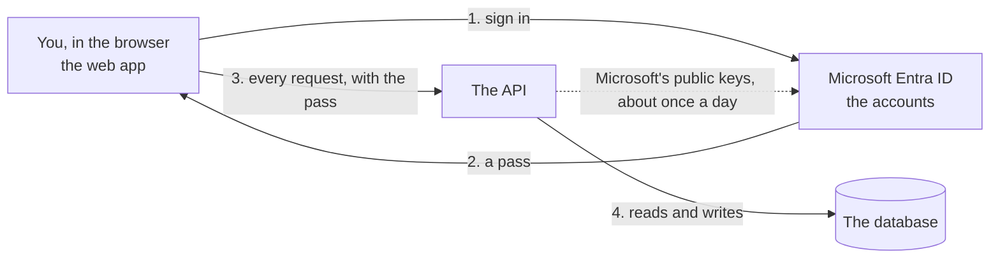
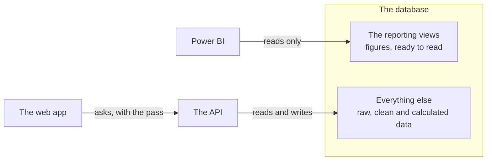
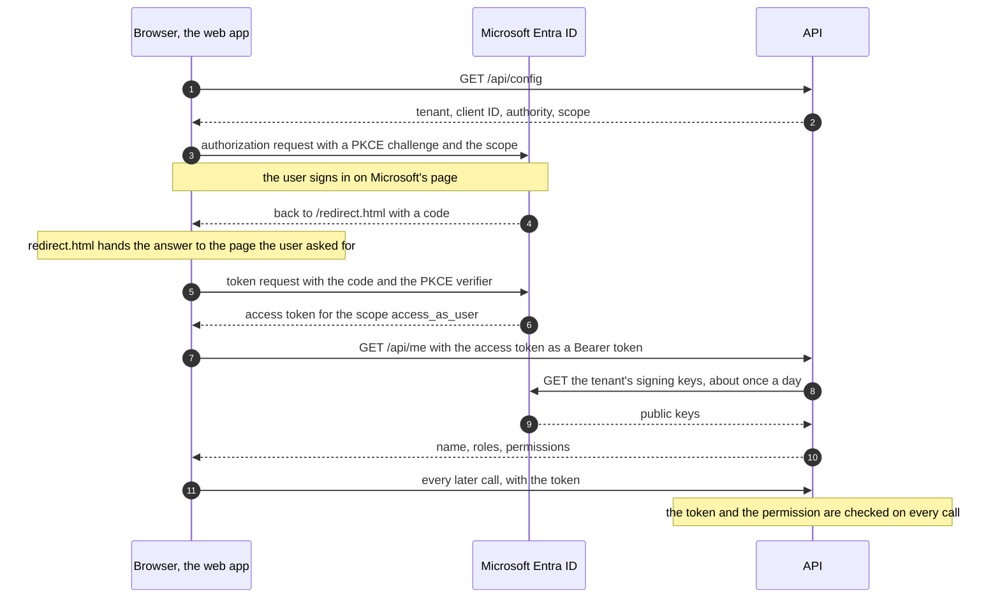
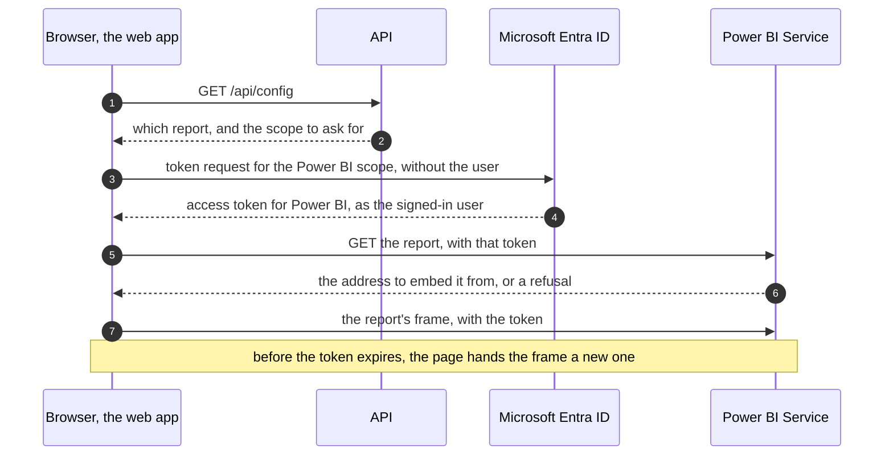

# The API

The API is the program the web app asks for everything: who is signed in, what
they may do and, as the features are built, the data itself. The plant's
devices will send their readings to it too. It is written in Python with
FastAPI.

It is not the only way to the data. Power BI reads its figures through a
separate, read-only path that does not pass through the API, and commands on
the server load exports and calculate the figures.
[Part 1](#the-other-way-to-the-data-power-bi) explains that in plain words and
[section 9](#9-what-does-not-go-through-the-api) in detail.

This guide has two parts:

- **[Part 1: In plain words](#part-1-in-plain-words)** is for a reader who does
  not write code. It says what the API is, how it works with the web app and
  with Microsoft Entra ID, and what it guarantees.
- **[Part 2: Technical reference](#part-2-technical-reference)** is for whoever
  maintains the API or calls it: every endpoint, the path of a request through
  the code, the token check, the errors, and how the app uses all of it.

The Entra ID side (roles, the app registration, giving someone access,
troubleshooting a sign-in) is in [Sign-in and roles](sign-in.md).

---

## Part 1: In plain words

### What the API is

The platform keeps its data in a database on a server. The **web app** is what
you see in the browser, and it never touches that database. It asks the
**API**, a program on the server. The API receives a request ("who am I?",
"here is a file to load"), decides whether the person asking may have it, and
answers.

The web app holds no data, and it takes no decision about who may see what. It
draws its screens from the API's answers, with one exception: the dashboard
shows a Power BI report, which the browser loads from Power BI itself, and
Power BI gets its figures another way.

The API is one of three ways into the database, and the only one the web app
uses:

| Way in | Used by | May |
|---|---|---|
| **The API** | The web app, and later the plant's devices | Read and write, as far as the role of the signed-in person allows |
| **Commands on the server** | An engineer | Load the exports, calculate the figures, close a month. The web app loads a file through the API too, one at a time; the calculations are commands only |
| **The reporting views** | Power BI | Read prepared figures, and nothing else. See [The other way to the data](#the-other-way-to-the-data-power-bi) |

The rest of this part is about the API. Sign-in and roles, described below,
protect the first way in only.

### The three parties



| Party | What it does | What it never knows |
|---|---|---|
| **The web app** | Shows the screens and sends your requests | Your password. Any rule about who may do what |
| **Microsoft Entra ID** | Holds the user accounts of this project. It checks your password, records the role an administrator gave you, and issues your pass | Anything about the plant's data |
| **The API** | Checks the pass, decides, and answers | Your password. It does not ask Microsoft about you either: the pass says who you are, and Microsoft's signature on it proves that it is genuine |

### What happens when you open the app

1. The browser loads the app, and the app asks the API one question anyone may
   ask: where do users of this installation sign in?
2. Nobody is signed in yet, so the browser goes to Microsoft's sign-in page.
3. You enter your account and password there. That page belongs to Microsoft:
   neither the app nor the API sees what you type.
4. Microsoft sends the browser back to the app with a **pass**. The technical
   name is *access token*. It states who you are, which role you were given,
   and until when it is valid.
5. The app asks the API "who is signed in, and what may they do?" and shows the
   pass. The API checks it and answers with your name and a list of
   permissions. The app draws only the sections on that list.
6. From then on the app shows the pass with every request, and the API checks
   it every time, as if it were the first.

Steps 2 to 4 usually take a second or two. A browser that is already signed in
to Microsoft with that account is usually not asked for the password again.

### The pass

- **Microsoft signs it.** Changing one letter breaks the signature, so a pass
  cannot be edited or made up. The API holds Microsoft's *public* keys, which
  can check a signature and cannot produce one.
- **It is short-lived.** A pass is valid for between an hour and an hour and a
  half. The app obtains the next one from Microsoft in the background, without
  asking you.
- **It is for this application only.** A pass issued for another application,
  or by another organisation's directory, is refused.
- **It lives in the browser tab.** Closing the tab discards it. The sign-out
  button in the header also ends the session at Microsoft: use it on a shared
  computer.
- **A change of role arrives with the next pass.** After an administrator
  changes your role, sign out and in, or wait up to an hour and a half.

### What each role may do

| Role | May |
|---|---|
| `viewer` | See the dashboard, and ask the chat assistant on it |
| `operator` | The above, and load data, see the history of every load (whoever made it, in the app or by a command), and read the dataset specs and download their templates. A file someone uploads is theirs alone until it is loaded: nobody else sees it, whatever their role |
| `engineer`, `admin` | The same as `operator` today; more arrives with later features |
| No role | Sign in, and nothing else. The app shows a page saying so |

An administrator assigns roles in Entra ID, not in this application.
[Sign-in and roles](sign-in.md#giving-someone-access) has the steps.

### When the API says no

Every answer of the API carries a number, the *status code*. Four of them mean
"no":

| The API answers | Number | Meaning |
|---|---|---|
| Sign in first | 401 | Nobody is signed in, or the pass is not valid: expired, altered, or issued for something else |
| You may not do this | 403 | You are signed in, and your role does not allow this request |
| Not built yet | 501 | The request is defined, and the feature behind it is not written yet. Validating an uploaded file over 5 MB answers this too: the file is kept, and its check arrives later |
| I cannot check passes right now | 503 | The API could not obtain Microsoft's keys, or was not told where users sign in. It lets nobody in until it can check |

An upload has refusals of its own: a file over 300 MB (413), a file that is not
an `.xlsx` (415), a request that does not say the file's size (411). The app
checks the first two before it sends anything, so a person meets them only
when something else sends the file.

Confirming a load has refusals of its own. 409 means that something changed
since the summary was shown: the file was checked again and the result
differs, another version of the catalogue was loaded meanwhile, or the same
file was already loaded. 422 means that the file cannot be loaded as it is: it
has errors, its warnings were not accepted, or it holds no rows. Nothing is
written in either case, and the app says what to do.

The app hides what you may not open, so you rarely meet these. The API refuses
by itself all the same, whatever the app shows.

A refusal never says *why* a pass was rejected. The reason is written in the
server's log, for the administrator. That is deliberate: an explanation would
help someone who is trying to forge a pass.

### The other way to the data: Power BI

Power BI does not ask the API. It reads the figures straight from the database,
through a door of its own.



- **What it reads.** Twelve *reporting views*. A view is a saved calculation
  that always shows the current figures, such as the equivalent batteries of
  each month.
- **Why a second way.** The API serves one person at a time and decides what
  that person may do. A reporting tool reads whole tables to build its charts,
  and speaks the database's own language. So Power BI gets a narrow door of its
  own.
- **How it is kept safe.**
  - Power BI has a login of its own. That login can read the reporting views
    and nothing else. It cannot change anything, and the rest of the database
    refuses it.
  - The door is closed until an engineer opens it with one command,
    `make powerbi`. It then answers only programs that run on the server
    itself.
  - The report published online cannot reach the server. A *gateway*, a
    Microsoft program installed on the server, calls out to Power BI and
    fetches the data for it.
- **The numbers agree.** The reporting views repeat the platform's own
  calculation; they do not calculate again. Power BI and the platform's other
  reports therefore show the same figures.
- **The app's roles do not apply here.** `viewer` and `operator` decide what
  the web app shows. Who may open the report is decided in Power BI, by the
  people who manage its workspace.
- **The report is as fresh as its last refresh.** Power BI keeps a copy of the
  data. A refresh needs the server, the door and the gateway all running, and
  none is scheduled yet.
- **The web app shows this report** inside its dashboard section. The browser
  loads it from Power BI directly, with a second pass that Microsoft issues for
  Power BI at the same sign-in. Neither the report nor its figures pass through
  the API: the API only tells the app which report to ask for.
- **Seeing it therefore takes three things,** given separately: a role in the
  app, access to the report's workspace in Power BI, and a Power BI licence.
  Someone who lacks one of the last two gets a message saying so in place of
  the report.

[Connecting Power BI to the database](powerbi.md) is the guide to this path.

### What works today

| State | What |
|---|---|
| **Works** | Signing in, and the answer to "who am I, and what may I do?" |
| **Works** | The health checks: is the API running, and can it reach the database? |
| **Works** | The settings the app reads when it starts: where users sign in, and which report the dashboard shows |
| **Works** | The kinds of data the app knows how to load ("dataset specs"), and an empty template of each to download. Two so far: production lines and invoice lines. Built on 2026-10-17 |
| **Works** | Uploading a file of up to 300 MB from the web app, and checking a file of up to 5 MB against its dataset's spec: every problem, with its row, column and rule. The file is kept; nothing reaches the database's evidence (Bronze) until the person confirms it. Built on 2026-10-17; seeing it as a signed-in user is still to be checked in a browser |
| **Works** | Every problem says why it probably happened and what to do about it in Excel. The corrected file is uploaded again from the same page, and the page says which problems it cleared, which remain and which are new. Data is never typed or edited in the app: it is entered and corrected in Excel. Built on 2026-10-18; seeing it as a signed-in user is still to be checked in a browser |
| **Works, outside the API** | Loading the exports and calculating the figures, by commands on the server |
| **Works, outside the API** | Power BI reading the equivalent batteries through the reporting views |
| **Works** | Confirming a checked file, so that it lands in the database's evidence exactly once. A summary comes first: the rows, the period of an export, the warnings to accept and, for a catalogue, what changes from the version in force. Then the history of every load, the app's and the command line's, and each load in detail, with its original file to download. Built on 2026-10-18; seeing it as a signed-in user is still to be checked in a browser |
| **Works** | Asking the chat assistant from the dashboard. It answers from simulated figures until the plant agrees to send real ones to OpenAI, and the API keeps nothing of a conversation. Built on 2026-10-19; seeing it as a signed-in user is still to be checked in a browser |
| **Planned** | Checking files over 5 MB. Updating the figures after a load: until then Silver, Gold and the report are rebuilt by commands. Undoing a load, with a reason |
| **Defined, not built** | Readings sent by the plant's devices |
| **Built, outside the API** | The Power BI report shown inside the web app's dashboard. Built on 2026-10-13; seeing it as a signed-in user is still to be checked in a browser |
| **Planned** | Energy indicators (KPIs), shown in that same report |
| **Will be removed** | Energy indicators served by the API. They were defined before the report existed, and no screen needs them |

"Defined, not built" means that the inputs and outputs of the request are
already written down, and the API answers "not built yet" (501) to a caller who
is allowed to make it. Who may call it is already enforced.

### What it guarantees

- **No password reaches the app or the API.** You type it on Microsoft's page
  only.
- **Sign-in needs no secret key.** An app that runs in a browser cannot keep a
  secret, so this one is built not to need one. The API checks passes with
  public keys.
- **The menu is a convenience, not the protection.** Typing an address by hand,
  or calling the API with another program, meets the same refusal.
- **Nothing is allowed by default.** A user without a role gets nothing. A new
  request that does not state who may make it fails the project's automated
  tests before it can be released.
- **The log names an identifier, not a person.** Each request is recorded with
  the caller's identifier in Entra ID. No name, no address and no pass is
  written to the log.
- **Power BI can only read, and only the reporting views.** Its login cannot
  change data, and the raw, clean and calculated tables refuse it.
- **A file lands once, whole or not at all.** Confirming writes every row and
  the record of the load together, or nothing. Pressing the button twice, or
  confirming again after an answer was lost, never loads a file twice.
- **A load says where it came from.** Its record names who confirmed it, when,
  from which file, which warnings they accepted and, for a catalogue, how it
  differed from the version before. The original file is kept unchanged and
  can be downloaded from the load's page.

One limit: three other screens on the same address (the earlier charts page,
the pipeline console and the file-store console) are **not** behind this
sign-in yet. That is acceptable on one's own computer and must be closed before
the platform runs on a shared server.

### Words used

| Word | Meaning |
|---|---|
| **API** | A program that other programs ask for data, through a fixed list of requests |
| **Endpoint** | One request of that list, such as "who am I?" |
| **Token** (the pass) | A short signed text that Microsoft issues after sign-in. It says who you are, for which application, with which role, and until when |
| **Tenant** | An organisation's directory of accounts in Entra ID. This project has its own |
| **App registration** | The entry in that directory that describes this application: its name, the addresses it may return to after sign-in, its roles |
| **Role** | A label an administrator gives a user: `viewer`, `operator`, `engineer` or `admin` |
| **Permission** | One thing a user may do, such as "load data". Each role grants a list of permissions |
| **Scope** | The name of what a token is for. This application has one, `access_as_user` |
| **Signing key** | Microsoft signs each token with a private key and publishes the matching public key. The API checks signatures with the public one |
| **Reporting view** | A saved calculation in the database that shows figures ready to read. Power BI reads the twelve of them and nothing else |
| **Gateway** | A Microsoft program on the server that fetches data for the report published online, so that no door of the server has to open to the internet |
| **Status code** | The number in every answer: 200 is success, the 400s are a problem with the request, the 500s a problem on the server |
| **Draft** | An uploaded file and what its check found, before it is loaded. Only the person who uploaded it sees it |
| **Load** | One file written into the database's evidence, with its record: who, when, from which file, how many rows. The history lists them |
| **Bronze** | The database's evidence: every row exactly as it arrived, never changed afterwards. The clean (Silver) and calculated (Gold) data are built from it |

---

## Part 2: Technical reference

Paths are written as a browser sees them, with the `/api` prefix. Inside the
API they carry no prefix (`/me`, not `/api/me`): Caddy removes it. The API's
log shows the short form.

### 1. Where it lives

[FastAPI](https://fastapi.tiangolo.com/) is the Python framework the API is
written with. It turns a Python function into an endpoint, checks inputs and
outputs against their type annotations, and generates the interactive
documentation.

| File | Owns |
|---|---|
| [`src/energy/api/main.py`](../src/energy/api/main.py) | `create_app()`: the middleware, the routers and who may call each, and the mapping of errors to answers. `PUBLIC_PATHS` |
| [`src/energy/api/deps.py`](../src/energy/api/deps.py) | What a handler can ask for: the settings, a database session, the request ID, the signed-in caller (`get_principal`, `requires`). The only module of `api` that imports an adapter ([ADR 0005](adr/0005-api-composition-root.md)) |
| [`src/energy/api/security.py`](../src/energy/api/security.py) | `Role`, `Permission`, the table `GRANTS`, `Principal`, and the mapping from a checked token to a principal |
| [`src/energy/api/middleware.py`](../src/energy/api/middleware.py) | The request ID and the access log |
| `src/energy/api/routers/` | One module per group of endpoints |
| `src/energy/api/schemas/` | The request and response models (Pydantic) |
| [`src/energy/ports/token_verifier.py`](../src/energy/ports/token_verifier.py) | The interface for checking a token. It names neither Entra ID nor JWTs |
| [`src/energy/adapters/entra_token_verifier.py`](../src/energy/adapters/entra_token_verifier.py) | Its implementation for Entra ID |

**The process.** Uvicorn runs `energy.api.main:app` on port 8000 inside the
`api` container. The port is not published. Caddy forwards `/api/*` to it with
the prefix removed, and `API_ROOT_PATH=/api` tells FastAPI its outside prefix,
so the generated documentation builds correct addresses.

**The generated documentation** is always current, because FastAPI builds it
from the code:

| Address | What |
|---|---|
| <http://localhost:8080/api/docs> | Swagger UI: every endpoint, its parameters and models, and a form to call it |
| <http://localhost:8080/api/redoc> | The same content as one readable page |
| <http://localhost:8080/api/openapi.json> | The OpenAPI schema, for tools |

This guide adds what they cannot say: which endpoints are built, why a call is
refused, and how the app and Entra ID take part.

### 2. Endpoints

| Operation | Who may call it | State | Answers |
|---|---|---|---|
| `GET /api/health` | Anyone | Built | That the process is alive, with its name, version and environment. It touches nothing outside the process |
| `GET /api/ready` | Anyone | Built | Each dependency check by name. 200 when healthy or degraded, 503 when unhealthy |
| `GET /api/config` | Anyone | Built | The app's settings: where to sign in (`"auth"`) and which Power BI report the dashboard shows (`"powerbi"`). Each is `null` when it is not configured |
| `GET /api/me` | Any signed-in person, with or without a role | Built | Who the caller is and what they may do |
| `GET /api/kpis` | `dashboard:view` | Placeholder. To be removed in Phase 4 | One KPI as a time series for one plant |
| `GET /api/kpis/summary` | `dashboard:view` | Placeholder. To be removed in Phase 4 | The latest value of every KPI |
| `GET /api/kpis/{plant_code}/coverage` | `dashboard:view` | Placeholder. To be removed in Phase 4 | How much of a period rests on reliable readings |
| `GET /api/datasets` | `loads:write` | Built | Every dataset spec: its kind, where it comes from, how rows are entered (by upload, the only way: [ADR 0009](adr/0009-data-is-entered-and-corrected-in-excel.md)), its sheet, natural key, period column and columns, and `last_load`, its latest completed load; and `limits`, the largest file accepted and the largest validated now |
| `GET /api/datasets/{dataset_key}/template` | `loads:write` | Built | The dataset's empty `.xlsx` template, named `<dataset_key>.xlsx`: its sheet, with exactly the spec's headers. 404 with `code` `unknown_dataset` for a key no spec has |
| `POST /api/drafts` | `loads:write` | Built | Takes one `.xlsx` as the raw body (query `dataset_key`, headers `Content-Length` and `X-File-Name`), streams it to object storage and answers 201 with the new draft and its `Location`; 200 with the earlier draft, committed or not, when the same person sends the same bytes for the same dataset again. 411, 413, 415 and 400 refuse it before or while it arrives |
| `GET /api/drafts/{draft_id}` | `loads:write`, the draft's owner only | Built | The draft, and what its last validation found: rows read, rows with errors and with warnings, whether it can be loaded, and how often each rule broke in each column, by first reason. For a correction, `previous_draft_id` and `comparison`: how many issues it cleared, kept and added. Once committed, `status` `committed` with its load's `run_id` and `committed_at`. 404 `unknown_draft` for anyone else's |
| `POST /api/drafts/{draft_id}/validate` | `loads:write`, the draft's owner only | Built | Checks the file against its dataset spec, replacing earlier results, and answers the draft. 409 `draft_busy` while it is arriving or being validated, and once it is committed; 501 `not_implemented` for a file over 5 MiB |
| `GET /api/drafts/{draft_id}/issues` | `loads:write`, the draft's owner only | Built | A page of the issues found (`offset`, `limit` up to 500), filtered by `severity`, `rule`, `column`, first `reason` and, for a correction, `change` (`new` or `remaining`): each with its row, column, rule, severity, value, the values its sentence needs, and its likely `reasons`, most likely first |
| `POST /api/drafts/{draft_id}/corrections` | `loads:write`, the draft's owner only | Built | Takes the corrected `.xlsx` exactly as `POST /api/drafts` takes a file, for the dataset of that draft, and answers 201 with the new draft, linked to it by `previous_draft_id`; 200 with an existing draft for the same bytes again (the draft itself, when nothing changed). 404 `unknown_draft` for anyone else's, 409 `draft_busy` for a draft whose own file never arrived, and the refusals of an upload |
| `GET /api/drafts/{draft_id}/cleared` | `loads:write`, the draft's owner only | Built | For a correction, a page of the issues of the earlier file it no longer has (`offset`, `limit` up to 500), each with the value it had. 404 for a draft that is no correction, or one that cannot be compared |
| `GET /api/drafts/{draft_id}/confirmation` | `loads:write`, the draft's owner only | Built | What confirming would write: `can_confirm` or `blocked_by`; the `validation_digest` to send back; the rows; the `warnings`, and whether they must be accepted; for an export, its `period` and the loads that already cover part of it; for a catalogue, its `current_version`, the `difference` from it and `removed_rows`, what Silver does with a row the new version leaves out. A stale draft is validated again first. 404 `unknown_draft` for anyone else's |
| `GET /api/drafts/{draft_id}/difference` | `loads:write`, the draft's owner only | Built | For a catalogue, a page of the rows of one kind of `change` (`added`, `changed` or `removed`; `offset`, `limit` up to 500), by natural key: an added or removed row with its values, a changed one with each changed column before and after. 404 for a draft that is not a validated catalogue |
| `POST /api/drafts/{draft_id}/commit` | `loads:write`, the draft's owner only | Built | Lands the draft in Bronze in one transaction (body: `validation_digest`, `accept_warnings`, `base_run_id`) and answers 201 with the load and its `Location`; 200 with the same load for a draft already committed. 409 when something changed since the confirmation, 422 when the draft cannot land (section 7) |
| `GET /api/loads` | `loads:write` | Built | A page of every load of the caller's plants, from the app or the command line: filtered by `dataset`, `state`, `user` (`me` or a subject), `origin` (`app` or `cli`), `period_from` and `period_to`, `from` and `to`; sorted by `started_at` or `rows`, `order` `desc` or `asc`; `offset`, `limit` up to 100. `people` names everyone who loaded, for the filter |
| `GET /api/loads/{run_id}` | `loads:write` | Built | One load: what it wrote and each sheet's rows, the original file, its validation and the warnings accepted, a catalogue's difference, and `draft_available`, whether the caller can still open its draft. 404 `unknown_load` |
| `GET /api/loads/{run_id}/original` | `loads:write` | Built | The file the load came from, streamed from object storage under the name it was uploaded with, its bytes checked against its hash on the way. 404 `unknown_load` when Bronze catalogues no file for the load |
| `POST /api/chat` | `chat:use` | Built | The assistant's answer to one question (body: `history`, the earlier messages, at most 200, and `question`, at most 4,000 characters), as plain text. Nothing is stored. 422 `empty_question` for a blank question, 502 `chat_model_unavailable` when the model does not answer, 503 `chat_not_configured` without a key ([chatbot-plan.md](chatbot-plan.md)) |
| `POST /api/ingest/readings` | Devices. Not enforced yet | Placeholder, Phase 3 | The accepted and rejected counts of a batch |
| `GET /api/ingest/watermark/{plant_code}/{source_key}` | Devices. Not enforced yet | Placeholder, Phase 3 | The newest timestamp held for a plant and source |

- **A placeholder** has its parameters and its response model written, and a
  handler that raises `NotImplementedError("Phase N: …")`. The API answers 501
  with `code` `not_implemented`. The caller is checked first, so a placeholder
  already answers 401 and 403 as the finished endpoint will.
- **The three KPI endpoints will not be implemented.** People see figures in
  the Power BI report, which does not read the API (section 9). Serving the
  same figures here too would give them two levels of freshness and two access
  models. [ADR 0007](adr/0007-figures-reach-people-through-power-bi.md) decides
  it: Phase 4 removes the three routes and delivers the energy KPIs as
  reporting views. Until then they answer 501, and their rows stay in this
  table because the routes still exist.
- **The device routes are not protected yet.** The watermark route asks for no
  credential. The readings route uses a stand-in from Phase 1
  (`deps.require_api_key`), which accepts a request without a key unless
  `APP_ENV` is `staging` or `production`. Both answer 501 today, so nothing is
  exposed. Real device keys are Phase 3 work.
- **`tests/unit/test_api_reference.py` keeps this table complete.** It fails
  when an operation of the API is missing from this guide, and when the guide
  names one that no longer exists.

**Sample answers.** The identifiers are made up.

`GET /api/health`

```json
{
  "status": "ok",
  "service": "clarios-energy",
  "version": "0.1.0",
  "environment": "local"
}
```

`GET /api/config`

```json
{
  "auth": {
    "tenant_id": "11111111-1111-4111-8111-111111111111",
    "client_id": "22222222-2222-4222-8222-222222222222",
    "authority": "https://login.microsoftonline.com/11111111-1111-4111-8111-111111111111",
    "api_scope": "api://22222222-2222-4222-8222-222222222222/access_as_user"
  },
  "powerbi": {
    "workspace_id": "44444444-4444-4444-8444-444444444444",
    "report_id": "55555555-5555-4555-8555-555555555555",
    "scope": "https://analysis.windows.net/powerbi/api/Report.Read.All",
    "report_api_url": "https://api.powerbi.com/v1.0/myorg/groups/44444444-4444-4444-8444-444444444444/reports/55555555-5555-4555-8555-555555555555",
    "report_web_url": "https://app.powerbi.com/groups/44444444-4444-4444-8444-444444444444/reports/55555555-5555-4555-8555-555555555555"
  }
}
```

- **`auth`** is `null` when `ENTRA_TENANT_ID` and `ENTRA_CLIENT_ID` are not
  both set, and **`powerbi`** is `null` when `POWERBI_WORKSPACE_ID` and
  `POWERBI_REPORT_ID` are not both set. Neither depends on the other.
- **None of the values is a secret.** A browser shows the first four in the
  address of Microsoft's sign-in page, and the two Power BI identifiers in the
  address of the report. The identifiers open nothing without the token of a
  user who has access to the workspace.
- **The API does not call Power BI.** `report_api_url` is where the *browser*
  asks Power BI for the report, with the user's own token (section 9).

`GET /api/me`, for an operator

```json
{
  "subject": "33333333-3333-4333-8333-333333333333",
  "name": "Test Operator",
  "username": "operator@example.test",
  "roles": ["operator"],
  "permissions": ["chat:use", "dashboard:view", "loads:write"],
  "plant_scope": ["1515"]
}
```

A person without a role gets the same shape with `"roles": []` and
`"permissions": []`.

`GET /api/datasets`, for an operator, with one made-up spec

```json
{
  "datasets": [
    {
      "key": "example_catalogue",
      "kind": "snapshot",
      "origin": "catalogue",
      "label": "datasets.example_catalogue.name",
      "description": "datasets.example_catalogue.description",
      "entry_modes": ["upload"],
      "sheet": "Hoja1",
      "header_row": 1,
      "natural_key": ["Código"],
      "period_column": null,
      "columns": [
        {"header": "Código", "key": "Código", "label": null, "type": "text", "required": true,
         "pattern": "^[A-Z]{2}[0-9]{3}$", "allowed": null, "min": null, "max": null, "severity": "error"},
        {"header": "Activo", "key": "Activo", "label": null, "type": "text", "required": false,
         "pattern": null, "allowed": ["Sí", "No"], "min": null, "max": null, "severity": "warning"},
        {"header": "Código", "key": "Código #2", "label": null, "type": "text", "required": false,
         "pattern": null, "allowed": null, "min": null, "max": null, "severity": "error"}
      ]
    }
  ],
  "limits": {"max_file_bytes": 314572800, "validated_in_request_bytes": 5242880}
}
```

- **The specs are files,** `config/datasets/<key>.yaml`, read once when the API
  starts. A malformed one stops the API before it serves anything, and the
  message names the file, the path in it and the problem.
  [Dataset specs](dataset-specs.md) is the guide to them.
- **`key` is the key Bronze stores a column under.** It is derived from the
  headers by the Bronze rules: a repeated header gets `#2`.
- **`label` and `description` are keys of the web app's translation file,**
  not texts. The app shows the header of a column without a `label`.
- **Nothing about Bronze or Silver is in the answer:** the app needs only what
  a person sees and types.
- **`limits`** are the sizes of increment 5: a file may be up to 300 MiB, and
  the API validates one of up to 5 MiB itself. The browser checks a file
  against `max_file_bytes` before sending a byte.

`POST /api/drafts`, with `dataset_key=lineas_produccion`, the synthetic broken
catalogue of `tests/fixtures/workbooks.py` as the body and
`X-File-Name: L%C3%ADneas%20rotas.xlsx`: 201, with the draft's address in
`Location`

```json
{
  "draft_id": "038ab17d-3944-4ba0-b75b-5556f85d39a0",
  "dataset_key": "lineas_produccion",
  "status": "uploaded",
  "filename": "Líneas rotas.xlsx",
  "declared_bytes": 5422,
  "size_bytes": 5422,
  "content_hash": "1dfec722923b25a122f8acfdffcef9c0a7e3b556b5cb059bd8d2d4f915f48997
",
  "created_at": "2026-10-17T18:50:45.076485Z",
  "uploaded_at": "2026-10-17T18:50:45.193724Z",
  "expires_at": "2026-11-16T18:50:45.193724Z",
  "failure_code": null,
  "validation": null
}
```

`POST /api/drafts/{draft_id}/validate`, the same draft once validated (10
counts; three shown)

```json
{
  "draft_id": "038ab17d-3944-4ba0-b75b-5556f85d39a0",
  "status": "validated",
  "validation": {
    "validated_at": "2026-10-17T18:50:45.252264Z",
    "sheet": "Lineas Produccion",
    "header_row": 1,
    "rows_read": 9,
    "rows_with_errors": 7,
    "rows_with_warnings": 0,
    "blocking": true,
    "counts": [
      {"rule": "cell.allowed", "severity": "error", "column": "Firma Automática", "rows": 1, "listed": 1},
      {"rule": "schema.column_missing", "severity": "warning", "column": "Última Firma Automática", "rows": 1, "listed": 1},
      {"rule": "schema.header_mismatch", "severity": "error", "column": "Descripción", "rows": 1, "listed": 1}
    ]
  }
}
```

`GET /api/drafts/{draft_id}/issues`, with `severity=error` and `limit=2`

```json
{
  "total": 8,
  "offset": 0,
  "limit": 2,
  "items": [
    {"row": 1, "column": "C", "column_key": "Descripción", "rule": "schema.header_mismatch",
     "severity": "error", "value": "Descripcion",
     "params": {"found": "Descripcion", "expected": "Descripción"}},
    {"row": 3, "column": "A", "column_key": "Línea", "rule": "cell.required",
     "severity": "error", "value": null, "params": {}}
  ]
}
```

`GET /api/drafts/{draft_id}/issues` of the synthetic file of every defect of
the plan's section 5 (`lines_defects` of `tests/fixtures/workbooks.py`), two of
its 19 issues: a warehouse code that lost its leading zero, and a cell of a
header row pasted inside the data

```json
{
  "total": 19,
  "offset": 0,
  "limit": 2,
  "items": [
    {"row": 5, "column": "B", "column_key": "Almac", "rule": "cell.pattern",
     "severity": "error", "value": "101", "params": {"pattern": "^[0-9]{4}$"},
     "reasons": [
       {"reason": "code.lost_leading_zeros", "params": {"digits": 4}},
       {"reason": "default.cell.pattern", "params": {}}
     ],
     "change": null},
    {"row": 8, "column": "D", "column_key": "Planificación de Unidades por Hora",
     "rule": "cell.type", "severity": "error",
     "value": "Planificación de Unidades por Hora", "params": {"type": "decimal"},
     "reasons": [
       {"reason": "row.header_repeated", "params": {}},
       {"reason": "default.cell.type", "params": {}}
     ],
     "change": null}
  ]
}
```

`POST /api/drafts/{draft_id}/corrections` with the same file corrected in part
(`lines_defects_corrected`), then `POST .../validate` of the new draft: the
comparison (two of five counts shown)

```json
{
  "draft_id": "224ae955-8b3e-4774-8bd3-1a12b226928f",
  "status": "validated",
  "filename": "Líneas corregidas.xlsx",
  "validation": {
    "rows_read": 10,
    "rows_with_errors": 3,
    "rows_with_warnings": 1,
    "blocking": true,
    "counts": [
      {"rule": "cell.pattern", "severity": "error", "column": "Almac", "rows": 2, "listed": 2,
       "reasons": [{"reason": "code.lost_leading_zeros", "rows": 1},
                   {"reason": "code.scientific_notation", "rows": 1}]},
      {"rule": "cell.text_damaged", "severity": "warning",
       "column": "Método de cantidad de transacción", "rows": 1, "listed": 1,
       "reasons": [{"reason": "text.invisible_characters", "rows": 1}]}
    ]
  },
  "previous_draft_id": "c56ff81d-9747-4af7-a3ed-766bddfbf839",
  "comparison": {
    "state": "ready",
    "previous": {"draft_id": "c56ff81d-9747-4af7-a3ed-766bddfbf839",
                 "filename": "Líneas con defectos.xlsx",
                 "validated_at": "2026-10-18T05:23:36.568100Z"},
    "previous_revalidated": false,
    "cleared": 14,
    "remaining": 5,
    "new": 1,
    "by_count_only": []
  }
}
```

`GET /api/drafts/{draft_id}/issues` of that correction, with `change=new`

```json
{
  "total": 1,
  "offset": 0,
  "limit": 100,
  "items": [
    {"row": 3, "column": "D", "column_key": "Planificación de Unidades por Hora",
     "rule": "cell.range", "severity": "error", "value": "-1", "params": {"min": "0"},
     "reasons": [{"reason": "default.cell.range", "params": {}}],
     "change": "new"}
  ]
}
```

- **The body is the file itself,** not a form: the API streams it to object
  storage a part (8 MiB) at a time and never holds it whole. A form would be
  parsed into a temporary file before the handler could start. The file's
  name is percent-encoded UTF-8, because a header holds ASCII only, and it is
  data: no key or path is ever made of it.
- **The size is checked three times.** `Content-Length` over 300 MiB is a 413
  before a byte is read; the bytes are counted as they arrive; and Caddy
  allows no body over 300 MiB on this route (10 MiB on every other). Without
  `Content-Length` the answer is 411. The first four bytes must be those of a
  zip archive, which every `.xlsx` is, or the upload stops with 415.
- **The original is archived under the key the Bronze loader uses,**
  `1515/<source_key>/<YYYY>/<MM>/<DD>/<sha256>.xlsx` in `bronze-raw`. Nothing
  is written to Bronze's tables: the commit of a later increment registers the
  file and lands the rows.
- **Rules are sent as IDs and values, never as sentences.** The web app keeps
  the sentence of every rule in its translation file, and a test of the server
  checks that every rule has one. The rules are in
  [Dataset specs](dataset-specs.md#what-a-file-is-checked-against).
- **The list is capped, the counts are not.** Each rule lists its first 1,000
  issues per column; `counts` gives every row it broke.
- **A draft is its owner's.** Anyone else gets 404, as for a draft that does
  not exist. A draft not worked on for 30 days is purged
  (`energy drafts purge`).
- **Reasons are IDs and values too.** The app keeps, for each reason, why it
  happened and what to do in Excel (`loads.reasons.<id>` of `es.json`); a
  rule's own reason, `default.<rule>`, is always the last, and its "why" is
  the rule's sentence. `counts[].reasons` counts every issue by its first
  reason, listed or not: they add up to `rows`.
- **A correction is a draft of its own,** with its own archived original; the
  earlier draft and its file are never changed, and both live while either is
  worked on. Two issues are the same issue when they break the same rule in
  the same column of the same row, a row being known by its natural key,
  ignoring case, spaces and accents, so a row that moved stays the same row.
- **The three numbers are exact.** A rule and column with more issues than
  the list holds on both sides is compared by count alone, in
  `by_count_only`, and kept out of them. When the dataset's spec changed
  between the two validations, validating the correction validates the earlier
  file again under the current one (`previous_revalidated`); when that cannot
  be done, `state` is `rules_changed` and nothing is matched.

`GET /api/drafts/{draft_id}/confirmation` of a synthetic catalogue of four
lines (`lines_catalogue_changed` of `tests/fixtures/workbooks.py`), whose
version in force came from the command line

```json
{
  "draft_id": "235929cc-2aa9-4865-b65f-6369da23f413",
  "dataset_key": "lineas_produccion",
  "kind": "snapshot",
  "filename": "Líneas octubre.xlsx",
  "sheet": "Lineas Produccion",
  "can_confirm": true,
  "blocked_by": null,
  "validation_digest": "320ef54d4f97d920b67815eaf463314dbaa24c3fcd74b64856bd199f976139f6",
  "rows": 4,
  "warnings": [],
  "warnings_to_accept": false,
  "period": null,
  "overlapping_loads": [],
  "current_version": {
    "run_id": "d8c2deb4-24bb-4993-9f49-a27bacbd9e7f",
    "origin": "cli",
    "finished_at": "2026-10-18T16:25:42.504310Z",
    "filename": "EQUS BATT.xlsx",
    "rows": 4,
    "uploaded_by_name": null,
    "window_start": null,
    "window_end": null
  },
  "difference": {
    "base_run_id": "d8c2deb4-24bb-4993-9f49-a27bacbd9e7f",
    "added": 1,
    "changed": 1,
    "removed": 1,
    "unchanged": 2,
    "removed_rows": "kept"
  },
  "already_loaded_run_id": null,
  "run_id": null
}
```

`GET /api/drafts/{draft_id}/difference`, with `change=changed`

```json
{
  "total": 1,
  "offset": 0,
  "limit": 100,
  "items": [
    {"change": "changed", "key": ["FAFORM01"], "row": 2, "previous_row": 2, "values": {},
     "columns": [{"column": "Descripción", "before": "Formación 1", "after": "Formación uno"}]}
  ]
}
```

`POST /api/drafts/{draft_id}/commit`, with the body
`{"validation_digest": "320ef54d…", "accept_warnings": false, "base_run_id": "d8c2deb4-…"}`:
201, with `Location: /api/loads/f93d5576-88d1-42fc-a472-542f971993e8`. The same
request again answers 200 with the same body.

```json
{
  "run_id": "f93d5576-88d1-42fc-a472-542f971993e8",
  "origin": "app",
  "state": "completed",
  "source_key": "manual_sheets",
  "dataset_key": "lineas_produccion",
  "sheets": [{"name": "Lineas Produccion", "dataset_key": "lineas_produccion", "rows": 4}],
  "filename": "Líneas octubre.xlsx",
  "rows": 4,
  "started_at": "2026-10-18T16:25:42.736584Z",
  "finished_at": "2026-10-18T16:25:42.736584Z",
  "window_start": null,
  "window_end": null,
  "uploaded_by_name": "Test Operator",
  "mine": true,
  "warnings_accepted": 0,
  "error": "",
  "plant_code": "1515",
  "flow_name": "Líneas octubre",
  "original": {
    "filename": "Líneas octubre.xlsx",
    "size_bytes": 5236,
    "content_hash": "b31c12f611b57ebba06077d4cdb82bb95cfcf7e81acf1283a4e7c9bbc6f163b6"
  },
  "validation": {
    "validated_at": "2026-10-18T16:25:42.708571Z",
    "rows_read": 4,
    "rows_with_warnings": 0,
    "counts": [],
    "accepted": null
  },
  "difference": {
    "base_run_id": "d8c2deb4-24bb-4993-9f49-a27bacbd9e7f",
    "added": 1, "changed": 1, "removed": 1, "unchanged": 2, "removed_rows": "kept"
  },
  "draft_id": "235929cc-2aa9-4865-b65f-6369da23f413",
  "draft_available": true
}
```

`GET /api/drafts/{draft_id}/confirmation` of a synthetic invoices export
(`invoices_good`): an export has a period, and no version to compare with

```json
{
  "draft_id": "486ca7a3-a627-499f-8698-ffca42911ccc",
  "dataset_key": "qad_facturas",
  "kind": "movement",
  "filename": "Facturas octubre.xlsx",
  "sheet": "Datos",
  "can_confirm": true,
  "blocked_by": null,
  "validation_digest": "79429848cf8e670ff07ccc154e9f6b78e44c7279d0cb530b5fb8e05c0c052ed4",
  "rows": 4,
  "warnings": [],
  "warnings_to_accept": false,
  "period": {"start": "2025-10-03", "end": "2025-10-31"},
  "overlapping_loads": [],
  "current_version": null,
  "difference": null,
  "already_loaded_run_id": null,
  "run_id": null
}
```

`GET /api/loads`, with `limit=2`: the load of the app, and the one of the command line
it replaced (`sheets[].rows` is filled in the detail only)

```json
{
  "total": 2,
  "offset": 0,
  "limit": 2,
  "items": [
    {"run_id": "f93d5576-88d1-42fc-a472-542f971993e8", "origin": "app", "state": "completed",
     "source_key": "manual_sheets", "dataset_key": "lineas_produccion",
     "sheets": [{"name": "Lineas Produccion", "dataset_key": "lineas_produccion", "rows": null}],
     "filename": "Líneas octubre.xlsx", "rows": 4,
     "started_at": "2026-10-18T16:25:42.736584Z", "finished_at": "2026-10-18T16:25:42.736584Z",
     "window_start": null, "window_end": null, "uploaded_by_name": "Test Operator",
     "mine": true, "warnings_accepted": 0, "error": ""},
    {"run_id": "d8c2deb4-24bb-4993-9f49-a27bacbd9e7f", "origin": "cli", "state": "completed",
     "source_key": "manual_sheets", "dataset_key": "lineas_produccion",
     "sheets": [{"name": "Lineas Produccion", "dataset_key": "lineas_produccion", "rows": null}],
     "filename": "EQUS BATT.xlsx", "rows": 4,
     "started_at": "2026-10-18T16:25:42.504310Z", "finished_at": "2026-10-18T16:25:42.504310Z",
     "window_start": null, "window_end": null, "uploaded_by_name": null,
     "mine": false, "warnings_accepted": 0, "error": ""}
  ],
  "people": [{"subject": "33333333-3333-4333-8333-333333333333", "name": "Test Operator"}]
}
```

`POST /api/drafts/{draft_id}/commit` with a digest that is not the draft's: 409

```json
{
  "code": "validation_changed",
  "message": "the draft's validation is not the one confirmed",
  "details": {"draft_id": "486ca7a3-a627-499f-8698-ffca42911ccc"}
}
```

- **The digest ties the commit to what the person saw.** `validation_digest`
  is a SHA-256 of the spec's digest, the sheet, the header row, the rows and
  every count of the validation. The commit sends it back. If the draft was
  validated again in between and the result differs, the answer is 409
  `validation_changed`, and nothing is written.
- **Warnings are accepted, never skipped.** When `warnings_to_accept` is true
  the commit needs `"accept_warnings": true`, or it answers 422
  `warnings_not_accepted`. The client sends only that flag: which warnings were
  accepted is the server's own list for that digest, recorded on the load
  (`validation.accepted` of the detail) with the person who confirmed.
- **A catalogue is compared with the version Silver would read now:** the
  rows of the latest completed load of that dataset, whichever way it came.
  Rows pair by their natural key, trimmed of spaces as Silver trims it, and
  rows sharing a key pair in row order. A changed row is one whose values
  differ. The commit sends `base_run_id`, the version it was compared with; if
  another load became current meanwhile, the answer is 409
  `current_version_changed`.
- **`removed_rows` is what Silver does with a row the new version leaves
  out,** as the dataset's spec states it: `kept` (Silver keeps what it already
  knows) or `dropped` (it removes the row at its next build). The app's
  sentence is `datasets.<key>.removedRows` of `es.json`, or
  `loads.difference.removedRows.<value>`. The load records it, so its detail
  still says what applied after the rule changes.
- **One transaction, at most once.** The commit locks the draft, takes a lock
  per dataset, catalogues the file in `bronze.raw_files` unless it is already
  there, opens the run, copies the staged rows into the landing table, checks
  that every count agrees, completes the run, removes the staged rows and marks
  the draft committed, all in one PostgreSQL transaction. A failure at any
  step leaves Bronze exactly as it was, without even a failed run, and the
  draft validated with its rows: confirm again. A committed draft answers
  every later commit with 200 and its load; a second request while the first
  is running gets 409 `draft_busy`.
- **The command line's statements land the rows.** The commit runs the SQL of
  the Bronze loader (`postgres_bronze_repo.py`) inside its own transaction, so
  a file loaded either way lands the same rows with the same hashes.
- **The same file twice is refused** with 409 `already_loaded`, whose
  `details.run_id` names the load, as the command line skips a file it already
  loaded. A different file of a period already loaded is allowed: the
  confirmation lists the loads it overlaps (`overlapping_loads`), and Silver
  keeps the newest copy of each row.
- **A stale draft is validated again** before its confirmation and its commit:
  one validated under another version of its spec, or before the commit's
  facts (sheets, period, the export's Info sheet) were kept, which revision
  `0009` added.
- **What a load records.** The run's `parameters` hold the command line's own
  keys, plus `input_mode` (`upload`), `dataset_key`, `draft_id`,
  `previous_draft_id`, `spec_digest`, `uploaded_by_name`, `validation` and,
  for a catalogue, `difference`. [The data dictionary](data_dictionary.md)
  lists them. Names in answers are display names, never sign-in names.
- **The history is Bronze's ledger:** every run of the caller's plants, the
  command line's included (`origin` `cli`), named by its dataset when one spec
  has its sheet. `mine` marks the caller's own. A load's draft opens only for
  its owner, while it lives (`draft_available`).
- **The original goes through the API,** never by an address of object
  storage, with `Content-Disposition` carrying its name in UTF-8 and
  `X-Content-Type-Options: nosniff`. Its bytes are hashed as they go, and the
  last piece is held back until the hash matches: a file that does not match
  stops short of its length, so the browser reports a broken download rather
  than keeping it.

`POST /api/chat`, with the body

```json
{
  "history": [
    { "role": "user", "content": "¿Cuántas EQ hubo en septiembre de 2026?" },
    { "role": "assistant", "content": "En septiembre de 2026 hubo 196.712,47 EQ. (Datos simulados: no son cifras reales de la planta.)" }
  ],
  "question": "¿Cuánta energía consumió OREC en agosto?"
}
```

```json
{ "answer": "No encontrado: la tabla está pendiente de implementación." }
```

- **The conversation travels with each question.** The web app keeps it in
  the tab (`sessionStorage`) and sends it whole, oldest first, without the
  question; only the last `CHAT_CONTEXT_WINDOW_LIMIT` messages reach the
  model. The API logs how many messages came and how long the answer took,
  never their text.
- **The handler is a plain function,** run in the thread pool: an answer takes
  seconds, up to `CHAT_TIMEOUT_SECONDS`.
- **The service is built on the first question and kept.** Without a key, each
  question answers 503 and nothing is built.

### 3. The three parties



| Between | What travels | When |
|---|---|---|
| Browser and Entra ID | The sign-in page, the token requests, sign-out. Microsoft's library (MSAL) does all of it | At sign-in, at each renewal of the token, at sign-out |
| Browser and API | Every request under `/api`, with `Authorization: Bearer <access token>` except on the public routes | All the time |
| API and Entra ID | One request: `GET https://login.microsoftonline.com/<tenant>/discovery/v2.0/keys` | With the first token after a start, then about once a day |

What does **not** happen:

- The API never asks Entra ID about a user, and never receives a password or
  an authorization code. It holds no client secret.
- Entra ID never calls the API.
- The API keeps no session and sets no cookie. Each request stands alone and
  carries its own proof.

One consequence: the API learns nothing between two tokens. A role that was
removed, or an account that was disabled, keeps working until the token in the
browser expires, which is 60 to 90 minutes after it was issued.

The flow in the browser is "authorization code with PKCE", by redirect. The
app requests the access token for its own API (`api://<client id>/access_as_user`),
and the ID token never goes to the API. [ADR 0006](adr/0006-api-tokens-and-app-roles.md)
records why.

### 4. The path of one request

`GET /api/loads` from a signed-in operator, step by step:

| # | Where | What happens |
|---|---|---|
| 1 | Caddy | Receives `/api/loads`, removes `/api`, forwards to `api:8000` |
| 2 | `CORSMiddleware` | Nothing for the app, which is served from the same address (section 8) |
| 3 | `RequestContextMiddleware.dispatch` | Takes the request ID from `X-Request-ID`, or makes one, and binds it to every log line of this request |
| 4 | The router | `loads` was mounted in `main.py` with `dependencies=[Depends(requires(Permission.LOADS_WRITE))]`, so the next four steps run before the handler |
| 5 | `deps._bearer` | Reads `Authorization: Bearer …`. Gives `None` when the header is missing or is not a Bearer one. It never answers by itself |
| 6 | `deps.get_token_verifier` | Gives the process's `EntraTokenVerifier`, or `None` when `ENTRA_TENANT_ID` and `ENTRA_CLIENT_ID` are not both set |
| 7 | `deps.get_principal` | No token: 401. No verifier: 503. Otherwise `verifier.verify(token)` (section 5), then `security.principal_from_token` (section 6). Leaves the caller's identifier on the request for the access log |
| 8 | `deps.requires(…)` | `security.require_permission`: 403 when no role of the caller grants the permission |
| 9 | FastAPI | Checks the parameters against the handler's signature: 422 when one is missing or malformed |
| 10 | The handler | Runs: `deps.get_load_service` gives the service, and `LoadService.loads` reads one page of Bronze's ledger through the `LoadLedger` port. A placeholder raises `NotImplementedError` instead |
| 11 | The exception handlers of `main.py` | Turn each error into its answer (section 7) |
| 12 | `RequestContextMiddleware` | Adds `X-Request-ID` to the answer and writes one access log line |

- **The caller is checked before the parameters.** A request without a token
  gets 401 even when its parameters are wrong, so someone who is not signed in
  learns nothing about an endpoint's inputs.
- **"No token" is decided first.** It is a 401 whatever else is wrong,
  including a server where sign-in is not configured.
- **`get_principal` is a plain function, not `async`.** Checking a token can
  fetch the signing keys over the network, and FastAPI runs a plain dependency
  in a worker thread, off the event loop.
- **Public routes skip steps 5 to 8.** They are the paths of `PUBLIC_PATHS`.
  `/api/me` runs steps 5 to 7 only: its handler asks for the caller
  (`PrincipalDep`) and no permission.

### 5. Checking the token

The API accepts one kind of token: a version 2.0 access token of the project's
tenant, issued for this app registration, with the scope `access_as_user`. The
checks run in this order, and the first that fails ends the request.

| # | The token must | It reads | Log reason when refused |
|---|---|---|---|
| 1 | Be a JWT with a readable header | the header | `malformed` |
| 2 | Name the algorithm RS256. No algorithm, or a symmetric one, is refused before any key is looked at | `alg` | `algorithm` |
| 3 | Name a key | `kid` | `no_key_id` |
| 4 | Name a key the tenant publishes | the key document | `unknown_key` |
| 5 | Be signed with that key, and carry `exp`, `nbf`, `iat`, `iss` and `aud` | the signature | `bad_signature`, `invalid` |
| 6 | Be inside its validity period, with 60 seconds of tolerance | `exp`, `nbf` | `expired`, `not_yet_valid` |
| 7 | Be a version 2.0 token | `ver` | `wrong_version` |
| 8 | Come from this tenant's issuer, `https://login.microsoftonline.com/<tenant>/v2.0` | `iss` | `wrong_issuer` |
| 9 | Belong to this tenant | `tid` | `wrong_tenant` |
| 10 | Be issued for this app registration | `aud` | `wrong_audience` |
| 11 | Carry the scope, which means a person is signed in. A token an application obtained for itself has none | `scp` | `missing_scope` |
| 12 | Name the person | `oid` | `no_subject` |

A token that passes yields a `VerifiedToken`: the person's identifier (`oid`),
the role values of the `roles` claim exactly as written, the expiry, and the
`name` and `preferred_username` claims when the token carries them. The adapter
knows nothing about what a role means.

**The version is checked before the issuer** on purpose. A version 1.0 token
names another issuer and another audience, and should be reported as what it
is: the app registration's `requestedAccessTokenVersion` is not `2`.

**The signing keys**

| Rule | Value |
|---|---|
| Fetched from | `https://login.microsoftonline.com/<tenant>/discovery/v2.0/keys`, with a 5-second timeout |
| Kept | In memory, for 24 hours |
| A token names an unknown key | The keys are fetched again, at most once every 5 minutes. A flood of forged tokens cannot make the API call Entra ID on every request |
| A fetch fails | The keys already held keep working. The next attempt comes 30 seconds later |
| No keys held and none could be fetched | 503 `identity_provider_unavailable`, not 401: the fault is on this side |

The verifier is built once per process (`deps._entra_token_verifier`), because
it holds the keys. A restart of the API empties the cache.

**A refusal does not say why.** Every refused token gets the same body and the
header `WWW-Authenticate: Bearer error="invalid_token"`. The reason goes to the
log, as a warning:

```text
[WARNING  ] caller not authenticated  [energy.api.main] reason=bad_signature request_id=…
```

A request with no token at all is logged with `reason=missing`, at the info
level: it is routine. A token is never logged.

```bash
docker compose logs api | grep "caller not authenticated"
```

### 6. From token to permission

```text
VerifiedToken            what the token says: oid, roles, name, expiry
  → principal_from_token
Principal                the caller: subject, roles, plant_scope, display_name
  → GRANTS
permissions              what the caller may do
```

| Permission | Granted to | Protects |
|---|---|---|
| `dashboard:view` | `viewer`, `operator`, `engineer`, `admin` | The dashboard section of the app, and `/api/kpis/*` until Phase 4 removes it |
| `loads:write` | `operator`, `engineer`, `admin` | `/api/datasets/*`, `/api/drafts/*`, `/api/loads/*`, the data-loading section of the app |
| `chat:use` | `viewer`, `operator`, `engineer`, `admin` | `/api/chat`, and the assistant's panel on the dashboard |

- **`dashboard:view` is navigation, not the protection of a figure.** It makes
  the app show the dashboard section. Who sees the report is decided in Power
  BI, by access to its workspace
  ([ADR 0007](adr/0007-figures-reach-people-through-power-bi.md)). A viewer
  needs both.
- **Endpoints ask for a permission, never for a role.** `GRANTS` in
  `security.py` is the only place where a role is given a meaning.
  `permissions_of` builds the list `GET /api/me` returns, and
  `require_permission` is the check behind `requires(…)`.
- **Nothing is inherited.** A role is listed on every row it applies to, so the
  table reads as it is enforced.
- **An unknown role value grants nothing.** A typing mistake in Entra ID gives
  no access.
- **`device` is never taken from a person's token,** whatever the token says.
- **There is no default role.** A person without one gets an empty list.
- **Every person is scoped to the one plant,** `1515`. Filtering by plant
  (`Principal.may_access_plant`, `filter_plants`) is Phase 3.

### 7. Answers and errors

Errors the API raises itself use one envelope:

```json
{
  "code": "forbidden",
  "message": "the caller may not do this",
  "details": { "permission": "loads:write" }
}
```

`code` is stable and safe to branch on. `message` is English, written for a
developer; the app shows its own texts and reads only the status and the
`code`.

| Status | `code` | When | Body |
|---|---|---|---|
| 200, 201, 202 | | Success. 201: a draft was created or committed, and `Location` names the draft or the load. 202 is the readings route's "accepted" | The endpoint's model |
| 400 | The error's own, for example `invalid_time_window`, `invalid_filename` or `incomplete_upload` | A rule of the domain refused the request: any `EnergyError` without a row of its own | Envelope |
| 401 | `unauthenticated` | No token, or a token that failed a check of section 5 | Envelope, with a fixed message and empty `details` |
| 403 | `forbidden` | A valid token without the permission the route needs | Envelope; `details.permission` names it |
| 404 | `entity_not_found`, or `unknown_dataset`, `unknown_draft` and `unknown_load` | A lookup by identifier found nothing. A draft of someone else answers the same, and so does the cleared list of a draft that is no correction to compare, or the difference of one that is no validated catalogue | Envelope |
| 409 | `draft_busy` | A draft still arriving, failed, or being validated or committed by another request; a validation of a committed draft; or a correction of a draft whose own file never arrived | Envelope |
| 409 | `not_validated`, `validation_changed`, `current_version_changed`, `already_loaded`, `dataset_busy`, `original_missing` | A commit refused because something changed since the confirmation: the draft is not validated (or is over 5 MiB), its validation differs from the digest sent, another load became the catalogue's current version, a completed load has the same file (`details.run_id`), another commit of the dataset held its lock for 10 seconds, or the archived original is gone. Nothing was written | Envelope |
| 411 | `length_required` | An upload without `Content-Length` | Envelope |
| 413 | `file_too_large` | An upload over 300 MiB: announced by `Content-Length`, or counted as it arrives | Envelope. Caddy refuses a body over its limit itself, before the API: 413 with an empty body, or a cut connection |
| 415 | `unsupported_file_format`, `empty_file` | An upload whose name, declared type or first bytes are not an `.xlsx`, or that is empty | Envelope |
| 404 | | No such path | FastAPI's own: `{"detail": "Not Found"}` |
| 422 | | A parameter or the body failed validation | FastAPI's own: `{"detail": [ … ]}`, one entry per problem |
| 422 | `draft_blocked`, `warnings_not_accepted`, `nothing_to_load` | A commit refused because the draft cannot land as it is: it has errors, its warnings were not accepted, or it has no rows. Nothing was written | Envelope |
| 422 | `empty_question` | A question to the assistant that is blank | Envelope |
| 500 | `commit_count_mismatch` | The rows a commit landed are not the rows staged. It is a bug, and the transaction was rolled back | Envelope |
| 500 | | An error nobody foresaw. The log line `request failed` has the traceback and the request ID | Plain text, without the `X-Request-ID` header |
| 501 | `not_implemented` | A placeholder endpoint, or a feature not built for this input (the validation of a draft over 5 MiB). The message names the phase or increment | Envelope |
| 502 | `chat_model_unavailable` | The assistant's model refused, timed out or could not be reached | Envelope |
| 503 | `chat_not_configured` | A question to the assistant, and `CHAT_API_KEY` is not set, its instructions are missing, or database mode has no reporting login | Envelope |
| 503 | `source_unavailable` | Object storage could not be reached, or refused to store a file | Envelope |
| 503 | `auth_not_configured` | A token arrived, and `ENTRA_TENANT_ID` or `ENTRA_CLIENT_ID` is not set | Envelope |
| 503 | `identity_provider_unavailable` | The signing keys could not be fetched and none are held | Envelope |
| 503 | | `GET /api/ready` found a dependency down | The readiness payload |

Three things to know before parsing an error:

- **Two shapes exist.** Validation errors (422) and unknown paths (404) come
  from FastAPI and use `detail`, not the envelope. A client must handle both:
  a 422 with `code` is a commit refused, one with `detail` a malformed request.
- **The request ID is in a header, not in the body.** Every answer carries
  `X-Request-ID`, except an unforeseen 500. The model `ErrorResponse` has a
  `request_id` field that no handler fills.
- **A 401 carries `WWW-Authenticate`:** `Bearer` when no token was presented,
  `Bearer error="invalid_token"` when one was refused.

**Following one request.** Send your own `X-Request-ID`, or read the one the
API returns, and search the log for it. Every line written while that request
was handled carries it:

```bash
docker compose logs api | grep <request id>
```

**The access log** is one line per request, `request handled`, with `method`,
`path`, `status_code`, `duration_ms`, `client` and `subject`:

```text
[INFO     ] request handled  [energy.api.middleware] client=… duration_ms=2.61 method=GET path=/me request_id=… status_code=200 subject=33333333-3333-4333-8333-333333333333
```

- `subject` is the caller's identifier in Entra ID, or `None` for a caller who
  is not signed in. No name and no address is logged.
- A 4xx answer is logged as a warning and a 5xx as an error. A placeholder's
  501 therefore shows as an error line.
- `/health` and `/ready` are logged only when they fail: the container's probe
  alone calls `/health` every 15 seconds.

### 8. How the web app calls it

| File | Does |
|---|---|
| [`frontend/src/api/client.ts`](../frontend/src/api/client.ts) | `createApi(auth)`: `get(path)`, `post(path)`, `postJson(path, body)` and `download(path)` ask the sign-in client for a token, call `/api` + `path` with `Authorization: Bearer`, and throw `ApiError(status, code, details)` for an answer that is not a success. `postJson` also returns the status, so a caller tells 201 from 200. `download` returns the file and the name the API gave it (`filename*` first), reporting the bytes received |
| [`frontend/src/api/datasets.ts`](../frontend/src/api/datasets.ts) | `fetchDatasets(api)`: `GET /api/datasets`, the specs and the upload `limits`. `downloadTemplate(api, key)` |
| [`frontend/src/api/drafts.ts`](../frontend/src/api/drafts.ts) | `uploadDraft(auth, target, ...)`: `POST /api/drafts`, or `POST /api/drafts/{draft_id}/corrections` for a corrected file, through `upload.ts`, with a token asked for just before sending. `fetchDraft`, `validateDraft`, `fetchIssues` and `fetchCleared` for the others; `fetchConfirmation`, `fetchDifference` and `commitDraft` for the confirmation |
| [`frontend/src/api/loads.ts`](../frontend/src/api/loads.ts) | `fetchLoads(api, filters)`, `fetchLoad(api, runId)` and `downloadOriginal(api, runId, onProgress)`: the history, one load, and its original file |
| [`frontend/src/api/upload.ts`](../frontend/src/api/upload.ts) | The only file that uses `XMLHttpRequest`, because `fetch` reports no upload progress. It sends the file as the raw body with its name percent-encoded in `X-File-Name`, and stops on an `AbortSignal` |
| [`frontend/src/api/config.ts`](../frontend/src/api/config.ts) | `fetchClientConfig()`: `GET /api/config`, without a token. Its answer also names the report of the dashboard |
| [`frontend/src/api/me.ts`](../frontend/src/api/me.ts) | `fetchMe(api)`: `GET /api/me`, with the token |
| [`frontend/src/api/health.ts`](../frontend/src/api/health.ts) | `fetchHealth()`: `GET /api/health`, without a token. The status line of the header asks every 30 seconds |
| [`frontend/src/auth/msalAuthClient.ts`](../frontend/src/auth/msalAuthClient.ts) | The only file that imports Microsoft's sign-in library. `getApiToken()` returns the token from the tab's cache, or renews it. `getServiceToken()` does the same for another service, which is how the dashboard gets its Power BI token |
| [`frontend/src/auth/Session.tsx`](../frontend/src/auth/Session.tsx) | Starts the session. Nothing of the app is drawn before it has finished |

**Starting up.** `Session.tsx` learns three things in order, and each one that
fails has its own page. The texts are Spanish and are named here by their key
in `frontend/src/i18n/es.json`.

| # | What | How | When it fails |
|---|---|---|---|
| 1 | The sign-in settings, and the report of the dashboard | `GET /api/config` | No answer: `problem.unreachable`, with a retry button. `"auth": null`: `problem.notConfigured`. `"powerbi": null` stops nothing: only the dashboard section says that the report is not configured |
| 2 | Who is signed in in this tab | MSAL, from the tab's storage or from Microsoft's answer. No call to the API | MSAL cannot start: `problem.cannotStart`. Nobody signed in: the browser goes to Microsoft, once per tab. Back without an account: the sign-in page (`signIn`), which waits for a click, so a failure cannot loop |
| 3 | What that person may do | `GET /api/me` | 401: `problem.sessionRefused`. Any other failure: `problem.unreachable`. An empty permission list: the no-access page (`noAccess`) |

After that, pages read the result with `useSession()`: the sign-in client, the
API helper, and the answer of `/api/me`.

- **The app decides nothing about access.** `frontend/src/sections.ts` gives
  each section the permission it needs, by the name the API uses. The
  navigation and `RequirePermission` compare that name with the list from
  `/api/me`. The app never reads `roles`, and never looks inside the token.
- **The answer of `/api/me` counts as fresh for five minutes.** After that the
  app asks again the next time the window regains focus. The sign-in settings
  are read once per page load.
- **The token is asked for before every call.** MSAL answers from its cache, or
  renews the token silently when it is about to expire. When Microsoft needs
  the user again, the page goes there and comes back.
- **Same origin, so no CORS.** The app calls relative addresses (`/api/me`),
  and Caddy serves both the app and the API. The Vite dev server (port 5173)
  hands `/api` to the stack on port 8080 through its proxy, so the app's code
  is the same in both. `API_CORS_ORIGINS` matters only for a client served
  from another address.
- **A file is sent once, as it is.** The loading page checks a file's name,
  emptiness and size against `limits` before anything leaves the browser,
  then sends it with `upload.ts`, showing the bytes as they leave. Cancelling
  aborts the request; the API removes what it had received. Once the draft
  exists the page moves to `/loads/drafts/<id>`, asks once for its validation,
  and pages through its issues. That address survives a reload or a new
  sign-in. The sentences of the rules and of their reasons are the app's
  (`loads.rules.*` and `loads.reasons.*` of `es.json`); the API sends their
  IDs and values.
- **A corrected file goes up from the draft's page,** by its button or dropped
  anywhere on the page, to `POST /api/drafts/{draft_id}/corrections`. The page
  then moves to the new draft, validates it once, and shows its `comparison`
  first. The cleared issues are asked for only when the person opens them.
- **A validated draft without errors shows its confirmation,** with one
  button, "Confirmar carga". A ref and the disabled button make a double
  click send one request. When the answer is lost the page says that it does
  not know whether the load landed, and "Comprobar" sends the same commit
  again: 200 means it had. A refusal of section 7 refreshes what changed and
  says what to do.
- **The history keeps its filters in the address** (`/loads/history?…`), so a
  filtered list can be reloaded or shared. Each load opens at
  `/loads/history/<run_id>`; its original downloads through the API with the
  token, never by a link to object storage.
- **The dashboard asks the API for nothing more.** Once it knows which report
  to show, it talks to Entra ID and to Power BI (section 9, "The report inside
  the web app").

### 9. What does not go through the API

The API is one of several ways into the database. The sign-in and the roles of
sections 3 to 6 protect that one only. These are all of them:

| Way in | Used by | Rights in the database | Checked by the API |
|---|---|---|---|
| The API process, in the `api` container | The users of the web app | The application's own role, which owns every schema | Yes: token and permission |
| The command line: `energy …`, the `make` targets that call it (`equs-load`, `equs-silver`, `refresh`, `resumen`, `close`, `report`, `powerbi`) and Alembic (`db-upgrade`) | An engineer with a shell on the machine that runs the stack | The same role. Each command runs in a container of the `api` image, started by `docker compose run`. It is not an HTTP request | No. Whoever may run `docker compose` on that machine may run them |
| `reporting-bridge`, for Power BI Desktop | Whoever holds the password of the login `powerbi`, on that machine | `SELECT` on the 12 views of schema `reporting`, in read-only sessions | No |
| The same bridge, for the Power BI Service, through the on-premises data gateway | The people added to the gateway's connection | The same login | No |
| The chat assistant's data tools, **only with `CHAT_DATA_SOURCE=database`**; the default, `simulated`, reads synthetic rows and touches no database ([chatbot-plan.md](chatbot-plan.md), ADR 0011) | An engineer running `make chat-ui` on the machine, and the web app's users through `POST /api/chat` | The reporting login: `SELECT` on the 12 views, in read-only transactions that are rolled back, with a time limit per query | No |

Of the other containers, `dash` also receives the database's address, and its
holding page asks nothing of it. The Prefect containers do not receive it.

**Data gets in through the first two rows.** The web app loads one file at a
time through the API: a person uploads it, it is checked, and confirming it
lands it in Bronze (`POST /api/drafts/{draft_id}/commit`). The command line
loads folders of exports, and runs the Silver build, the Gold refresh and the
monthly close, which the API does not. Both land rows with the same
statements, and the history of loads (`GET /api/loads`) lists both.

#### The Power BI path

[Connecting Power BI to the database](powerbi.md) is its guide, with the
diagram, the setup and the troubleshooting. What matters next to the API:

- **The port is opt-in.** `make powerbi` creates or renews the login
  (`energy reporting create-reader`) and starts `reporting-bridge`, a TCP relay
  that publishes `127.0.0.1:5433`. `make up` never starts it, and
  `make powerbi-down` removes it. Without it the stack publishes no database
  port at all.
- **The protection is in the database, not in the relay.** The bridge forwards
  bytes and checks nothing; PostgreSQL asks for a login as it always does. What
  limits Power BI is that login:
  - it is a member of the role `reporting_reader`, whose only privilege is
    `SELECT` on the 12 views;
  - its sessions are read-only (`default_transaction_read_only`), with
    `search_path` set to `reporting`;
  - it may hold 10 connections, and a statement is stopped after 10 minutes.

  These were read back from the catalogue of the development database on
  2026-10-12.
- **No token and no role of the app is involved.** It is a database login.
  `viewer` and `operator` mean nothing on this path, and Entra ID takes no part
  in the Desktop connection.
- **The figures cannot disagree.** The equivalent batteries in the reporting
  views come from the Gold views, which also feed `make resumen`. The reporting
  views calculate nothing again; from Silver they take only catalogues.
- **Not encrypted, so local only.** The database speaks no TLS. The bridge
  therefore listens on `127.0.0.1`, and the gateway runs on the same machine.
  The gateway's own link to the Power BI Service is encrypted, and the gateway
  opens it outwards.
- **Import mode.** The published model holds a copy of the data and shows it
  until the next refresh. A refresh needs the stack, the bridge and the gateway
  all running. None is scheduled.

#### The report inside the web app

Built on 2026-10-13 (increment 3 of the frontend plan,
[ADR 0008](adr/0008-embedding-the-report-in-the-dashboard.md)). That a signed-in
user sees the report was not checked by a session: it needs a browser, and is
the owner's check. [The frontend plan](frontend-plan.md#10-increment-3-in-detail-the-dashboard-page)
has the checklist, and [docs/powerbi.md](powerbi.md#the-report-inside-the-web-app)
what a viewer needs and what each message means.

The dashboard section shows the published report in the model Microsoft calls
"embed for your organization". It is not a new way into the database: the
report shows the copy of the data that Power BI took at its last refresh.



- **The API's whole part is step 1 and 2:** it tells the app which report to
  ask for. It never calls Power BI and holds no Power BI secret.
- **A second token, from the same sign-in.** It carries one delegated
  permission, `Report.Read.All`: read the reports this user may already open.
  The API's own token is not accepted by Power BI, nor Power BI's by the API.
- **Access is decided twice, by two parties.** The app shows the section to a
  holder of `dashboard:view`. Power BI shows the report to the people in its
  workspace who hold a Power BI licence. The app cannot widen that.
- **The app only reads.** `GET` is the only method it sends to Power BI.
- **The token is kept fresh while the report is open,** so a report left on
  screen does not go blank after an hour.
- **A refusal becomes a message,** one per cause: no access to the workspace,
  report not found, Power BI unreachable, Microsoft needing the user again.
  `frontend/src/powerbi/reportProblem.ts` is where each of Power BI's answers
  is given its meaning.
- **Silence is not taken for a refusal.** When Power BI's frame reports
  nothing for a minute, the frame stays in view and a line above it offers to
  start over: whatever Power BI drew there remains readable.

| File | Does |
|---|---|
| [`frontend/src/pages/DashboardPage.tsx`](../frontend/src/pages/DashboardPage.tsx) | The section: fetches the token, the report's address and the embedding library, draws the report, and shows a message when it cannot |
| [`frontend/src/powerbi/reportLookup.ts`](../frontend/src/powerbi/reportLookup.ts) | The `GET` to Power BI's REST API |
| [`frontend/src/powerbi/reportProblem.ts`](../frontend/src/powerbi/reportProblem.ts) | What each refusal means |
| [`frontend/src/powerbi/tokenRenewal.ts`](../frontend/src/powerbi/tokenRenewal.ts) | Replaces the token before it expires |
| [`frontend/src/powerbi/powerBiReportEmbed.ts`](../frontend/src/powerbi/powerBiReportEmbed.ts) | The only file that imports Microsoft's embedding library, `powerbi-client` |

#### What is planned

Neither of these is built. The first is a decision of
[ADR 0007](adr/0007-figures-reach-people-through-power-bi.md), and the second of
[the frontend plan](frontend-plan.md#power-bi-embedding).

- **Phase 4, the energy KPIs.** They reach people as new views of schema
  `reporting`, each row with its `coverage`, shown in the same report. The API
  serves no analytical figure: its three KPI endpoints are removed. What a load
  did, before the report is refreshed, is read in its detail
  (`/api/loads/{run_id}`), built in increment 7.
- **Increment 10, updating the figures.** After a load, a job rebuilds Silver,
  refreshes Gold, and then asks Power BI to refresh the model. That will be the
  first time the platform itself calls Power BI. On shared capacity, where the
  report's workspace is, Microsoft allows a model eight such refreshes a day,
  scheduled ones included.

If viewers turn out to have no Power BI licence, the plan switches to "embed
for your customers". That model would add an endpoint of the API that hands out
embed tokens, and a secret on the server. It is not decided.

### 10. Configuration

| Variable | Default | Effect |
|---|---|---|
| `ENTRA_TENANT_ID` | empty | The tenant whose tokens are accepted. A GUID |
| `ENTRA_CLIENT_ID` | empty | The app registration tokens must be issued for. A GUID |
| `POWERBI_WORKSPACE_ID` | empty | The Power BI workspace of the report the dashboard shows. A GUID |
| `POWERBI_REPORT_ID` | empty | That report. A GUID |
| `API_ROOT_PATH` | `/api` | The prefix Caddy removes. It must equal the Caddyfile's route |
| `API_CORS_ORIGINS` | `http://localhost` | Other origins allowed to call the API from a browser, separated by commas |
| `API_KEY_HEADER` | `X-API-Key` | The header devices will present their key in |
| `APP_ENV` | `local` | `staging` and `production` make the stand-in device key mandatory |
| `CHAT_API_KEY` | empty | The OpenAI key of the chat assistant. A secret |
| `CHAT_MODEL`, `CHAT_CONTEXT_WINDOW_LIMIT`, `CHAT_TIMEOUT_SECONDS` | `gpt-4.1-mini`, 20, 60 | The model, how many earlier messages reach it, how long an answer may take |
| `CHAT_DATA_SOURCE` | `simulated` | Where the assistant's queries run: synthetic rows, or `database`, the real reporting views (only once the plant agrees, ADR 0011) |
| `CHAT_SQL_ROW_LIMIT`, `CHAT_SQL_TIMEOUT_SECONDS` | 200, 15 | The rows and seconds one of its queries may take |

- With either `ENTRA_*` value empty the stack still starts. The public routes
  answer, a request with a token gets 503 `auth_not_configured`, and the app
  says that sign-in is not configured.
- With either `POWERBI_*` value empty the stack starts too, and everything
  works but the dashboard, which says that the report is not configured. The
  API only passes the two values on: it does not check that the report exists.
- A value of the four that is not a GUID stops the API at start.
- The API reads its environment at start: after a change, `make up`.
- The `api` container needs outbound HTTPS access to
  `login.microsoftonline.com`. It needs none to Power BI: the browser does.
- `ENTRA_CLIENT_SECRET` is read by nothing, and no container receives it.
- With `CHAT_API_KEY` empty the stack starts, `POST /api/chat` answers 503
  `chat_not_configured`, and the app says the assistant is not configured.
  An empty `CHAT_*` variable keeps its default: compose passes each one
  through. With a key, the `api` container needs outbound HTTPS access to
  `api.openai.com`.

Where the Entra identifiers come from, and every setting of the app
registration, is in [Sign-in and roles](sign-in.md#the-app-registration). Where
the Power BI identifiers come from is in
[Connecting Power BI to the database](powerbi.md#the-report-inside-the-web-app).

### 11. Trying it by hand

```bash
curl -s http://localhost:8080/api/health
curl -s http://localhost:8080/api/ready
curl -s http://localhost:8080/api/config
curl -i http://localhost:8080/api/me        # 401, with WWW-Authenticate: Bearer
```

**A protected route.** Swagger UI at <http://localhost:8080/api/docs> has an
**Authorize** button, which takes a token and sends it with every call made
from that page. To obtain one, sign in to the app, open the browser's developer
tools, and copy the value after `Bearer ` from the `Authorization` request
header of a call to `/api/me`.

This step is described, not yet tested with a real token.

**The dataset specs and a template**, with a token of an operator or above
pasted into a shell variable, never into a file:

```bash
curl -s -H "Authorization: Bearer $TOKEN" http://localhost:8080/api/datasets
curl -s -H "Authorization: Bearer $TOKEN" -OJ http://localhost:8080/api/datasets/qad_facturas/template
```

The second saves `qad_facturas.xlsx` in the current folder. Swagger UI offers
the same two calls, and a download link for the file.

**An upload, its validation and its issues.** The file is the body itself;
`--data-binary` sends it as it is, and curl adds `Content-Length`.
`scripts/make_test_workbooks.py <folder>` writes made-up files to try,
`lineas_rota.xlsx` among them, with the list of every issue it must show:

```bash
curl -s -H "Authorization: Bearer $TOKEN"   -H "Content-Type: application/vnd.openxmlformats-officedocument.spreadsheetml.sheet"   -H "X-File-Name: lineas_rota.xlsx" --data-binary @lineas_rota.xlsx   "http://localhost:8080/api/drafts?dataset_key=lineas_produccion"
DRAFT=<the draft_id of the answer>
curl -s -X POST -H "Authorization: Bearer $TOKEN" http://localhost:8080/api/drafts/$DRAFT/validate
curl -s -H "Authorization: Bearer $TOKEN" "http://localhost:8080/api/drafts/$DRAFT/issues?severity=error"
```

A file of more than 5 MB answers 201 and then 501 to the validation; one of
more than 300 MB answers 413 (with `--large`, the script writes one of each).

**A correction.** The script also writes `defectos_lineas.xlsx`, every defect
of the plan's section 5 with the reason each must give
(`defectos_lineas.manifest.tsv`), and `defectos_lineas_corregido.xlsx`, the same
file after some of the fixes (`defectos_lineas_corregido.expected.tsv`: 14
cleared, 5 remaining, 1 new). Upload and validate the first as above, then:

```bash
curl -s -H "Authorization: Bearer $TOKEN"   -H "Content-Type: application/vnd.openxmlformats-officedocument.spreadsheetml.sheet"   -H "X-File-Name: defectos_lineas_corregido.xlsx" --data-binary @defectos_lineas_corregido.xlsx   "http://localhost:8080/api/drafts/$DRAFT/corrections"
CORRECTION=<the draft_id of the answer>
curl -s -X POST -H "Authorization: Bearer $TOKEN" http://localhost:8080/api/drafts/$CORRECTION/validate
curl -s -H "Authorization: Bearer $TOKEN" "http://localhost:8080/api/drafts/$CORRECTION/issues?change=new"
curl -s -H "Authorization: Bearer $TOKEN" "http://localhost:8080/api/drafts/$CORRECTION/cleared"
```
Remove a draft and its original at once with
`energy drafts purge --draft-id $DRAFT`; `energy drafts purge --dry-run` says
what the purge of expired drafts would remove. It never removes an original
that Bronze catalogues, so a committed draft's file stays.

**Confirming a load.** A commit writes Bronze for good: nothing undoes a load
until increment 11, and a synthetic catalogue committed into the development
database becomes the version the next Silver build reads. Try it on a scratch
copy of the database and a scratch bucket. The script writes
`lineas_catalogo.xlsx` and `lineas_catalogo_cambiada.xlsx`, two versions of a
lines catalogue (`lineas_catalogo_cambiada.expected.tsv`: one line added, one
changed, one removed, two unchanged), and `facturas_buena.xlsx`, a sound
invoices export of October 2025 (`facturas_buena.expected.tsv`). Upload and
validate one as above, then:

```bash
curl -s -H "Authorization: Bearer $TOKEN" http://localhost:8080/api/drafts/$DRAFT/confirmation
curl -s -i -H "Authorization: Bearer $TOKEN" -H "Content-Type: application/json"   -d '{"validation_digest": "<validation_digest>", "base_run_id": "<current_version.run_id>"}'   http://localhost:8080/api/drafts/$DRAFT/commit
```

The answer is 201, with the load's address in `Location`; the same command
again answers 200 with the same load. For an export, or a catalogue without a
current version, leave `base_run_id` out; with warnings, add
`"accept_warnings": true`. Then:

```bash
curl -s -H "Authorization: Bearer $TOKEN" "http://localhost:8080/api/loads?user=me"
RUN=<the run_id of the load>
curl -s -H "Authorization: Bearer $TOKEN" http://localhost:8080/api/loads/$RUN
curl -s -H "Authorization: Bearer $TOKEN" -OJ http://localhost:8080/api/loads/$RUN/original
```

**A malformed spec stops the API.** Check the specs without starting anything:
`energy datasets check`, or `energy datasets check --config-dir <folder>` for a
copy being edited ([Dataset specs](dataset-specs.md#checking-a-spec)).

A token is a password for as long as it lives. Never paste one into a file, a
ticket, a chat or this repository.

### 12. Tests

| File | Covers |
|---|---|
| `tests/unit/test_entra_token_verifier.py` | The adapter: accepted and refused tokens, signed with keys made in the test, and the behaviour of the key cache |
| `tests/unit/test_api_security.py` | The table `GRANTS`, and the mapping from a token to a principal |
| `tests/unit/test_api_auth.py` | 401, 403 and 503 through the routes, `/me`, `/config`, and one test that calls every published operation without a token and fails for one that answers |
| `tests/unit/test_api_reference.py` | This guide's endpoint table against the published schema |
| `tests/unit/test_api_chat.py` | `POST /chat` on a fake model: the conversation passed in order, the refusals (422, 403, 401), 502 and 503, and the service built once |
| `tests/unit/test_architecture.py` | That `api/deps.py`, and no other module of `api`, imports an adapter |
| `tests/integration/test_health_endpoint.py` | `/health` and `/ready` against a real database, and the 501 of a placeholder |
| `frontend/src/auth/Session.test.tsx`, `msalAuthClient.test.ts` | The app's start-up, each failure page, and the calls to MSAL, with stand-ins for both |
| `tests/unit/test_settings.py` | The settings, among them the two that name the report: empty means not configured, and a value that is not a GUID is refused |
| `tests/unit/test_api_datasets.py` | The two dataset routes: who may call them, the specs described, the template read back, the 404, and a malformed spec stopping the app from being built |
| `tests/unit/test_dataset_spec.py`, `test_yaml_dataset_specs.py`, `test_dataset_specs_committed.py`, `test_xlsx_dataset_template.py` | What a spec may hold, one case per kind of mistake; reading them from their folder; the committed specs against the loader's routes, the Silver build's SQL, the translation file and the real workbooks; every template read back by the Bronze reader |
| `tests/unit/test_api_drafts.py` | The six draft routes through the API with the real service, an in-memory repository and a directory archive: 201 and 200, every refusal (400, 404, 411, 413, 415), owner only, validation, the 409 and the 501, issues filtered and paged, reasons, a correction and its comparison, the cleared list |
| `tests/unit/test_draft_reasons.py`, `test_draft_comparison.py` | Every defect of the plan's section 5 through a real workbook, with its first reason; what each detector must not say; every reason's texts in `es.json`; counts by reason past the list's cap; the comparison's arithmetic and the spec's digest |
| `tests/unit/test_drafts.py`, `test_draft_rules.py`, `test_zip_package.py`, `test_draft_service.py`, `test_caddyfile.py` | The limits and the upload guard; each rule, with the Silver build's own number and the sentences of `es.json`; the archive's limits and a lying archive; the use cases, including a client that goes away and the purge; the Caddyfile's limits against the API's |
| `tests/integration/test_drafts_end_to_end.py` | Against PostgreSQL and MinIO: every planted issue found, with its reason; the original archived under its hash; a correction compared in SQL to the exact counts, with every table of Bronze, Silver and Gold unchanged and the earlier original untouched; a correction outliving the purge of its earlier draft; and a 96 MiB upload through the API under a memory bound |
| `tests/unit/test_draft_commit.py` | The validation digest, why a draft cannot be committed, the warnings to accept, and the run's `parameters`, key by key |
| `tests/unit/test_load_service.py` | The commit, the confirmation, the difference, the history and the detail with in-memory stand-ins: every refusal, the 200 of a repeat, revalidation, a failure after the rows leaving everything as it was; and a scan that only the two Bronze adapters write Bronze |
| `tests/unit/test_api_loads.py` | The confirmation, difference, commit and loads routes: 201 with `Location` and 200, each refusal's status and code, accepted warnings recorded, filters, 422 and 404 for bad values, names by display name only, the original's headers and bytes, and a file that does not match its hash never arriving whole |
| `tests/integration/test_commit_end_to_end.py` | Against PostgreSQL and MinIO: every field a commit writes; the counts with a repeated row; two commits of one draft at once and two catalogue versions at once; a failure after the rows land and a database connection killed mid-commit, with Bronze, Silver and Gold unchanged; the command line and the commit landing the same rows; revalidation; the purge; the history |
| `frontend/src/loads/*.test.tsx`, `frontend/src/api/upload.test.ts` | The loading pages: datasets, template, the checks before sending, progress, cancel, every refusal, the validation and the issues list, with a stand-in for `XMLHttpRequest`; the confirmation, a double click sending one request, a lost answer, each refusal, and the committed draft |
| `frontend/src/history/HistoryPage.test.tsx` | The history and a load's detail: both origins, table and cards, filters in the address and sent to the API, empty and failing states, pages, the original downloaded with the token |
| `frontend/src/pages/DashboardPage.test.tsx`, `frontend/src/powerbi/*.test.ts` | The dashboard: the report shown, its token replaced, and each message, with stand-ins for sign-in and for Power BI. One file runs Microsoft's embedding library itself, in a test browser that loads nothing |

- **Tests never reach Entra ID.** The fixture `token_verifier` replaces the
  bound adapter through `app.dependency_overrides`, and
  `auth_headers("viewer")` gives the headers of a signed-in caller with that
  role. `auth_headers()` is a caller with no role.
- **A test module never imports `energy.api.main` at its top.** Importing it
  builds the app, which caches the settings, and pytest imports every module
  before it runs any test. Import inside the test.

### 13. Adding or changing an endpoint

1. Write the handler in a router and its models in `api/schemas/`.
2. Mount the router in `api/main.py` with the permission it needs. A route
   that says nothing about its caller fails `tests/unit/test_api_auth.py`.
3. Add its row to the table of section 2. A missing row fails
   `tests/unit/test_api_reference.py`.

[CONTRIBUTING.md](../CONTRIBUTING.md#adding-an-endpoint) has the rules in full.

### 14. Not built yet, and limits

- **The endpoints for data.** Section 2 marks each placeholder with its phase.
- **An upload does not resume.** A connection that breaks loses the upload:
  the API removes what it had received, and the file is sent again whole.
- **A file over 5 MiB is kept, not validated.** Its validation answers 501
  until the worker validates large files (increment 12 of the frontend plan).
- **A draft is its owner's only,** whatever the role. Nobody else can see it,
  validate it, correct it or list its issues.
- **Nothing is typed or edited in the app** (ADR 0009). A mistake is fixed in
  Excel and the file uploaded again as a correction.
- **A correction is compared with the draft it corrects only,** not with any
  earlier one. A row is matched by its natural key; fixing a key cell itself
  makes the row's other issues read as cleared and new, a row without a
  complete key is matched by its row number, and rows sharing a key pair up
  in order. A rule and column over the list's cap on both sides is compared
  by count alone.
- **Two defects cannot be told from the file alone:** `1.234` meant as 1234 is
  a valid number, and a code that lost its leading zeros in a column without
  a pattern may be a real code. They wait for the checks against existing
  data (increment 8).
- **A load cannot be undone from the app.** Voiding one, with a reason, is
  increment 11. Until then a load stays, and the next Silver build reads it.
- **A load does not update the figures.** Silver, Gold and the report are
  rebuilt by commands until increment 10 does it after a load.
- **An overlapping period is a notice, not a rule.** The checks against data
  already loaded are increment 8.
- **A catalogue's removed lines stay in Silver.** For `lineas_produccion`, a
  line with production receipts that a new version leaves out loses its
  description, warehouse and units per hour; one without keeps its last
  values. What Silver should do is a question for the plant.
- **A commit is one transaction,** which grows with the rows. A file of 5 MiB
  holds about 20,000 rows of the receipts export; larger files (increment 12)
  may make the commit a job.
- **The original downloads into the browser's memory.** A file of 300 MB may
  be too much for a phone.
- **No figure comes from the API.** The KPI endpoints are placeholders that
  Phase 4 removes
  ([ADR 0007](adr/0007-figures-reach-people-through-power-bi.md)). A figure is
  as fresh as the report's last refresh.
- **The command line and Power BI are outside this sign-in** (section 9). What
  protects them is access to the machine, and the limits of Power BI's login.
- **The report in the dashboard was not seen by a session.** It is built and
  tested with stand-ins for Microsoft. Seeing it as a signed-in user, and
  seeing it outlive its first token, are the owner's checks in a browser.
- **How Power BI refuses a user without a licence is not known.** That user
  gets the general refusal message, which names the licence, until the answer
  has been seen.
- **Device keys.** `security.hash_api_key` and `verify_api_key` are
  placeholders, and the device routes are open (section 2).
- **Filtering by plant.** Every person sees the one plant.
- **A token cannot be withdrawn.** A change in Entra ID takes effect when the
  token expires (section 3).
- **The API does not limit the rate of requests.**
- **`/dash/`, `/prefect/` and `/minio/` are outside this sign-in.** Caddy
  serves them without it. That must be closed before the stack runs on a
  shared host.
- **Plain HTTP on `localhost`.** A deployment with a host name needs HTTPS, and
  browsers allow sign-in over nothing else there.

---

## Related documents

- [Sign-in and roles](sign-in.md) — roles, the app registration, giving someone
  access, troubleshooting.
- [Connecting Power BI to the database](powerbi.md) — the reporting views, the
  bridge, the gateway and the published report.
- [ADR 0005](adr/0005-api-composition-root.md) — why `api/deps.py` may import
  adapters.
- [ADR 0006](adr/0006-api-tokens-and-app-roles.md) — which token the API
  accepts, and how roles become permissions.
- [ADR 0007](adr/0007-figures-reach-people-through-power-bi.md) — why the API
  serves no figure, and what Phase 4 removes.
- [ADR 0008](adr/0008-embedding-the-report-in-the-dashboard.md) — how the
  dashboard embeds the report: the permission, the token, the library.
- [Architecture](architecture.md) — the layers, and where the API sits among
  them.
- [Frontend plan](frontend-plan.md) — the web app's design and its increments.
- [CONTRIBUTING.md](../CONTRIBUTING.md#adding-an-endpoint) — the rules for a
  new endpoint.
- FastAPI: <https://fastapi.tiangolo.com/>
- Microsoft, access tokens and how an API validates them: <https://learn.microsoft.com/en-us/entra/identity-platform/access-tokens>
- Microsoft, the authorization code flow with PKCE: <https://learn.microsoft.com/en-us/entra/identity-platform/v2-oauth2-auth-code-flow>
