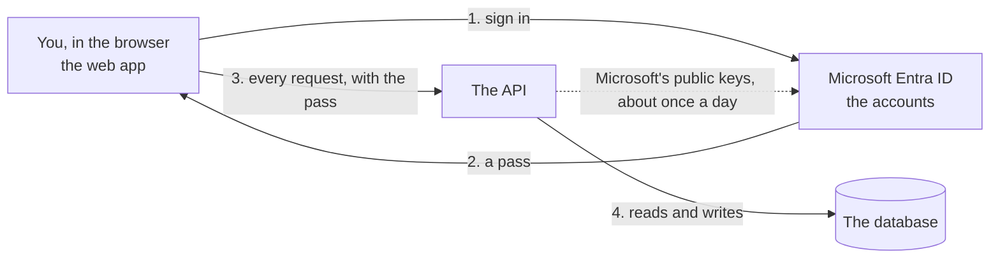
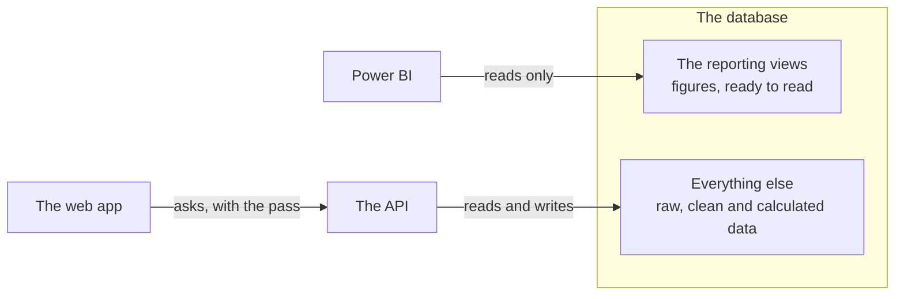
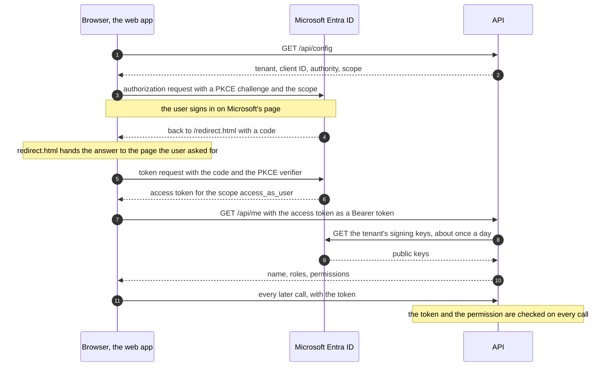
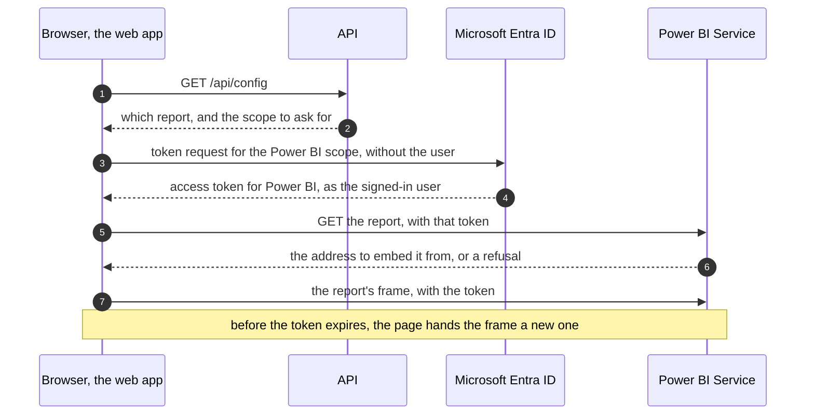

# The API

The API is the program the web app asks for everything: who is signed in, what
they may do and, as the features are built, the data itself. The plant's
devices will send their readings to it too. It is written in Python with
FastAPI.

It is not the only way to the data. Power BI reads its figures through a
separate, read-only path that does not pass through the API, and the data is
loaded today by commands on the server.
[Part 1](#the-other-way-to-the-data-power-bi) explains that in plain words and
[section 9](#9-what-does-not-go-through-the-api) in detail.

This guide has two parts:

- **[Part 1: In plain words](#part-1-in-plain-words)** is for a reader who does
  not write code. It says what the API is, how it works with the web app and
  with Microsoft Entra ID, and what it guarantees.
- **[Part 2: Technical reference](#part-2-technical-reference)** is for whoever
  maintains the API or calls it: every endpoint, the path of a request through
  the code, the token check, the errors, and how the app uses all of it.

The Entra ID side (roles, the app registration, giving someone access,
troubleshooting a sign-in) is in [Sign-in and roles](sign-in.md).

---

## Part 1: In plain words

### What the API is

The platform keeps its data in a database on a server. The **web app** is what
you see in the browser, and it never touches that database. It asks the
**API**, a program on the server. The API receives a request ("who am I?",
"here is a file to load"), decides whether the person asking may have it, and
answers.

The web app holds no data, and it takes no decision about who may see what. It
draws its screens from the API's answers, with one exception: the dashboard
shows a Power BI report, which the browser loads from Power BI itself, and
Power BI gets its figures another way.

The API is one of three ways into the database, and the only one the web app
uses:

| Way in | Used by | May |
|---|---|---|
| **The API** | The web app, and later the plant's devices | Read and write, as far as the role of the signed-in person allows |
| **Commands on the server** | An engineer | Load the exports, calculate the figures, close a month. All data gets in this way today; loading from the web app is being built |
| **The reporting views** | Power BI | Read prepared figures, and nothing else. See [The other way to the data](#the-other-way-to-the-data-power-bi) |

The rest of this part is about the API. Sign-in and roles, described below,
protect the first way in only.

### The three parties



| Party | What it does | What it never knows |
|---|---|---|
| **The web app** | Shows the screens and sends your requests | Your password. Any rule about who may do what |
| **Microsoft Entra ID** | Holds the user accounts of this project. It checks your password, records the role an administrator gave you, and issues your pass | Anything about the plant's data |
| **The API** | Checks the pass, decides, and answers | Your password. It does not ask Microsoft about you either: the pass says who you are, and Microsoft's signature on it proves that it is genuine |

### What happens when you open the app

1. The browser loads the app, and the app asks the API one question anyone may
   ask: where do users of this installation sign in?
2. Nobody is signed in yet, so the browser goes to Microsoft's sign-in page.
3. You enter your account and password there. That page belongs to Microsoft:
   neither the app nor the API sees what you type.
4. Microsoft sends the browser back to the app with a **pass**. The technical
   name is *access token*. It states who you are, which role you were given,
   and until when it is valid.
5. The app asks the API "who is signed in, and what may they do?" and shows the
   pass. The API checks it and answers with your name and a list of
   permissions. The app draws only the sections on that list.
6. From then on the app shows the pass with every request, and the API checks
   it every time, as if it were the first.

Steps 2 to 4 usually take a second or two. A browser that is already signed in
to Microsoft with that account is usually not asked for the password again.

### The pass

- **Microsoft signs it.** Changing one letter breaks the signature, so a pass
  cannot be edited or made up. The API holds Microsoft's *public* keys, which
  can check a signature and cannot produce one.
- **It is short-lived.** A pass is valid for between an hour and an hour and a
  half. The app obtains the next one from Microsoft in the background, without
  asking you.
- **It is for this application only.** A pass issued for another application,
  or by another organisation's directory, is refused.
- **It lives in the browser tab.** Closing the tab discards it. The sign-out
  button in the header also ends the session at Microsoft: use it on a shared
  computer.
- **A change of role arrives with the next pass.** After an administrator
  changes your role, sign out and in, or wait up to an hour and a half.

### What each role may do

| Role | May |
|---|---|
| `viewer` | See the dashboard |
| `operator` | The above, and load data and see the history of loads |
| `engineer`, `admin` | The same as `operator` today; more arrives with later features |
| No role | Sign in, and nothing else. The app shows a page saying so |

An administrator assigns roles in Entra ID, not in this application.
[Sign-in and roles](sign-in.md#giving-someone-access) has the steps.

### When the API says no

Every answer of the API carries a number, the *status code*. Four of them mean
"no":

| The API answers | Number | Meaning |
|---|---|---|
| Sign in first | 401 | Nobody is signed in, or the pass is not valid: expired, altered, or issued for something else |
| You may not do this | 403 | You are signed in, and your role does not allow this request |
| Not built yet | 501 | The request is defined, and the feature behind it is not written yet |
| I cannot check passes right now | 503 | The API could not obtain Microsoft's keys, or was not told where users sign in. It lets nobody in until it can check |

The app hides what you may not open, so you rarely meet these. The API refuses
by itself all the same, whatever the app shows.

A refusal never says *why* a pass was rejected. The reason is written in the
server's log, for the administrator. That is deliberate: an explanation would
help someone who is trying to forge a pass.

### The other way to the data: Power BI

Power BI does not ask the API. It reads the figures straight from the database,
through a door of its own.



- **What it reads.** Twelve *reporting views*. A view is a saved calculation
  that always shows the current figures, such as the equivalent batteries of
  each month.
- **Why a second way.** The API serves one person at a time and decides what
  that person may do. A reporting tool reads whole tables to build its charts,
  and speaks the database's own language. So Power BI gets a narrow door of its
  own.
- **How it is kept safe.**
  - Power BI has a login of its own. That login can read the reporting views
    and nothing else. It cannot change anything, and the rest of the database
    refuses it.
  - The door is closed until an engineer opens it with one command,
    `make powerbi`. It then answers only programs that run on the server
    itself.
  - The report published online cannot reach the server. A *gateway*, a
    Microsoft program installed on the server, calls out to Power BI and
    fetches the data for it.
- **The numbers agree.** The reporting views repeat the platform's own
  calculation; they do not calculate again. Power BI and the platform's other
  reports therefore show the same figures.
- **The app's roles do not apply here.** `viewer` and `operator` decide what
  the web app shows. Who may open the report is decided in Power BI, by the
  people who manage its workspace.
- **The report is as fresh as its last refresh.** Power BI keeps a copy of the
  data. A refresh needs the server, the door and the gateway all running, and
  none is scheduled yet.
- **The web app shows this report** inside its dashboard section. The browser
  loads it from Power BI directly, with a second pass that Microsoft issues for
  Power BI at the same sign-in. Neither the report nor its figures pass through
  the API: the API only tells the app which report to ask for.
- **Seeing it therefore takes three things,** given separately: a role in the
  app, access to the report's workspace in Power BI, and a Power BI licence.
  Someone who lacks one of the last two gets a message saying so in place of
  the report.

[Connecting Power BI to the database](powerbi.md) is the guide to this path.

### What works today

| State | What |
|---|---|
| **Works** | Signing in, and the answer to "who am I, and what may I do?" |
| **Works** | The health checks: is the API running, and can it reach the database? |
| **Works** | The settings the app reads when it starts: where users sign in, and which report the dashboard shows |
| **Works, outside the API** | Loading the exports and calculating the figures, by commands on the server |
| **Works, outside the API** | Power BI reading the equivalent batteries through the reporting views |
| **Defined, not built** | Loading a file from the web app, and the list of past loads |
| **Defined, not built** | The history of processing runs |
| **Defined, not built** | Readings sent by the plant's devices |
| **Built, outside the API** | The Power BI report shown inside the web app's dashboard. Built on 2026-10-13; seeing it as a signed-in user is still to be checked in a browser |
| **Planned** | Energy indicators (KPIs), shown in that same report |
| **Will be removed** | Energy indicators served by the API. They were defined before the report existed, and no screen needs them |

"Defined, not built" means that the inputs and outputs of the request are
already written down, and the API answers "not built yet" (501) to a caller who
is allowed to make it. Who may call it is already enforced.

### What it guarantees

- **No password reaches the app or the API.** You type it on Microsoft's page
  only.
- **Sign-in needs no secret key.** An app that runs in a browser cannot keep a
  secret, so this one is built not to need one. The API checks passes with
  public keys.
- **The menu is a convenience, not the protection.** Typing an address by hand,
  or calling the API with another program, meets the same refusal.
- **Nothing is allowed by default.** A user without a role gets nothing. A new
  request that does not state who may make it fails the project's automated
  tests before it can be released.
- **The log names an identifier, not a person.** Each request is recorded with
  the caller's identifier in Entra ID. No name, no address and no pass is
  written to the log.
- **Power BI can only read, and only the reporting views.** Its login cannot
  change data, and the raw, clean and calculated tables refuse it.

One limit: three other screens on the same address (the earlier charts page,
the pipeline console and the file-store console) are **not** behind this
sign-in yet. That is acceptable on one's own computer and must be closed before
the platform runs on a shared server.

### Words used

| Word | Meaning |
|---|---|
| **API** | A program that other programs ask for data, through a fixed list of requests |
| **Endpoint** | One request of that list, such as "who am I?" |
| **Token** (the pass) | A short signed text that Microsoft issues after sign-in. It says who you are, for which application, with which role, and until when |
| **Tenant** | An organisation's directory of accounts in Entra ID. This project has its own |
| **App registration** | The entry in that directory that describes this application: its name, the addresses it may return to after sign-in, its roles |
| **Role** | A label an administrator gives a user: `viewer`, `operator`, `engineer` or `admin` |
| **Permission** | One thing a user may do, such as "load data". Each role grants a list of permissions |
| **Scope** | The name of what a token is for. This application has one, `access_as_user` |
| **Signing key** | Microsoft signs each token with a private key and publishes the matching public key. The API checks signatures with the public one |
| **Reporting view** | A saved calculation in the database that shows figures ready to read. Power BI reads the twelve of them and nothing else |
| **Gateway** | A Microsoft program on the server that fetches data for the report published online, so that no door of the server has to open to the internet |
| **Status code** | The number in every answer: 200 is success, the 400s are a problem with the request, the 500s a problem on the server |

---

## Part 2: Technical reference

Paths are written as a browser sees them, with the `/api` prefix. Inside the
API they carry no prefix (`/me`, not `/api/me`): Caddy removes it. The API's
log shows the short form.

### 1. Where it lives

[FastAPI](https://fastapi.tiangolo.com/) is the Python framework the API is
written with. It turns a Python function into an endpoint, checks inputs and
outputs against their type annotations, and generates the interactive
documentation.

| File | Owns |
|---|---|
| [`src/energy/api/main.py`](../src/energy/api/main.py) | `create_app()`: the middleware, the routers and who may call each, and the mapping of errors to answers. `PUBLIC_PATHS` |
| [`src/energy/api/deps.py`](../src/energy/api/deps.py) | What a handler can ask for: the settings, a database session, the request ID, the signed-in caller (`get_principal`, `requires`). The only module of `api` that imports an adapter ([ADR 0005](adr/0005-api-composition-root.md)) |
| [`src/energy/api/security.py`](../src/energy/api/security.py) | `Role`, `Permission`, the table `GRANTS`, `Principal`, and the mapping from a checked token to a principal |
| [`src/energy/api/middleware.py`](../src/energy/api/middleware.py) | The request ID and the access log |
| `src/energy/api/routers/` | One module per group of endpoints |
| `src/energy/api/schemas/` | The request and response models (Pydantic) |
| [`src/energy/ports/token_verifier.py`](../src/energy/ports/token_verifier.py) | The interface for checking a token. It names neither Entra ID nor JWTs |
| [`src/energy/adapters/entra_token_verifier.py`](../src/energy/adapters/entra_token_verifier.py) | Its implementation for Entra ID |

**The process.** Uvicorn runs `energy.api.main:app` on port 8000 inside the
`api` container. The port is not published. Caddy forwards `/api/*` to it with
the prefix removed, and `API_ROOT_PATH=/api` tells FastAPI its outside prefix,
so the generated documentation builds correct addresses.

**The generated documentation** is always current, because FastAPI builds it
from the code:

| Address | What |
|---|---|
| <http://localhost:8080/api/docs> | Swagger UI: every endpoint, its parameters and models, and a form to call it |
| <http://localhost:8080/api/redoc> | The same content as one readable page |
| <http://localhost:8080/api/openapi.json> | The OpenAPI schema, for tools |

This guide adds what they cannot say: which endpoints are built, why a call is
refused, and how the app and Entra ID take part.

### 2. Endpoints

| Operation | Who may call it | State | Answers |
|---|---|---|---|
| `GET /api/health` | Anyone | Built | That the process is alive, with its name, version and environment. It touches nothing outside the process |
| `GET /api/ready` | Anyone | Built | Each dependency check by name. 200 when healthy or degraded, 503 when unhealthy |
| `GET /api/config` | Anyone | Built | The app's settings: where to sign in (`"auth"`) and which Power BI report the dashboard shows (`"powerbi"`). Each is `null` when it is not configured |
| `GET /api/me` | Any signed-in person, with or without a role | Built | Who the caller is and what they may do |
| `GET /api/kpis` | `dashboard:view` | Placeholder. To be removed in Phase 4 | One KPI as a time series for one plant |
| `GET /api/kpis/summary` | `dashboard:view` | Placeholder. To be removed in Phase 4 | The latest value of every KPI |
| `GET /api/kpis/{plant_code}/coverage` | `dashboard:view` | Placeholder. To be removed in Phase 4 | How much of a period rests on reliable readings |
| `POST /api/uploads` | `loads:write` | Placeholder, Phase 3 | 202 with the ID of the run to follow |
| `GET /api/uploads` | `loads:write` | Placeholder, Phase 3 | Past uploads and how each ended |
| `GET /api/runs` | `loads:write` | Placeholder, Phase 3 | Recent pipeline runs |
| `GET /api/runs/{run_id}` | `loads:write` | Placeholder, Phase 3 | One run in detail |
| `GET /api/runs/{run_id}/quarantine` | `loads:write` | Placeholder, Phase 3 | The rows a run rejected, and why |
| `POST /api/runs/{run_id}/retry` | `loads:write` | Placeholder, Phase 3 | 202 with the ID of the new run |
| `POST /api/ingest/readings` | Devices. Not enforced yet | Placeholder, Phase 3 | The accepted and rejected counts of a batch |
| `GET /api/ingest/watermark/{plant_code}/{source_key}` | Devices. Not enforced yet | Placeholder, Phase 3 | The newest timestamp held for a plant and source |

- **A placeholder** has its parameters and its response model written, and a
  handler that raises `NotImplementedError("Phase N: …")`. The API answers 501
  with `code` `not_implemented`. The caller is checked first, so a placeholder
  already answers 401 and 403 as the finished endpoint will.
- **The three KPI endpoints will not be implemented.** People see figures in
  the Power BI report, which does not read the API (section 9). Serving the
  same figures here too would give them two levels of freshness and two access
  models. [ADR 0007](adr/0007-figures-reach-people-through-power-bi.md) decides
  it: Phase 4 removes the three routes and delivers the energy KPIs as
  reporting views. Until then they answer 501, and their rows stay in this
  table because the routes still exist.
- **The device routes are not protected yet.** The watermark route asks for no
  credential. The readings route uses a stand-in from Phase 1
  (`deps.require_api_key`), which accepts a request without a key unless
  `APP_ENV` is `staging` or `production`. Both answer 501 today, so nothing is
  exposed. Real device keys are Phase 3 work.
- **`tests/unit/test_api_reference.py` keeps this table complete.** It fails
  when an operation of the API is missing from this guide, and when the guide
  names one that no longer exists.

**Sample answers.** The identifiers are made up.

`GET /api/health`

```json
{
  "status": "ok",
  "service": "clarios-energy",
  "version": "0.1.0",
  "environment": "local"
}
```

`GET /api/config`

```json
{
  "auth": {
    "tenant_id": "11111111-1111-4111-8111-111111111111",
    "client_id": "22222222-2222-4222-8222-222222222222",
    "authority": "https://login.microsoftonline.com/11111111-1111-4111-8111-111111111111",
    "api_scope": "api://22222222-2222-4222-8222-222222222222/access_as_user"
  },
  "powerbi": {
    "workspace_id": "44444444-4444-4444-8444-444444444444",
    "report_id": "55555555-5555-4555-8555-555555555555",
    "scope": "https://analysis.windows.net/powerbi/api/Report.Read.All",
    "report_api_url": "https://api.powerbi.com/v1.0/myorg/groups/44444444-4444-4444-8444-444444444444/reports/55555555-5555-4555-8555-555555555555",
    "report_web_url": "https://app.powerbi.com/groups/44444444-4444-4444-8444-444444444444/reports/55555555-5555-4555-8555-555555555555"
  }
}
```

- **`auth`** is `null` when `ENTRA_TENANT_ID` and `ENTRA_CLIENT_ID` are not
  both set, and **`powerbi`** is `null` when `POWERBI_WORKSPACE_ID` and
  `POWERBI_REPORT_ID` are not both set. Neither depends on the other.
- **None of the values is a secret.** A browser shows the first four in the
  address of Microsoft's sign-in page, and the two Power BI identifiers in the
  address of the report. The identifiers open nothing without the token of a
  user who has access to the workspace.
- **The API does not call Power BI.** `report_api_url` is where the *browser*
  asks Power BI for the report, with the user's own token (section 9).

`GET /api/me`, for an operator

```json
{
  "subject": "33333333-3333-4333-8333-333333333333",
  "name": "Test Operator",
  "username": "operator@example.test",
  "roles": ["operator"],
  "permissions": ["dashboard:view", "loads:write"],
  "plant_scope": ["1515"]
}
```

A person without a role gets the same shape with `"roles": []` and
`"permissions": []`.

### 3. The three parties



| Between | What travels | When |
|---|---|---|
| Browser and Entra ID | The sign-in page, the token requests, sign-out. Microsoft's library (MSAL) does all of it | At sign-in, at each renewal of the token, at sign-out |
| Browser and API | Every request under `/api`, with `Authorization: Bearer <access token>` except on the public routes | All the time |
| API and Entra ID | One request: `GET https://login.microsoftonline.com/<tenant>/discovery/v2.0/keys` | With the first token after a start, then about once a day |

What does **not** happen:

- The API never asks Entra ID about a user, and never receives a password or
  an authorization code. It holds no client secret.
- Entra ID never calls the API.
- The API keeps no session and sets no cookie. Each request stands alone and
  carries its own proof.

One consequence: the API learns nothing between two tokens. A role that was
removed, or an account that was disabled, keeps working until the token in the
browser expires, which is 60 to 90 minutes after it was issued.

The flow in the browser is "authorization code with PKCE", by redirect. The
app requests the access token for its own API (`api://<client id>/access_as_user`),
and the ID token never goes to the API. [ADR 0006](adr/0006-api-tokens-and-app-roles.md)
records why.

### 4. The path of one request

`GET /api/uploads` from a signed-in operator, step by step:

| # | Where | What happens |
|---|---|---|
| 1 | Caddy | Receives `/api/uploads`, removes `/api`, forwards to `api:8000` |
| 2 | `CORSMiddleware` | Nothing for the app, which is served from the same address (section 8) |
| 3 | `RequestContextMiddleware.dispatch` | Takes the request ID from `X-Request-ID`, or makes one, and binds it to every log line of this request |
| 4 | The router | `uploads` was mounted in `main.py` with `dependencies=[Depends(requires(Permission.LOADS_WRITE))]`, so the next four steps run before the handler |
| 5 | `deps._bearer` | Reads `Authorization: Bearer …`. Gives `None` when the header is missing or is not a Bearer one. It never answers by itself |
| 6 | `deps.get_token_verifier` | Gives the process's `EntraTokenVerifier`, or `None` when `ENTRA_TENANT_ID` and `ENTRA_CLIENT_ID` are not both set |
| 7 | `deps.get_principal` | No token: 401. No verifier: 503. Otherwise `verifier.verify(token)` (section 5), then `security.principal_from_token` (section 6). Leaves the caller's identifier on the request for the access log |
| 8 | `deps.requires(…)` | `security.require_permission`: 403 when no role of the caller grants the permission |
| 9 | FastAPI | Checks the parameters against the handler's signature: 422 when one is missing or malformed |
| 10 | The handler | Runs. A placeholder raises `NotImplementedError` |
| 11 | The exception handlers of `main.py` | Turn each error into its answer (section 7) |
| 12 | `RequestContextMiddleware` | Adds `X-Request-ID` to the answer and writes one access log line |

- **The caller is checked before the parameters.** A request without a token
  gets 401 even when its parameters are wrong, so someone who is not signed in
  learns nothing about an endpoint's inputs.
- **"No token" is decided first.** It is a 401 whatever else is wrong,
  including a server where sign-in is not configured.
- **`get_principal` is a plain function, not `async`.** Checking a token can
  fetch the signing keys over the network, and FastAPI runs a plain dependency
  in a worker thread, off the event loop.
- **Public routes skip steps 5 to 8.** They are the paths of `PUBLIC_PATHS`.
  `/api/me` runs steps 5 to 7 only: its handler asks for the caller
  (`PrincipalDep`) and no permission.

### 5. Checking the token

The API accepts one kind of token: a version 2.0 access token of the project's
tenant, issued for this app registration, with the scope `access_as_user`. The
checks run in this order, and the first that fails ends the request.

| # | The token must | It reads | Log reason when refused |
|---|---|---|---|
| 1 | Be a JWT with a readable header | the header | `malformed` |
| 2 | Name the algorithm RS256. No algorithm, or a symmetric one, is refused before any key is looked at | `alg` | `algorithm` |
| 3 | Name a key | `kid` | `no_key_id` |
| 4 | Name a key the tenant publishes | the key document | `unknown_key` |
| 5 | Be signed with that key, and carry `exp`, `nbf`, `iat`, `iss` and `aud` | the signature | `bad_signature`, `invalid` |
| 6 | Be inside its validity period, with 60 seconds of tolerance | `exp`, `nbf` | `expired`, `not_yet_valid` |
| 7 | Be a version 2.0 token | `ver` | `wrong_version` |
| 8 | Come from this tenant's issuer, `https://login.microsoftonline.com/<tenant>/v2.0` | `iss` | `wrong_issuer` |
| 9 | Belong to this tenant | `tid` | `wrong_tenant` |
| 10 | Be issued for this app registration | `aud` | `wrong_audience` |
| 11 | Carry the scope, which means a person is signed in. A token an application obtained for itself has none | `scp` | `missing_scope` |
| 12 | Name the person | `oid` | `no_subject` |

A token that passes yields a `VerifiedToken`: the person's identifier (`oid`),
the role values of the `roles` claim exactly as written, the expiry, and the
`name` and `preferred_username` claims when the token carries them. The adapter
knows nothing about what a role means.

**The version is checked before the issuer** on purpose. A version 1.0 token
names another issuer and another audience, and should be reported as what it
is: the app registration's `requestedAccessTokenVersion` is not `2`.

**The signing keys**

| Rule | Value |
|---|---|
| Fetched from | `https://login.microsoftonline.com/<tenant>/discovery/v2.0/keys`, with a 5-second timeout |
| Kept | In memory, for 24 hours |
| A token names an unknown key | The keys are fetched again, at most once every 5 minutes. A flood of forged tokens cannot make the API call Entra ID on every request |
| A fetch fails | The keys already held keep working. The next attempt comes 30 seconds later |
| No keys held and none could be fetched | 503 `identity_provider_unavailable`, not 401: the fault is on this side |

The verifier is built once per process (`deps._entra_token_verifier`), because
it holds the keys. A restart of the API empties the cache.

**A refusal does not say why.** Every refused token gets the same body and the
header `WWW-Authenticate: Bearer error="invalid_token"`. The reason goes to the
log, as a warning:

```text
[WARNING  ] caller not authenticated  [energy.api.main] reason=bad_signature request_id=…
```

A request with no token at all is logged with `reason=missing`, at the info
level: it is routine. A token is never logged.

```bash
docker compose logs api | grep "caller not authenticated"
```

### 6. From token to permission

```text
VerifiedToken            what the token says: oid, roles, name, expiry
  → principal_from_token
Principal                the caller: subject, roles, plant_scope, display_name
  → GRANTS
permissions              what the caller may do
```

| Permission | Granted to | Protects |
|---|---|---|
| `dashboard:view` | `viewer`, `operator`, `engineer`, `admin` | The dashboard section of the app, and `/api/kpis/*` until Phase 4 removes it |
| `loads:write` | `operator`, `engineer`, `admin` | `/api/uploads/*`, `/api/runs/*`, the data-loading section of the app |

- **`dashboard:view` is navigation, not the protection of a figure.** It makes
  the app show the dashboard section. Who sees the report is decided in Power
  BI, by access to its workspace
  ([ADR 0007](adr/0007-figures-reach-people-through-power-bi.md)). A viewer
  needs both.
- **Endpoints ask for a permission, never for a role.** `GRANTS` in
  `security.py` is the only place where a role is given a meaning.
  `permissions_of` builds the list `GET /api/me` returns, and
  `require_permission` is the check behind `requires(…)`.
- **Nothing is inherited.** A role is listed on every row it applies to, so the
  table reads as it is enforced.
- **An unknown role value grants nothing.** A typing mistake in Entra ID gives
  no access.
- **`device` is never taken from a person's token,** whatever the token says.
- **There is no default role.** A person without one gets an empty list.
- **Every person is scoped to the one plant,** `1515`. Filtering by plant
  (`Principal.may_access_plant`, `filter_plants`) is Phase 3.

### 7. Answers and errors

Errors the API raises itself use one envelope:

```json
{
  "code": "forbidden",
  "message": "the caller may not do this",
  "details": { "permission": "loads:write" }
}
```

`code` is stable and safe to branch on. `message` is English, written for a
developer; the app shows its own texts and reads only the status and the
`code`.

| Status | `code` | When | Body |
|---|---|---|---|
| 200, 202 | | Success. 202 means "accepted, follow the run" | The endpoint's model |
| 400 | The error's own, for example `invalid_time_window` | A rule of the domain refused the request: any `EnergyError` without a row of its own | Envelope |
| 401 | `unauthenticated` | No token, or a token that failed a check of section 5 | Envelope, with a fixed message and empty `details` |
| 403 | `forbidden` | A valid token without the permission the route needs | Envelope; `details.permission` names it |
| 404 | `entity_not_found` | A lookup by identifier found nothing | Envelope |
| 404 | | No such path | FastAPI's own: `{"detail": "Not Found"}` |
| 422 | | A parameter or the body failed validation | FastAPI's own: `{"detail": [ … ]}`, one entry per problem |
| 500 | | An error nobody foresaw. The log line `request failed` has the traceback and the request ID | Plain text, without the `X-Request-ID` header |
| 501 | `not_implemented` | A placeholder endpoint. The message names the phase | Envelope |
| 503 | `auth_not_configured` | A token arrived, and `ENTRA_TENANT_ID` or `ENTRA_CLIENT_ID` is not set | Envelope |
| 503 | `identity_provider_unavailable` | The signing keys could not be fetched and none are held | Envelope |
| 503 | | `GET /api/ready` found a dependency down | The readiness payload |

Three things to know before parsing an error:

- **Two shapes exist.** Validation errors (422) and unknown paths (404) come
  from FastAPI and use `detail`, not the envelope. A client must handle both.
- **The request ID is in a header, not in the body.** Every answer carries
  `X-Request-ID`, except an unforeseen 500. The model `ErrorResponse` has a
  `request_id` field that no handler fills.
- **A 401 carries `WWW-Authenticate`:** `Bearer` when no token was presented,
  `Bearer error="invalid_token"` when one was refused.

**Following one request.** Send your own `X-Request-ID`, or read the one the
API returns, and search the log for it. Every line written while that request
was handled carries it:

```bash
docker compose logs api | grep <request id>
```

**The access log** is one line per request, `request handled`, with `method`,
`path`, `status_code`, `duration_ms`, `client` and `subject`:

```text
[INFO     ] request handled  [energy.api.middleware] client=… duration_ms=2.61 method=GET path=/me request_id=… status_code=200 subject=33333333-3333-4333-8333-333333333333
```

- `subject` is the caller's identifier in Entra ID, or `None` for a caller who
  is not signed in. No name and no address is logged.
- A 4xx answer is logged as a warning and a 5xx as an error. A placeholder's
  501 therefore shows as an error line.
- `/health` and `/ready` are logged only when they fail: the container's probe
  alone calls `/health` every 15 seconds.

### 8. How the web app calls it

| File | Does |
|---|---|
| [`frontend/src/api/client.ts`](../frontend/src/api/client.ts) | `createApi(auth).get(path)`: asks the sign-in client for a token, calls `/api` + `path` with `Authorization: Bearer`, and throws `ApiError(status, code)` for an answer that is not a success |
| [`frontend/src/api/config.ts`](../frontend/src/api/config.ts) | `fetchClientConfig()`: `GET /api/config`, without a token. Its answer also names the report of the dashboard |
| [`frontend/src/api/me.ts`](../frontend/src/api/me.ts) | `fetchMe(api)`: `GET /api/me`, with the token |
| [`frontend/src/api/health.ts`](../frontend/src/api/health.ts) | `fetchHealth()`: `GET /api/health`, without a token. The status line of the header asks every 30 seconds |
| [`frontend/src/auth/msalAuthClient.ts`](../frontend/src/auth/msalAuthClient.ts) | The only file that imports Microsoft's sign-in library. `getApiToken()` returns the token from the tab's cache, or renews it. `getServiceToken()` does the same for another service, which is how the dashboard gets its Power BI token |
| [`frontend/src/auth/Session.tsx`](../frontend/src/auth/Session.tsx) | Starts the session. Nothing of the app is drawn before it has finished |

**Starting up.** `Session.tsx` learns three things in order, and each one that
fails has its own page. The texts are Spanish and are named here by their key
in `frontend/src/i18n/es.json`.

| # | What | How | When it fails |
|---|---|---|---|
| 1 | The sign-in settings, and the report of the dashboard | `GET /api/config` | No answer: `problem.unreachable`, with a retry button. `"auth": null`: `problem.notConfigured`. `"powerbi": null` stops nothing: only the dashboard section says that the report is not configured |
| 2 | Who is signed in in this tab | MSAL, from the tab's storage or from Microsoft's answer. No call to the API | MSAL cannot start: `problem.cannotStart`. Nobody signed in: the browser goes to Microsoft, once per tab. Back without an account: the sign-in page (`signIn`), which waits for a click, so a failure cannot loop |
| 3 | What that person may do | `GET /api/me` | 401: `problem.sessionRefused`. Any other failure: `problem.unreachable`. An empty permission list: the no-access page (`noAccess`) |

After that, pages read the result with `useSession()`: the sign-in client, the
API helper, and the answer of `/api/me`.

- **The app decides nothing about access.** `frontend/src/sections.ts` gives
  each section the permission it needs, by the name the API uses. The
  navigation and `RequirePermission` compare that name with the list from
  `/api/me`. The app never reads `roles`, and never looks inside the token.
- **The answer of `/api/me` counts as fresh for five minutes.** After that the
  app asks again the next time the window regains focus. The sign-in settings
  are read once per page load.
- **The token is asked for before every call.** MSAL answers from its cache, or
  renews the token silently when it is about to expire. When Microsoft needs
  the user again, the page goes there and comes back.
- **Same origin, so no CORS.** The app calls relative addresses (`/api/me`),
  and Caddy serves both the app and the API. The Vite dev server (port 5173)
  hands `/api` to the stack on port 8080 through its proxy, so the app's code
  is the same in both. `API_CORS_ORIGINS` matters only for a client served
  from another address.
- **Only `GET` exists in the client so far.** Sending a file arrives with the
  data-loading increments of [the frontend plan](frontend-plan.md).
- **The dashboard asks the API for nothing more.** Once it knows which report
  to show, it talks to Entra ID and to Power BI (section 9, "The report inside
  the web app").

### 9. What does not go through the API

The API is one of several ways into the database. The sign-in and the roles of
sections 3 to 6 protect that one only. These are all of them:

| Way in | Used by | Rights in the database | Checked by the API |
|---|---|---|---|
| The API process, in the `api` container | The users of the web app | The application's own role, which owns every schema | Yes: token and permission |
| The command line: `energy …`, the `make` targets that call it (`equs-load`, `equs-silver`, `refresh`, `resumen`, `close`, `report`, `powerbi`) and Alembic (`db-upgrade`) | An engineer with a shell on the machine that runs the stack | The same role. Each command runs in a container of the `api` image, started by `docker compose run`. It is not an HTTP request | No. Whoever may run `docker compose` on that machine may run them |
| `reporting-bridge`, for Power BI Desktop | Whoever holds the password of the login `powerbi`, on that machine | `SELECT` on the 12 views of schema `reporting`, in read-only sessions | No |
| The same bridge, for the Power BI Service, through the on-premises data gateway | The people added to the gateway's connection | The same login | No |

Of the other containers, `dash` also receives the database's address, and its
holding page asks nothing of it. The Prefect containers do not receive it.

**All data gets in through the second row today.** The loaders, the Silver
build, the Gold refresh and the monthly close are commands. The endpoints that
will let the web app load data are the placeholders of section 2, and the
increments of [the frontend plan](frontend-plan.md) build them.

#### The Power BI path

[Connecting Power BI to the database](powerbi.md) is its guide, with the
diagram, the setup and the troubleshooting. What matters next to the API:

- **The port is opt-in.** `make powerbi` creates or renews the login
  (`energy reporting create-reader`) and starts `reporting-bridge`, a TCP relay
  that publishes `127.0.0.1:5433`. `make up` never starts it, and
  `make powerbi-down` removes it. Without it the stack publishes no database
  port at all.
- **The protection is in the database, not in the relay.** The bridge forwards
  bytes and checks nothing; PostgreSQL asks for a login as it always does. What
  limits Power BI is that login:
  - it is a member of the role `reporting_reader`, whose only privilege is
    `SELECT` on the 12 views;
  - its sessions are read-only (`default_transaction_read_only`), with
    `search_path` set to `reporting`;
  - it may hold 10 connections, and a statement is stopped after 10 minutes.

  These were read back from the catalogue of the development database on
  2026-10-12.
- **No token and no role of the app is involved.** It is a database login.
  `viewer` and `operator` mean nothing on this path, and Entra ID takes no part
  in the Desktop connection.
- **The figures cannot disagree.** The equivalent batteries in the reporting
  views come from the Gold views, which also feed `make resumen`. The reporting
  views calculate nothing again; from Silver they take only catalogues.
- **Not encrypted, so local only.** The database speaks no TLS. The bridge
  therefore listens on `127.0.0.1`, and the gateway runs on the same machine.
  The gateway's own link to the Power BI Service is encrypted, and the gateway
  opens it outwards.
- **Import mode.** The published model holds a copy of the data and shows it
  until the next refresh. A refresh needs the stack, the bridge and the gateway
  all running. None is scheduled.

#### The report inside the web app

Built on 2026-10-13 (increment 3 of the frontend plan,
[ADR 0008](adr/0008-embedding-the-report-in-the-dashboard.md)). That a signed-in
user sees the report was not checked by a session: it needs a browser, and is
the owner's check. [The frontend plan](frontend-plan.md#10-increment-3-in-detail-the-dashboard-page)
has the checklist, and [docs/powerbi.md](powerbi.md#the-report-inside-the-web-app)
what a viewer needs and what each message means.

The dashboard section shows the published report in the model Microsoft calls
"embed for your organization". It is not a new way into the database: the
report shows the copy of the data that Power BI took at its last refresh.



- **The API's whole part is step 1 and 2:** it tells the app which report to
  ask for. It never calls Power BI and holds no Power BI secret.
- **A second token, from the same sign-in.** It carries one delegated
  permission, `Report.Read.All`: read the reports this user may already open.
  The API's own token is not accepted by Power BI, nor Power BI's by the API.
- **Access is decided twice, by two parties.** The app shows the section to a
  holder of `dashboard:view`. Power BI shows the report to the people in its
  workspace who hold a Power BI licence. The app cannot widen that.
- **The app only reads.** `GET` is the only method it sends to Power BI.
- **The token is kept fresh while the report is open,** so a report left on
  screen does not go blank after an hour.
- **A refusal becomes a message,** one per cause: no access to the workspace,
  report not found, Power BI unreachable, Microsoft needing the user again.
  `frontend/src/powerbi/reportProblem.ts` is where each of Power BI's answers
  is given its meaning.
- **Silence is not taken for a refusal.** When Power BI's frame reports
  nothing for a minute, the frame stays in view and a line above it offers to
  start over: whatever Power BI drew there remains readable.

| File | Does |
|---|---|
| [`frontend/src/pages/DashboardPage.tsx`](../frontend/src/pages/DashboardPage.tsx) | The section: fetches the token, the report's address and the embedding library, draws the report, and shows a message when it cannot |
| [`frontend/src/powerbi/reportLookup.ts`](../frontend/src/powerbi/reportLookup.ts) | The `GET` to Power BI's REST API |
| [`frontend/src/powerbi/reportProblem.ts`](../frontend/src/powerbi/reportProblem.ts) | What each refusal means |
| [`frontend/src/powerbi/tokenRenewal.ts`](../frontend/src/powerbi/tokenRenewal.ts) | Replaces the token before it expires |
| [`frontend/src/powerbi/powerBiReportEmbed.ts`](../frontend/src/powerbi/powerBiReportEmbed.ts) | The only file that imports Microsoft's embedding library, `powerbi-client` |

#### What is planned

Neither of these is built. The first is a decision of
[ADR 0007](adr/0007-figures-reach-people-through-power-bi.md), and the second of
[the frontend plan](frontend-plan.md#power-bi-embedding).

- **Phase 4, the energy KPIs.** They reach people as new views of schema
  `reporting`, each row with its `coverage`, shown in the same report. The API
  serves no analytical figure: its three KPI endpoints are removed. What a load
  did, before the report is refreshed, is asked by run (`/api/runs/…`).
- **Increment 10, updating the figures.** After a load, a job rebuilds Silver,
  refreshes Gold, and then asks Power BI to refresh the model. That will be the
  first time the platform itself calls Power BI. On shared capacity, where the
  report's workspace is, Microsoft allows a model eight such refreshes a day,
  scheduled ones included.

If viewers turn out to have no Power BI licence, the plan switches to "embed
for your customers". That model would add an endpoint of the API that hands out
embed tokens, and a secret on the server. It is not decided.

### 10. Configuration

| Variable | Default | Effect |
|---|---|---|
| `ENTRA_TENANT_ID` | empty | The tenant whose tokens are accepted. A GUID |
| `ENTRA_CLIENT_ID` | empty | The app registration tokens must be issued for. A GUID |
| `POWERBI_WORKSPACE_ID` | empty | The Power BI workspace of the report the dashboard shows. A GUID |
| `POWERBI_REPORT_ID` | empty | That report. A GUID |
| `API_ROOT_PATH` | `/api` | The prefix Caddy removes. It must equal the Caddyfile's route |
| `API_CORS_ORIGINS` | `http://localhost` | Other origins allowed to call the API from a browser, separated by commas |
| `API_KEY_HEADER` | `X-API-Key` | The header devices will present their key in |
| `APP_ENV` | `local` | `staging` and `production` make the stand-in device key mandatory |

- With either `ENTRA_*` value empty the stack still starts. The public routes
  answer, a request with a token gets 503 `auth_not_configured`, and the app
  says that sign-in is not configured.
- With either `POWERBI_*` value empty the stack starts too, and everything
  works but the dashboard, which says that the report is not configured. The
  API only passes the two values on: it does not check that the report exists.
- A value of the four that is not a GUID stops the API at start.
- The API reads its environment at start: after a change, `make up`.
- The `api` container needs outbound HTTPS access to
  `login.microsoftonline.com`. It needs none to Power BI: the browser does.
- `ENTRA_CLIENT_SECRET` is read by nothing, and no container receives it.

Where the Entra identifiers come from, and every setting of the app
registration, is in [Sign-in and roles](sign-in.md#the-app-registration). Where
the Power BI identifiers come from is in
[Connecting Power BI to the database](powerbi.md#the-report-inside-the-web-app).

### 11. Trying it by hand

```bash
curl -s http://localhost:8080/api/health
curl -s http://localhost:8080/api/ready
curl -s http://localhost:8080/api/config
curl -i http://localhost:8080/api/me        # 401, with WWW-Authenticate: Bearer
```

**A protected route.** Swagger UI at <http://localhost:8080/api/docs> has an
**Authorize** button, which takes a token and sends it with every call made
from that page. To obtain one, sign in to the app, open the browser's developer
tools, and copy the value after `Bearer ` from the `Authorization` request
header of a call to `/api/me`.

This step is described, not yet tested with a real token.

A token is a password for as long as it lives. Never paste one into a file, a
ticket, a chat or this repository.

### 12. Tests

| File | Covers |
|---|---|
| `tests/unit/test_entra_token_verifier.py` | The adapter: accepted and refused tokens, signed with keys made in the test, and the behaviour of the key cache |
| `tests/unit/test_api_security.py` | The table `GRANTS`, and the mapping from a token to a principal |
| `tests/unit/test_api_auth.py` | 401, 403 and 503 through the routes, `/me`, `/config`, and one test that calls every published operation without a token and fails for one that answers |
| `tests/unit/test_api_reference.py` | This guide's endpoint table against the published schema |
| `tests/unit/test_architecture.py` | That `api/deps.py`, and no other module of `api`, imports an adapter |
| `tests/integration/test_health_endpoint.py` | `/health` and `/ready` against a real database, and the 501 of a placeholder |
| `frontend/src/auth/Session.test.tsx`, `msalAuthClient.test.ts` | The app's start-up, each failure page, and the calls to MSAL, with stand-ins for both |
| `tests/unit/test_settings.py` | The settings, among them the two that name the report: empty means not configured, and a value that is not a GUID is refused |
| `frontend/src/pages/DashboardPage.test.tsx`, `frontend/src/powerbi/*.test.ts` | The dashboard: the report shown, its token replaced, and each message, with stand-ins for sign-in and for Power BI. One file runs Microsoft's embedding library itself, in a test browser that loads nothing |

- **Tests never reach Entra ID.** The fixture `token_verifier` replaces the
  bound adapter through `app.dependency_overrides`, and
  `auth_headers("viewer")` gives the headers of a signed-in caller with that
  role. `auth_headers()` is a caller with no role.
- **A test module never imports `energy.api.main` at its top.** Importing it
  builds the app, which caches the settings, and pytest imports every module
  before it runs any test. Import inside the test.

### 13. Adding or changing an endpoint

1. Write the handler in a router and its models in `api/schemas/`.
2. Mount the router in `api/main.py` with the permission it needs. A route
   that says nothing about its caller fails `tests/unit/test_api_auth.py`.
3. Add its row to the table of section 2. A missing row fails
   `tests/unit/test_api_reference.py`.

[CONTRIBUTING.md](../CONTRIBUTING.md#adding-an-endpoint) has the rules in full.

### 14. Not built yet, and limits

- **The endpoints for data.** Section 2 marks each placeholder with its phase.
- **No figure comes from the API.** The KPI endpoints are placeholders that
  Phase 4 removes
  ([ADR 0007](adr/0007-figures-reach-people-through-power-bi.md)). A figure is
  as fresh as the report's last refresh.
- **The command line and Power BI are outside this sign-in** (section 9). What
  protects them is access to the machine, and the limits of Power BI's login.
- **The report in the dashboard was not seen by a session.** It is built and
  tested with stand-ins for Microsoft. Seeing it as a signed-in user, and
  seeing it outlive its first token, are the owner's checks in a browser.
- **How Power BI refuses a user without a licence is not known.** That user
  gets the general refusal message, which names the licence, until the answer
  has been seen.
- **Device keys.** `security.hash_api_key` and `verify_api_key` are
  placeholders, and the device routes are open (section 2).
- **Filtering by plant.** Every person sees the one plant.
- **A token cannot be withdrawn.** A change in Entra ID takes effect when the
  token expires (section 3).
- **The API does not limit the rate of requests.**
- **`/dash/`, `/prefect/` and `/minio/` are outside this sign-in.** Caddy
  serves them without it. That must be closed before the stack runs on a
  shared host.
- **Plain HTTP on `localhost`.** A deployment with a host name needs HTTPS, and
  browsers allow sign-in over nothing else there.

---

## Related documents

- [Sign-in and roles](sign-in.md) — roles, the app registration, giving someone
  access, troubleshooting.
- [Connecting Power BI to the database](powerbi.md) — the reporting views, the
  bridge, the gateway and the published report.
- [ADR 0005](adr/0005-api-composition-root.md) — why `api/deps.py` may import
  adapters.
- [ADR 0006](adr/0006-api-tokens-and-app-roles.md) — which token the API
  accepts, and how roles become permissions.
- [ADR 0007](adr/0007-figures-reach-people-through-power-bi.md) — why the API
  serves no figure, and what Phase 4 removes.
- [ADR 0008](adr/0008-embedding-the-report-in-the-dashboard.md) — how the
  dashboard embeds the report: the permission, the token, the library.
- [Architecture](architecture.md) — the layers, and where the API sits among
  them.
- [Frontend plan](frontend-plan.md) — the web app's design and its increments.
- [CONTRIBUTING.md](../CONTRIBUTING.md#adding-an-endpoint) — the rules for a
  new endpoint.
- FastAPI: <https://fastapi.tiangolo.com/>
- Microsoft, access tokens and how an API validates them: <https://learn.microsoft.com/en-us/entra/identity-platform/access-tokens>
- Microsoft, the authorization code flow with PKCE: <https://learn.microsoft.com/en-us/entra/identity-platform/v2-oauth2-auth-code-flow>
