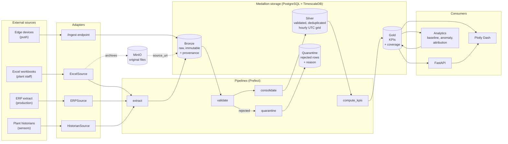
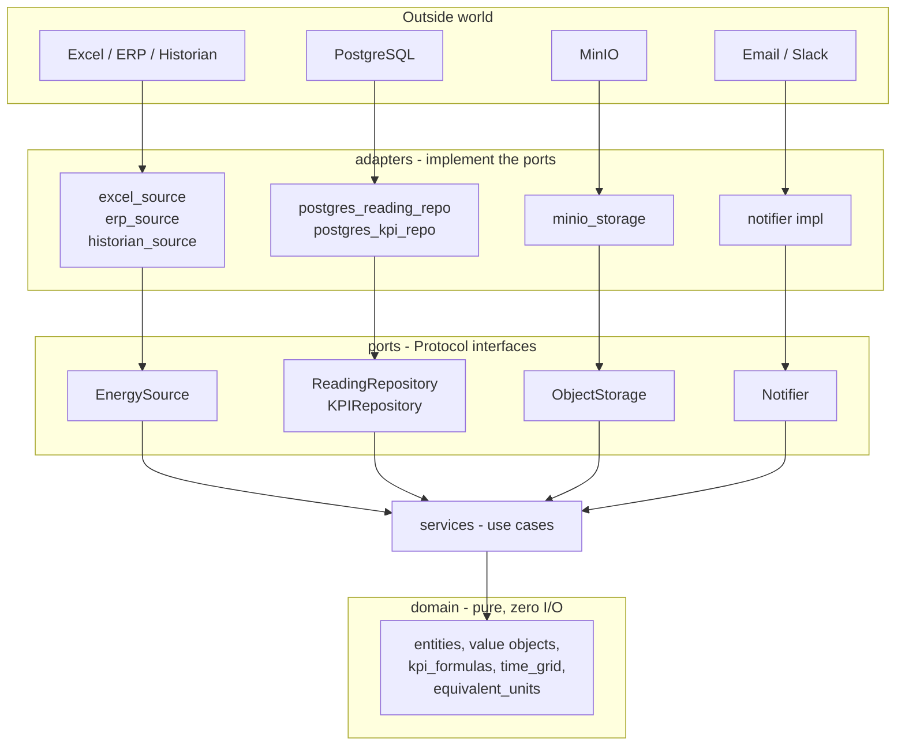
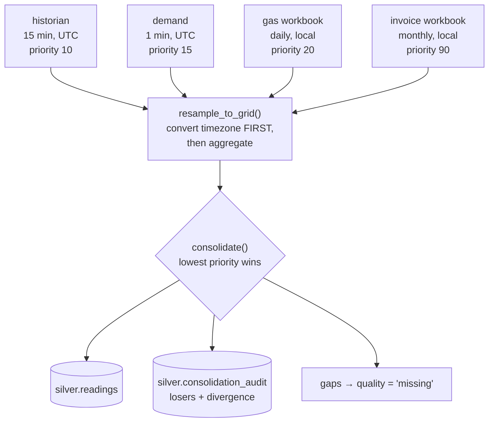
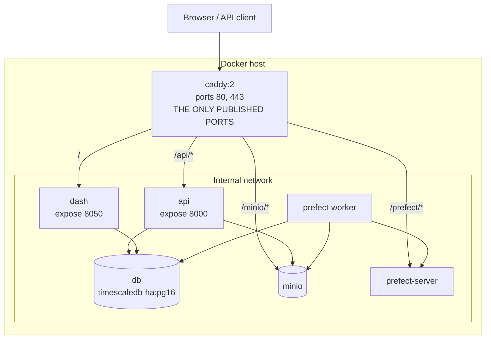

# Architecture

Clarios Energy is a **modular monolith**: one deployable codebase, internally
partitioned so that any part of it could be extracted into its own service
without untangling imports. Two patterns shape it — a **medallion** data flow
(Bronze → Silver → Gold) and a **hexagonal** (ports and adapters) code structure.

They answer different questions. The medallion architecture governs *data*: how
raw input becomes a trustworthy number. The hexagonal structure governs *code*:
what may depend on what. Neither is decoration; both are enforced, the first by
database constraints and Pandera contracts, the second by
[`tests/unit/test_architecture.py`](../tests/unit/test_architecture.py).

---

## 1. System overview



---

## 2. The medallion layers

Each layer makes a strictly stronger promise than the one before it. That is the
entire point: a consumer knows what it may assume, and a producer knows what it
must guarantee.

### Bronze — raw and immutable

Bronze stores what arrived, exactly as it arrived. Rows are appended and never
updated; the only thing that removes them is the retention policy.

It deliberately validates almost nothing. Rejecting a malformed value here would
destroy the evidence needed to diagnose it, so the raw record is kept whole in a
JSONB `payload` column and only the *provenance envelope* is checked.

Every Bronze row carries:

| Column | Purpose |
|---|---|
| `source_system` | which configured source produced it |
| `source_uri` | object-storage key or query reference locating the original |
| `source_row` | 1-based row within the payload — points at a spreadsheet cell |
| `ingestion_run_id` | the run that wrote it |
| `ingested_at` | when it landed (UTC) |
| `content_hash` | SHA-256 of the raw payload; the deduplication key |

Together these make every downstream number traceable back to the literal bytes a
plant sent. The `content_hash` also makes ingestion idempotent: re-uploading a
file is a no-op rather than a duplicate.

### Silver — validated and canonical

Silver holds readings that are typed, deduplicated, physically plausible, and
aligned to the **canonical hourly UTC grid**. It is the strictest boundary in the
platform and the point at which bad data stops.

Three guarantees define it:

1. **One live row per `(meter_id, ts_utc)`.** Enforced by a partial unique index
   covering non-superseded rows, so a correction can supersede a value without
   deleting the audit trail.
2. **Missing is not zero.** An interval nobody reported is stored with
   `quality = 'missing'` and a null value, enforced by a check constraint. A zero
   would silently deflate every average computed over the period.
3. **Nothing is dropped.** Rows that fail validation land in `silver.quarantine`
   with the rule they broke. Rows in equals rows landed plus rows quarantined —
   a conservation property that makes silent data loss detectable.

### Gold — published KPIs

Gold holds the numbers dashboards and the API read. It is *published*: rewritten
per period by the KPI pipeline rather than mutated row by row, so a recomputation
that yields fewer values leaves no stale rows behind.

Every Gold row carries `coverage` — the fraction of its period actually backed by
reliable readings — as a `NOT NULL` column bounded to `[0, 1]`. A KPI without its
coverage is a number without an error bar, and consumers will read it as certain.

---

## 3. The hexagonal structure

The application core (`domain`) knows nothing about the outside world. Everything
external is reached through a **port** — a `typing.Protocol` expressed in domain
terms — and implemented by an **adapter**.



### The layer dependency rule

| Layer | May import from `energy` |
|---|---|
| `core` | *nothing* |
| `domain` | *nothing* (except itself) |
| `ports` | `domain` |
| `schemas` | `domain`, `core` |
| `db` | `domain`, `core` |
| `adapters` | `domain`, `ports`, `core`, `db` |
| `services` | `domain`, `ports`, `core` |
| `analytics` | `domain`, `core` |
| `pipelines` | `domain`, `ports`, `adapters`, `services`, `schemas`, `core`, `db` |
| `api` | `domain`, `ports`, `services`, `schemas`, `db`, `core` |
| `dashboards` | `domain`, `ports`, `services`, `core` |

Two consequences are worth stating explicitly:

**`domain` depends on nothing.** This is the single most valuable structural
guarantee in the codebase. It is what lets every business rule — every KPI
formula, every grid calculation, every equivalence factor — be tested without a
database, a container, or a network call.

**`api`, `dashboards` and `pipelines` are siblings.** None may import another.
This is what keeps the monolith *modular*: each is an entry point, and any one
could become its own deployable without untangling an import from the others.

The rule is checked statically, by parsing imports with `ast` rather than
observing them at runtime, so a violation inside a `TYPE_CHECKING` block — which
would never execute — is caught too.

### Why this shape

Adding a data source is the test of the design. A new source means:

1. Write an adapter implementing `EnergySource`.
2. Add an entry to `config/sources.yaml`.

Nothing else changes. No pipeline, no service, no endpoint, no migration. If a
proposed source appears to require changes elsewhere, the port is missing
something — which is a useful signal rather than an inconvenience.

---

## 4. Request and data flow

### A file upload

```
POST /api/uploads
  → UploadService hashes the payload
  → duplicate? → 202 with duplicate=true, no run started
  → archive original bytes in MinIO (write-once)
  → register an ingestion run
  → 202 with run_id
  → Prefect: excel_ingestion flow
      → parse workbook            (adapters.excel_source)
      → append to Bronze          (tasks.extract)
      → validate against contract (tasks.validate)
          → passing rows  → consolidate → Silver
          → failing rows  → quarantine
      → derive the affected window from the parsed rows
      → recompute exactly those Gold periods
```

The file is archived **before** the run is registered. A crash between the two
leaves an orphaned object — harmless — rather than a run pointing at bytes that
were never stored.

### A dashboard query

```
Dash callback → KPIService.get_series() → KPIRepository.query() → gold.kpi_daily
```

Nothing is aggregated on the way out. A figure drawn on a chart and the same
figure returned by the API resolve to the same stored row, so they cannot
disagree.

---

## 5. Consolidating seven sources

The hardest step in the platform, and the reason Silver exists. Seven systems
report the same plants at different cadences, in different timezones, with
overlapping coverage and disagreeing values.



Three decisions encoded here:

- **Timezone conversion happens before resampling.** Resampling in local time and
  converting afterwards misplaces every interval across a daylight-saving
  transition — precisely when consumption patterns look most anomalous and are
  scrutinised most closely.
- **Conflicts are audited, not silently resolved.** A user whose spreadsheet
  disagrees with the dashboard can look up which source won and by how much.
- **Divergence beyond tolerance downgrades quality to `suspect`.** Two sources
  agreeing within noise is normal; disagreeing by 20% means something is
  misconfigured, and the value is reported flagged rather than trusted.

---

## 6. Deployment topology



Caddy is the only service that publishes ports. Everything else is reachable only
on the internal compose network, which is why `make db-upgrade` runs Alembic
*inside* the api container rather than from the host.

The MinIO **console** is proxied; the **S3 API** is not. Object storage
credentials grant access to every archived source file, so that endpoint stays
internal.

---

## 7. Where to make a change

| You want to… | Change this |
|---|---|
| Add a data source | `adapters/`, `config/sources.yaml` |
| Change a KPI formula | `domain/kpi_formulas.py` |
| Add a KPI | `config/kpis.yaml`, then `domain/kpi_formulas.py` if the maths is new |
| Change what counts as valid data | `schemas/silver.py` |
| Change how source conflicts resolve | `config/sources.yaml` priorities |
| Add an endpoint | `api/routers/`, `api/schemas/` |
| Add a chart | `dashboards/components/charts.py`, `dashboards/layouts.py` |
| Change the database shape | a new migration in `migrations/versions/` |

## Related documents

- [Data dictionary](data_dictionary.md) — table-by-table field reference
- [Runbook](runbook.md) — backups, restore, incident response
- [ADR 0002](adr/0002-postgres-timescale-over-nosql.md) — why PostgreSQL + TimescaleDB
- [ADR 0003](adr/0003-modular-monolith-over-microservices.md) — why a modular monolith
