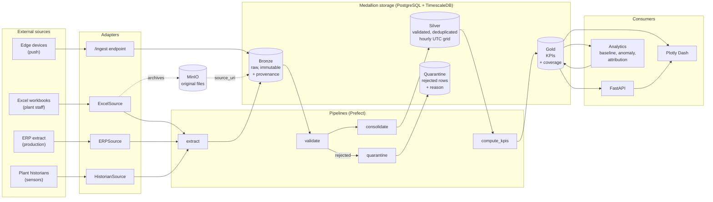
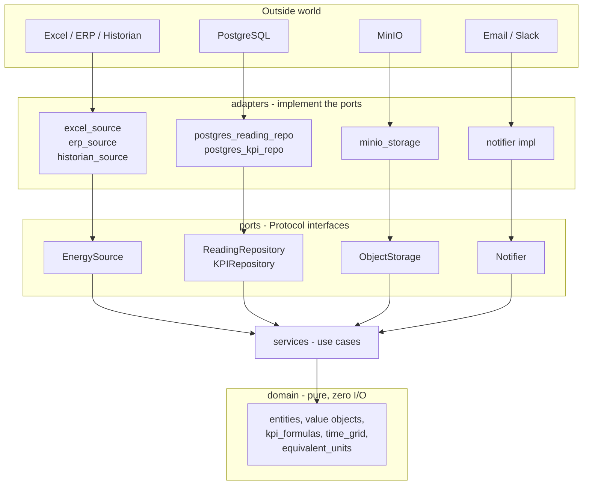
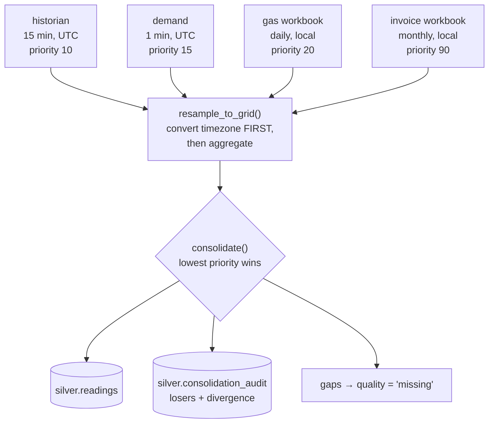
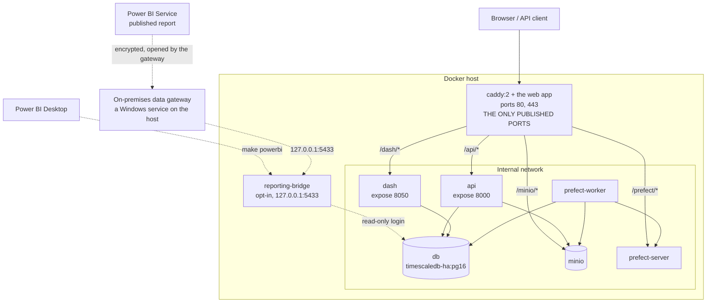

# Architecture

Clarios Energy is a **modular monolith**: one deployable codebase, internally
partitioned so that any part of it could be extracted into its own service
without untangling imports. Two patterns shape it — a **medallion** data flow
(Bronze → Silver → Gold) and a **hexagonal** (ports and adapters) code structure.

They answer different questions. The medallion architecture governs *data*: how
raw input becomes a trustworthy number. The hexagonal structure governs *code*:
what may depend on what. Neither is decoration; both are enforced, the first by
database constraints and Pandera contracts, the second by
[`tests/unit/test_architecture.py`](../tests/unit/test_architecture.py).

---

## 1. System overview



---

## 2. The medallion layers

Each layer makes a strictly stronger promise than the one before it. That is the
entire point: a consumer knows what it may assume, and a producer knows what it
must guarantee.

### Bronze — raw and immutable

Bronze stores what arrived, exactly as it arrived. Rows are appended and never
updated; the only thing that removes them is the retention policy.

It deliberately validates almost nothing. Rejecting a malformed value here would
destroy the evidence needed to diagnose it, so the raw record is kept whole in a
JSONB `payload` column and only the *provenance envelope* is checked.

Every Bronze row carries:

| Column | Purpose |
|---|---|
| `source_system` | which configured source produced it |
| `source_uri` | object-storage key or query reference locating the original |
| `source_row` | 1-based row within the payload — points at a spreadsheet cell |
| `ingestion_run_id` | the run that wrote it |
| `ingested_at` | when it landed (UTC) |
| `content_hash` | SHA-256 of the raw payload; the deduplication key |

Together these make every downstream number traceable back to the literal bytes a
plant sent. The `content_hash` also makes ingestion idempotent: re-uploading a
file is a no-op rather than a duplicate.

### Silver — validated and canonical

Silver holds readings that are typed, deduplicated, physically plausible, and
aligned to the **canonical hourly UTC grid**. It is the strictest boundary in the
platform and the point at which bad data stops.

Three guarantees define it:

1. **One live row per `(meter_id, ts_utc)`.** Enforced by a partial unique index
   covering non-superseded rows, so a correction can supersede a value without
   deleting the audit trail.
2. **Missing is not zero.** An interval nobody reported is stored with
   `quality = 'missing'` and a null value, enforced by a check constraint. A zero
   would silently deflate every average computed over the period.
3. **Nothing is dropped.** Rows that fail validation land in `silver.quarantine`
   with the rule they broke. Rows in equals rows landed plus rows quarantined —
   a conservation property that makes silent data loss detectable.

### Gold — published KPIs

Gold holds the numbers dashboards and the API read. It is *published*: rewritten
per period by the KPI pipeline rather than mutated row by row, so a recomputation
that yields fewer values leaves no stale rows behind.

Every Gold row carries `coverage` — the fraction of its period actually backed by
reliable readings — as a `NOT NULL` column bounded to `[0, 1]`. A KPI without its
coverage is a number without an error bar, and consumers will read it as certain.

The equivalent-batteries (EQUS) part of Gold is built differently: it is views,
not tables. They apply the equation Silver stores as data, so they are as fresh as
Silver and need no pipeline to fill them. What is published is the **monthly
close**, `gold.resumen_equ`: a month's column H frozen by `energy equs close-month`
after the data-quality checks pass, and replaced only by an explicit reclose that
keeps the old values. The code follows the hexagon: the queries in
`adapters/postgres_equs_gold.py`, the order of the steps of a refresh, a close and
a report in `services/equs_gold.py`, and the layout of the report in
`domain/equs_gold.py`.

---

## 3. The hexagonal structure

The application core (`domain`) knows nothing about the outside world. Everything
external is reached through a **port** — a `typing.Protocol` expressed in domain
terms — and implemented by an **adapter**.



### The layer dependency rule

| Layer | May import from `energy` |
|---|---|
| `core` | *nothing* |
| `domain` | *nothing* (except itself) |
| `ports` | `domain` |
| `schemas` | `domain`, `core` |
| `db` | `domain`, `core` |
| `adapters` | `domain`, `ports`, `core`, `db` |
| `services` | `domain`, `ports`, `core` |
| `analytics` | `domain`, `core` |
| `pipelines` | `domain`, `ports`, `adapters`, `services`, `schemas`, `core`, `db` |
| `api` | `domain`, `ports`, `services`, `schemas`, `db`, `core` |
| `dashboards` | `domain`, `ports`, `services`, `core` |

**One exception, by module.** `api/deps.py`, and no other module of `api`, may
also import `adapters`. Every entry point needs one place where adapters are
bound to the ports its code depends on. For pipelines that place is
`pipelines/flows`; for the API it is `deps.py`, which today binds the adapter
that checks sign-in tokens. Routers, schemas and `api/security.py` receive ports
through the dependencies `deps.py` exports and never name an adapter.
[ADR 0005](adr/0005-api-composition-root.md) records the decision, and the test
fails for an adapter import anywhere else in `api`.

Two consequences are worth stating explicitly:

**`domain` depends on nothing.** This is the single most valuable structural
guarantee in the codebase. It is what lets every business rule — every KPI
formula, every grid calculation, every equivalence factor — be tested without a
database, a container, or a network call.

**`api`, `dashboards` and `pipelines` are siblings.** None may import another.
This is what keeps the monolith *modular*: each is an entry point, and any one
could become its own deployable without untangling an import from the others.

The rule is checked statically, by parsing imports with `ast` rather than
observing them at runtime, so a violation inside a `TYPE_CHECKING` block — which
would never execute — is caught too.

### Why this shape

Adding a data source is the test of the design. A new source means:

1. Write an adapter implementing `EnergySource`.
2. Add an entry to `config/sources.yaml`.

Nothing else changes. No pipeline, no service, no endpoint, no migration. If a
proposed source appears to require changes elsewhere, the port is missing
something — which is a useful signal rather than an inconvenience.

---

## 4. Request and data flow

### Who is calling

Every route of the API needs a signed-in person, unless it is listed as public
(`/health`, `/ready`, `/config` and the API's own documentation). Devices will
use API keys on `/ingest`, in Phase 3.

```
any request with Authorization: Bearer <token>
  → deps.get_principal
      → TokenVerifier.verify()      (port; adapters.entra_token_verifier)
          signature, validity period, issuer, tenant, audience, scope
          → refused → 401
      → security.principal_from_token()   roles from the token's `roles` claim
  → deps.requires(permission)
      → security.GRANTS: does a role of the caller grant it?
          → no → 403
  → the handler
```

The web app obtains the token from Microsoft Entra ID in the browser, and asks
`GET /me` what the caller may do. `api/security.py` is the only place where a
role is given a meaning: the app holds no such rule. [The API](api.md) follows a
request through these steps and lists every endpoint; [Sign-in and
roles](sign-in.md) has the Entra ID side.

### A file upload, from the web app

```
POST /api/drafts?dataset_key=…        the file is the body, streamed
  → DraftService: count, check and hash the bytes on the way
  → same person, same bytes, same dataset? → 200 with that draft
  → archive the original in MinIO, under the Bronze loader's key
  → 201 with the draft                (staging.drafts; Bronze untouched)
POST /api/drafts/{draft_id}/validate
  → read the workbook as Bronze would (domain.landing)
  → the spec's rules and the reasons  (domain.draft_rules, draft_reasons)
  → rows and issues into staging      (adapters.postgres_draft_repo)
GET /api/drafts/{draft_id}/confirmation
  → what the commit would write; a catalogue's difference from its
    current version                    (adapters.postgres_load_committer)
POST /api/drafts/{draft_id}/commit
  → LoadService: the digest seen, the warnings accepted, the original present
  → LoadCommitter.commit, one transaction:
      lock the draft and the dataset → catalogue the file (raw_files)
      → open the run → copy the staged rows into the landing table
      → check the counts → complete the run → clear the staged rows
      → mark the draft committed
  → 201 with the load                  (GET /api/loads/{run_id})
```

- **The file is archived before anything else,** and catalogued in Bronze only
  by the commit. An abandoned draft leaves Bronze untouched, and the purge
  removes its original.
- **A failed commit leaves nothing,** not even a failed run, and a draft
  commits once
  ([ADR 0010](adr/0010-a-draft-is-committed-once-in-one-transaction.md)).
- **Silver and Gold are rebuilt by commands** (`make equs-silver`,
  `make refresh`) until increment 10 of the frontend plan runs them after a
  load.
- **Energy readings are another path.** The `excel_ingestion` flow (parse,
  append to Bronze, validate against a contract, consolidate into Silver,
  recompute the affected Gold periods) is their Phase 3 design. No endpoint
  starts it yet.

### A dashboard query

People see figures in the Power BI report embedded in the web app:

```
gold → schema reporting (read-only views) → Power BI → the web app's dashboard
```

The reporting views restate Gold and calculate nothing again, so a figure in
the report and the same figure printed by the command line resolve to the same
rows. The API serves no analytical figure: its three KPI endpoints are
placeholders of the Phase 1 scaffold, and Phase 4 removes them
([ADR 0007](adr/0007-figures-reach-people-through-power-bi.md)).

The last arrow does not pass through this stack. The browser loads the report
from the Power BI Service, with the signed-in user's own token for Power BI;
the API only tells the app which report to ask for
([ADR 0008](adr/0008-embedding-the-report-in-the-dashboard.md)). What the
report shows is the copy Power BI took at its last refresh.

Dash, if Phase 5 keeps it, reads inside its own process:

```
Dash callback → KPIService.get_series() → KPIRepository.query() → gold.kpi_daily
```

Nothing is aggregated on the way out. Whether Dash draws these charts at all is
decided when Phase 5 starts
([ADR 0004](adr/0004-react-spa-entra-and-embedded-power-bi.md)).

---

## 5. Consolidating seven sources

The hardest step in the platform, and the reason Silver exists. Seven systems
report the same plants at different cadences, in different timezones, with
overlapping coverage and disagreeing values.



Three decisions encoded here:

- **Timezone conversion happens before resampling.** Resampling in local time and
  converting afterwards misplaces every interval across a daylight-saving
  transition — precisely when consumption patterns look most anomalous and are
  scrutinised most closely.
- **Conflicts are audited, not silently resolved.** A user whose spreadsheet
  disagrees with the dashboard can look up which source won and by how much.
- **Divergence beyond tolerance downgrades quality to `suspect`.** Two sources
  agreeing within noise is normal; disagreeing by 20% means something is
  misconfigured, and the value is reported flagged rather than trusted.

---

## 6. Deployment topology



Caddy is the only service that publishes ports. Everything else is reachable only
on the internal compose network, which is why `make db-upgrade` runs Alembic
*inside* the api container rather than from the host.

Caddy also serves the **web app** at `/`. The app is static files, built from
`frontend/` (React, TypeScript, Vite) into the Caddy image by
`frontend/Dockerfile`, so it adds no service. It holds no business rule: it
calls the API under `/api`. What the `Caddyfile` does with each path:

| Path | Goes to |
|---|---|
| `/api/*`, `/prefect/*`, `/minio/*` | The service, with the prefix removed |
| `/dash/*` | Dash, with the prefix kept (`DASH_URL_BASE_PATHNAME` is `/dash/`) |
| `/auth/*` | Nowhere: Caddy answers 404. Reserved for a server-side sign-in callback |
| Any other path with a file extension | A file of the app, or 404 |
| Any other path | The app's `index.html`, which routes in the browser |

[Frontend plan](frontend-plan.md) has the design and the increments;
[ADR 0004](adr/0004-react-spa-entra-and-embedded-power-bi.md) records the
decision.

The one exception is opt-in. `reporting-bridge` (compose profile `reporting`,
started by `make powerbi`) relays a database port for Power BI. It listens on
127.0.0.1 by default, and the only login meant for it reads the `reporting` views
and nothing else. `make up` never starts it. See [powerbi.md](powerbi.md).

The MinIO **console** is proxied; the **S3 API** is not. Object storage
credentials grant access to every archived source file, so that endpoint stays
internal.

---

## 7. Where to make a change

| You want to… | Change this |
|---|---|
| Add a data source | `adapters/`, `config/sources.yaml` |
| Land another EQUS workbook or sheet | the routing table in `pipelines/flows/equs_bronze_load.py` |
| Change how a spreadsheet row is stored in Bronze | `domain/landing.py` — a contract: it changes every content hash |
| Change a rule of the EQUS Silver build | `adapters/equs_silver_sql.py`, and its case in `tests/integration/test_equs_silver_rules.py` |
| Add a check to the EQUS data-quality report | a `REPORT_*` query in `adapters/equs_silver_sql.py`, a field in `domain/equs_silver.py` |
| Change a factor or a rule of the EQ equation | a new row in `silver.equs_version` and its rows in `factores_equ` and `instrucc`; never an edit to version 1. Gold needs no change |
| Change how Gold applies the equation, or add a Gold view | a new migration replacing the view (revision 0004 holds the current ones); keep every number of the equation out of it, a migration test checks |
| Add a data-quality check before the close | a `dq_*` view, a row in `gold.controles_calidad` and a line in `gold.calidad_datos_rango` (a new migration) |
| Change the layout of the EQUS report | the rows of `gold.secciones_reporte` and `gold.filas_resumen_equ`; `domain/equs_gold.py` only nests what they say |
| Change what a refresh or a close does | `services/equs_gold.py` for the order of the steps, `adapters/postgres_equs_gold.py` for the SQL around them |
| Show Power BI another figure | a view in schema `reporting`, in a new migration that also grants `SELECT` on it to `reporting_reader`; build it on Gold *views*, never Gold functions (they run with the reader's rights) |
| Change what the Power BI login may do | `adapters/postgres_reporting.py` (its attributes and session settings); the views it reads are the migration's |
| Change a KPI formula | `domain/kpi_formulas.py` |
| Add a KPI | `config/kpis.yaml`, then `domain/kpi_formulas.py` if the maths is new |
| Change what counts as valid data | `schemas/silver.py` |
| Change how source conflicts resolve | `config/sources.yaml` priorities |
| Add an endpoint | `api/routers/`, `api/schemas/`, and mount it in `api/main.py` with the permission it needs: a route nobody is asked about fails `tests/unit/test_api_auth.py` |
| Change what a role may do | the table `GRANTS` in `api/security.py`, and `tests/unit/test_api_security.py`. The web app follows: it reads permissions from `GET /me` |
| Give a person access | no code: assign them a role in Entra ID ([Sign-in and roles](sign-in.md)) |
| Add a chart | `dashboards/components/charts.py`, `dashboards/layouts.py` |
| Change the database shape | a new migration in `migrations/versions/` |

## Related documents

- [Database overview](database_overview.md) — the schemas and how they relate, with diagrams
- [Data dictionary](data_dictionary.md) — table-by-table field reference
- [Power BI](powerbi.md) — connecting Power BI to the read-only reporting views
- [Runbook](runbook.md) — backups, restore, incident response
- [ADR 0002](adr/0002-postgres-timescale-over-nosql.md) — why PostgreSQL + TimescaleDB
- [ADR 0003](adr/0003-modular-monolith-over-microservices.md) — why a modular monolith
- [ADR 0004](adr/0004-react-spa-entra-and-embedded-power-bi.md) — why a React app, Entra ID sign-in and embedded Power BI
- [ADR 0005](adr/0005-api-composition-root.md) — why `api/deps.py` may import adapters
- [ADR 0006](adr/0006-api-tokens-and-app-roles.md) — which token the API accepts, and how roles become permissions
- [ADR 0007](adr/0007-figures-reach-people-through-power-bi.md) — why figures reach people through Power BI only, and the API's KPI endpoints are removed
- [ADR 0008](adr/0008-embedding-the-report-in-the-dashboard.md) — how the dashboard embeds the report with the user's own Power BI token
- [ADR 0009](adr/0009-data-is-entered-and-corrected-in-excel.md) — why data is entered and corrected in Excel: no grid and no form in the app
- [ADR 0010](adr/0010-a-draft-is-committed-once-in-one-transaction.md) — why a draft is committed once, in one transaction, with the loader's own SQL
- [ADR 0011](adr/0011-the-assistant-reads-the-reporting-views.md) — why the chat assistant reads the `reporting` views with read-only SQL, on simulated data until the plant agrees (proposed)
- [The API](api.md) — what it is in plain words, every endpoint, the token check, the errors, how the web app calls it
- [Sign-in and roles](sign-in.md) — the app registration, giving someone access, troubleshooting
- [Frontend plan](frontend-plan.md) — the web app's design and its increments
