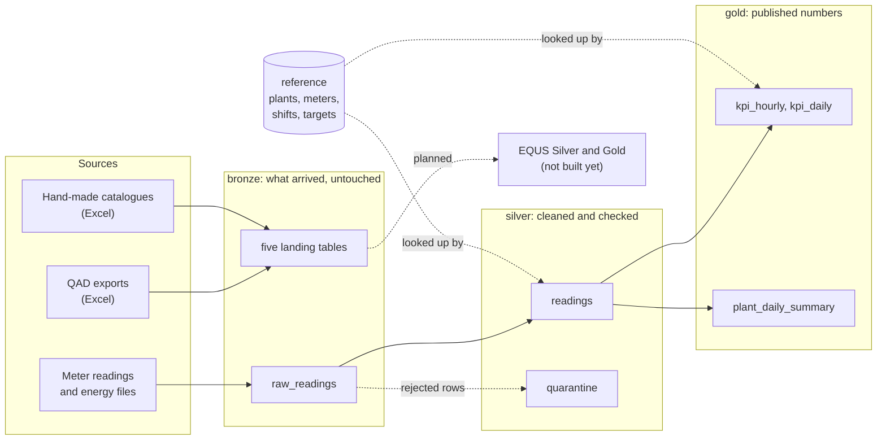
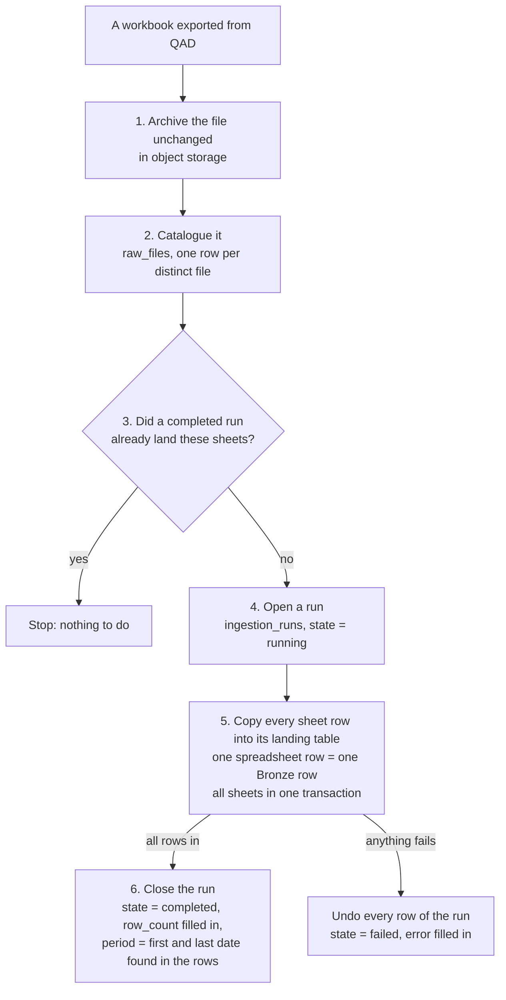
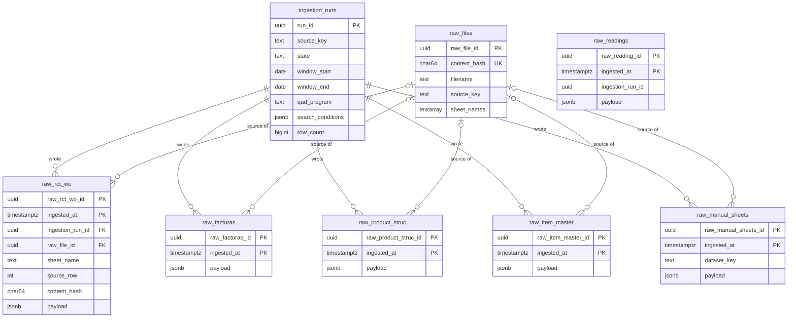
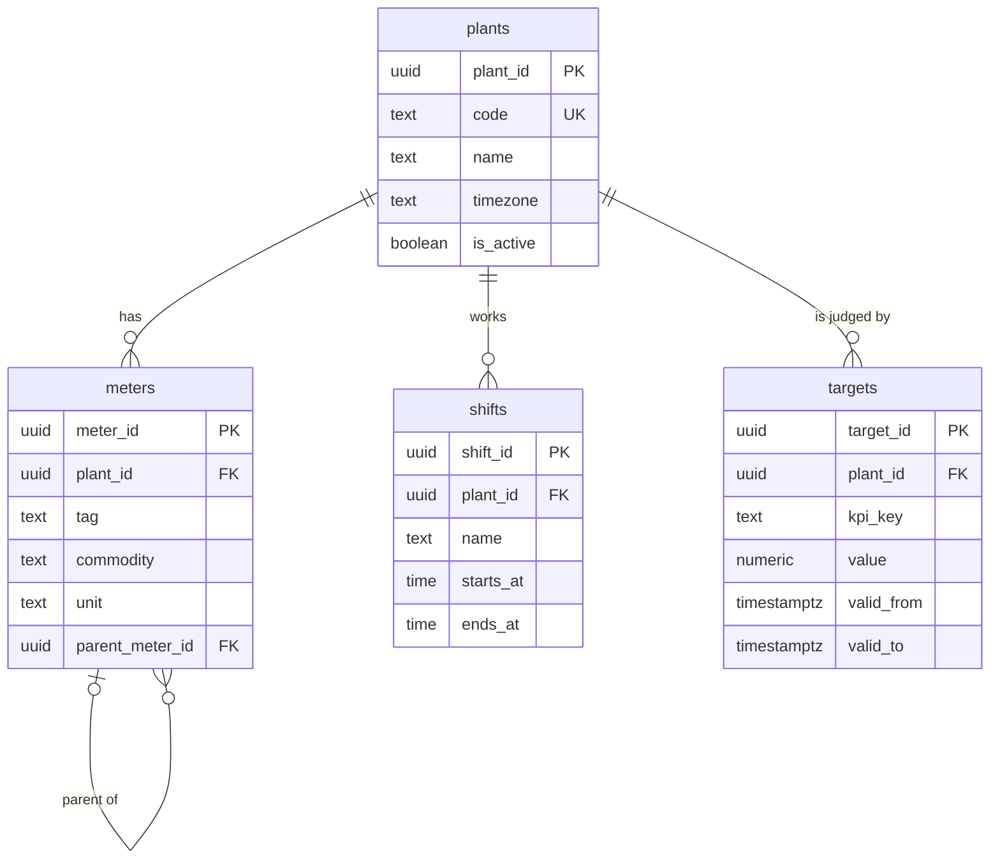
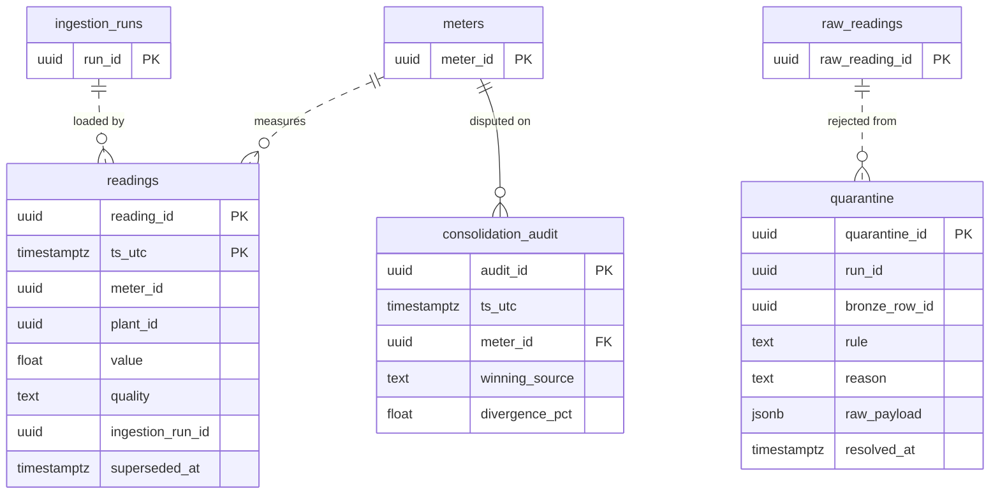
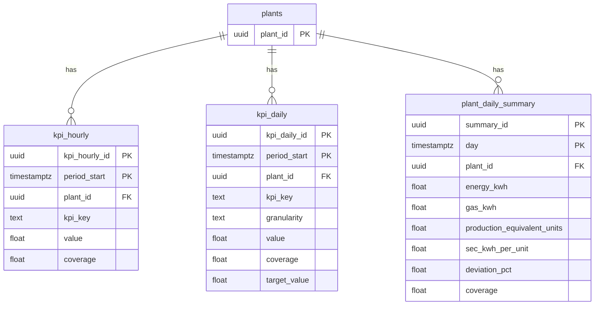
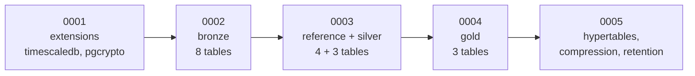
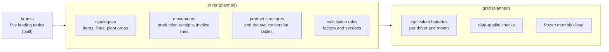

# Database overview

A first read for anyone joining the project. It explains what the database holds,
how the pieces relate and where to look next. For every column of every table, see
the [data dictionary](data_dictionary.md).

**Where things stand.** The tables described here exist, and the migrations that
create them are tested. One loader is built: it lands the equivalent-batteries
workbooks in Bronze (section 3). Nothing fills the other tables yet, so on a fresh
database they are empty. Sections marked *planned* describe tables that do not
exist yet.

---

## 1. What the database is for

One PostgreSQL 16 database (with the TimescaleDB extension) serves two purposes
for the Clarios battery plant:

| Purpose | Question it answers | Where the data comes from |
|---|---|---|
| **Energy monitoring** | How much electricity and gas did each plant use, and how efficiently? | Meter readings and energy files |
| **Equivalent batteries (EQUS)** | How much did the plant really produce, once batteries of different sizes are made comparable? | Exports from QAD (the plant's ERP), saved as Excel workbooks, plus a few hand-made Excel catalogues |

The two meet in one indicator: energy used per equivalent battery.

---

## 2. Four schemas, one direction of travel

Data moves through three layers, each stricter than the one before. A fourth schema
holds the lists the others refer to.



| Schema | In one sentence | Can rows change? |
|---|---|---|
| `bronze` | An exact copy of what each source sent. | Never. Rows are only added. |
| `silver` | The same data, typed, checked and de-duplicated. | A correction replaces a row but keeps the old one. |
| `gold` | The figures that reports and dashboards show. | Recomputed per period. |
| `reference` | Plants, meters, shifts and targets. | Maintained by people. |

The rule behind the layers: **never repair data where it lands**. Bronze keeps the
evidence, Silver decides what is valid, Gold publishes. If a number looks wrong, you
can always walk back from Gold to the exact spreadsheet row it came from.

---

## 3. Bronze: the landing area

Created by [`0002_create_bronze_schema.py`](../migrations/versions/0002_create_bronze_schema.py).

### How one workbook becomes Bronze rows

This is what the loader does for each workbook.



Two consequences worth knowing:

- **Loading the same file twice does nothing.** A sheet that a completed run already
  landed is skipped. To land it again on purpose, use `--force`; Bronze then holds
  both copies, each under its own run.
- **A run is all or nothing.** A `completed` run has all its rows. A `failed` run has
  none, and its `error` column says why.
- **The loader assumes no year.** It lands whatever dates an export holds, and each
  run records the first and last *Fecha Efectiva* it found (`window_start`,
  `window_end`). Which fiscal year a figure belongs to is decided later, in Gold.

### Loading the workbooks

Put the workbooks in `data/raw_excels/` and run:

```bash
make equs-load
```

This lands every workbook the calculation uses, in a fixed order, and prints one
line per sheet. About 205,000 rows take under a minute. The files are only read,
never changed. To land a single workbook or chosen sheets, see the `energy equs
load` examples in the [README](../README.md).

**Exports of other years go in the same folder.** Name each one with the usual
name followed by anything, and `make equs-load` lands the ones it has not landed
yet:

```text
Calculo de equivalente - Explorar transacciones por art.xlsx        the current export
Calculo de equivalente - Explorar transacciones por art FY24.xlsx   an older one
Calculo de equivalente - Unidades facturadas FY24.xlsx              its invoices
```

This works for the two movement exports only (transactions and invoices). The
structure and catalogue workbooks are snapshots, so there is one file of each,
under its exact name: to update one, replace the file. Any workbook in the
folder that the loader does not recognise is listed at the end of its output as
not loaded.

### The tables



The five landing tables have the same columns; the diagram spells them out once, on
`raw_rct_wo`. `raw_readings` is the landing table for energy readings. It is older
than the others and is not linked to the two ledgers by a foreign key.

| Table | What lands in it | Rows with the FY26 files |
|---|---|---|
| `ingestion_runs` | One row per load: which source, which period, what state, how many rows. | 7 |
| `raw_files` | One row per archived workbook, identified by the hash of its bytes. | 6 |
| `raw_rct_wo` | Production receipts: *Explorar transacciones por art* › `Datos`. | 138,773 |
| `raw_facturas` | Invoice lines: *Unidades facturadas* › `Datos`. | 14,458 |
| `raw_product_struc` | Product structures: *BOM BATERIAS FORMADAS* › `PASTA`, `PLACAS`, `BAT ENS`, `BAT FOR`, `BAT TERM`, and *ESTRUCTURA DECORADO* › `Datos`. | 48,475 |
| `raw_item_master` | The item master: *Item_Master* › `Datos`, `Grupo-Fam`. The workbook has not been delivered yet. | 0 |
| `raw_manual_sheets` | Hand-made catalogues. `dataset_key` says which one: `clasif_poly`, `lineas_produccion`, `instrucc`, `element_deco`, `comparativo_lineas`. | 3,633 |
| `raw_readings` | Energy meter readings. No loader yet. | 0 |

There are seven runs for six files because *ESTRUCTURA DECORADO* feeds two loads: its
product structures and its catalogue of decoration pieces.

### Three rules that make Bronze trustworthy

1. **The row is stored as it arrived.** Each row keeps its cells in a JSON `payload`.
   The keys are the column headers of the sheet, in Spanish and with their accents.
   The values are the cell text. Nothing is converted: a date stays text, and `N/A`
   stays `N/A`.
2. **Rows are never changed.** The database rejects any `UPDATE` on a landing table.
   A correction is a new row from a new run.
3. **Duplicates are kept.** The exports contain repeated rows, and removing them
   changes the result of the calculation. That decision belongs to Silver, where it
   is visible. Bronze keeps every copy.

This is the payload of the first production receipt (shortened):

```json
{
  "Fecha Efectiva": "2025-12-10",
  "Número Artículo": "111000002",
  "Número de transacción": "17240425",
  "Tipo Transacción": "RCT-WO",
  "Cambiar cantidad de ubic": "70000",
  "Costo Total": "182346891.593783",
  "Campo Equs": "N/A",
  "Línea Producción": "MAQBUJEO"
}
```

How a cell becomes text:

| In the workbook | In the payload |
|---|---|
| Text | Exactly as it is, not trimmed. `N/A` stays `N/A`. |
| A whole number, such as 900 | `900`, never `900.0` |
| Any other number | Its plain decimal form: `0.0636`, `0.00001`. Never `1e-05`. |
| A date, a date and time, a time | `2025-12-10`, `2025-12-10T11:34:05`, `11:34:00` |
| True / false | `true` / `false` |
| An empty cell | No key at all |

How a column gets its key:

| The header is… | The key is… | Example |
|---|---|---|
| A text | That text, trimmed | `Fecha Efectiva` |
| Repeated | The text plus ` #2`, ` #3` | `Descripción`, `Descripción #2` |
| Blank | The Excel column letter | `P` |
| Missing (the sheet has no header row) | The Excel column letter | `A`, `B`, `D` |

Rows that are completely empty are not landed. Every other row is, including rows
that repeat an earlier one.

Around the payload, every landing row records where it came from:

| Column | Meaning |
|---|---|
| `ingestion_run_id` | The load that wrote the row. |
| `raw_file_id` | The archived workbook it came from. |
| `source_uri` | Where the original is archived, and which sheet: `bucket://key#sheet`. |
| `sheet_name`, `source_row` | The sheet and the Excel row number. |
| `content_hash` | A fingerprint of the payload, used to find identical rows. |
| `ingested_at` | When the row landed. |

---

## 4. Reference: the lists everything else points to

Created by [`0003_create_silver_schema.py`](../migrations/versions/0003_create_silver_schema.py),
together with Silver.



Targets carry dates of validity. A target agreed for this year does not change how
last year was judged.

---

## 5. Silver: cleaned and checked

Silver today holds the energy readings. A solid line is a foreign key the database
enforces. A dashed line is a link by value that the database does not enforce.



| Table | What it holds |
|---|---|
| `readings` | One valid reading per meter and hour, in UTC. |
| `quarantine` | Every row that failed a check, with the rule it broke. Nothing is thrown away. |
| `consolidation_audit` | Each case where two sources disagreed, and which one won. |

Three things to remember:

- **Time is always UTC, on the hour.** Local time is used only when showing data.
- **Missing is not zero.** An hour nobody reported has quality `missing` and an empty
  value. A zero would lower every average.
- **Corrections do not overwrite.** The old row gets a `superseded_at` date and a new
  row is added.

---

## 6. Gold: the published numbers

Created by [`0004_create_gold_schema.py`](../migrations/versions/0004_create_gold_schema.py).



| Table | What it holds |
|---|---|
| `kpi_hourly` | One value per plant, indicator and hour. |
| `kpi_daily` | The same per day, week or month, with the target in force. |
| `plant_daily_summary` | One wide row per plant and day; what the dashboard's first page reads. |

Every Gold row has a `coverage` between 0 and 1: the share of the period that is
backed by reliable readings. Read it before trusting the value next to it. In
`plant_daily_summary`, a positive `deviation_pct` means the plant used **more**
energy than expected.

---

## 7. Which tables are time-partitioned

Five tables are TimescaleDB *hypertables*: PostgreSQL tables that are split into
chunks by time, which keeps queries over a date range fast. You query them like any
other table. Set up by [`0005_create_hypertables.py`](../migrations/versions/0005_create_hypertables.py).

| Table | Split by | Old data |
|---|---|---|
| `bronze.raw_readings` | `ingested_at` | Compressed after 30 days, deleted after 2 years |
| `silver.readings` | `ts_utc` | Compressed after 90 days |
| `gold.kpi_hourly` | `period_start` | Compressed after 180 days |
| `gold.kpi_daily` | `period_start` | Kept as is |
| `gold.plant_daily_summary` | `day` | Kept as is |

The five EQUS landing tables are ordinary tables for now. Their primary key already
includes `ingested_at`, so they can become hypertables later without being rebuilt.

---

## 8. Which migration creates what

The database is built only by the numbered files in `migrations/versions/`, applied
in order. To change the shape of the database, add a new file; do not create or
alter tables by hand.



---

## 9. Planned: the EQUS calculation (not built yet)

Bronze is the first step of moving the equivalent-batteries calculation out of
Excel. The next two layers are designed in [EQUS_CONTEXT.md](EQUS_CONTEXT.md) and
have no tables yet.



---

## 10. Looking around

The database publishes no port to your machine, so open `psql` inside its container:

```bash
make up                                          # start the stack
make db-upgrade                                  # apply the migrations
make equs-load                                   # land the EQUS workbooks
docker compose exec db psql -U energy -d energy  # open a SQL prompt
```

Plain `\dt` shows almost nothing, because the tables are not in the default
`public` schema. Name the schema:

```sql
\dn                       -- list the schemas
\dt bronze.*              -- list the tables of a schema
\d+ bronze.raw_rct_wo     -- columns, indexes and triggers of a table

-- The latest loads
SELECT flow_name, source_key, state, row_count, started_at
FROM bronze.ingestion_runs
ORDER BY started_at DESC
LIMIT 10;

-- Rows landed per sheet of the product structures
SELECT sheet_name, count(*)
FROM bronze.raw_product_struc
GROUP BY sheet_name
ORDER BY sheet_name;

-- A production receipt by its QAD transaction number
SELECT sheet_name, source_row, payload
FROM bronze.raw_rct_wo
WHERE payload ->> 'Número de transacción' = '17240425';

-- Rows that landed more than once
SELECT content_hash, count(*)
FROM bronze.raw_product_struc
GROUP BY content_hash
HAVING count(*) > 1;
```

---

## Glossary

| Term | Meaning |
|---|---|
| **QAD** | The plant's ERP system. Its reports are exported to Excel. |
| **EQUS** | Equivalent batteries: production expressed in standard batteries, so that months with a different product mix can be compared. |
| **Run** | One execution of a load. Every Bronze row points at the run that wrote it. |
| **Payload** | The JSON column that holds a source row exactly as it arrived. |
| **Provenance** | The columns that say where a row came from: run, file, sheet, row number. |
| **Content hash** | A fixed-length fingerprint (SHA-256) of a file or a row. Equal content gives an equal hash. |
| **Hypertable** | A table that TimescaleDB splits into chunks by time. |
| **Migration** | A numbered file that changes the shape of the database. |
| **Coverage** | The share of a period that is backed by reliable data, from 0 to 1. |

## Related documents

- [Data dictionary](data_dictionary.md): every column of every table
- [Architecture](architecture.md): how the code is organised around the database
- [EQUS context](EQUS_CONTEXT.md): the business rules of the equivalent-batteries calculation
- [Runbook](runbook.md): backups, restore, incident response
