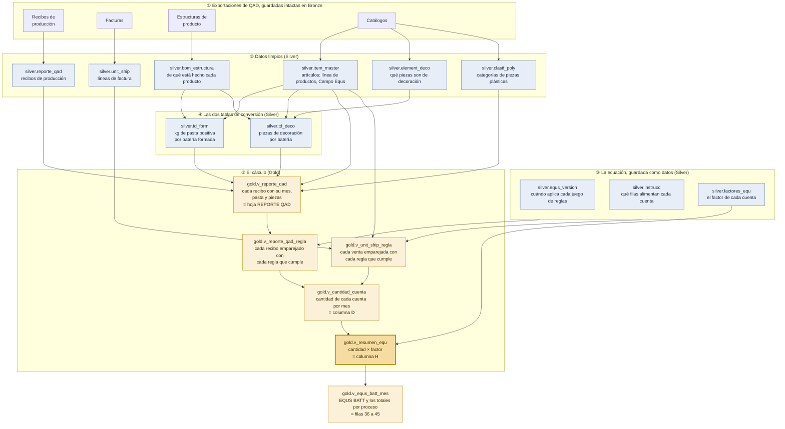
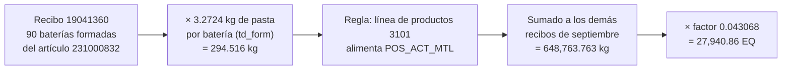

# Cómo se calculan las baterías equivalentes

Esta página es para lectores de planta, finanzas y gerencia que conocen la hoja
RESUMEN EQU del libro EQUS BATT. Muestra, paso a paso, cómo la base de datos
llega a los mismos números. No hace falta leer código ni SQL para seguirla.

Cómo el comando `make resumen` llega a estos números se explica en una página
técnica aparte, en inglés: [equs_resumen_call_chain.md](equs_resumen_call_chain.md).

[English version](equs_calculation_explained.md).

> **Sobre los números.** Se escriben con punto decimal y coma de miles
> (215,590.33), igual que los imprime el sistema con `make resumen`, para que se
> puedan comparar cifra por cifra.

---

## La versión corta

El indicador de producción de la planta, **EQUS BATT**, suma las **baterías
equivalentes (EQ)** de dieciséis cuentas. El libro las llama *cuentas STATS*.
Las cuentas miden kilos de óxido, rejillas, placas, baterías ensambladas, pasta
dentro de las baterías formadas, piezas de decoración y baterías despachadas, y
algunos conteos que se informan pero no se suman. Para cada cuenta y cada mes:

> **EQ = cantidad del mes × factor**
>
> **factor = multiplicador ÷ estándar por batería × peso del proceso**

**Ejemplo.** Una batería de camión cuenta como 2.15 baterías de carro, así que su
multiplicador es 2.15. El estándar es una batería ensamblada por batería
estándar. El ensamble es el 35.4 % del costo de conversión de la planta, así que
su peso es 0.354. El factor de `COSPRODU_TRUCK` es entonces 2.15 ÷ 1 × 0.354 =
**0.7611**. En septiembre de 2026 la planta ensambló 16,265 baterías de camión:
16,265 × 0.7611 = **12,379.29 EQ**.

En la hoja RESUMEN EQU, la columna D es la cantidad, la columna G el factor y la
columna H las EQ. La base de datos sigue los mismos pasos y termina en
**`gold.v_resumen_equ`**, su columna H. El resto de esta página recorre esos
pasos.

## Antes de empezar: tablas y vistas

- Una **tabla** guarda filas, como una hoja con datos pegados.
- Una **vista** no guarda nada. Es un cálculo guardado, como una hoja llena de
  fórmulas: cada vez que alguien la consulta, se recalcula a partir de las tablas
  que tiene debajo. Por eso una vista nunca está desactualizada. Cada paso del
  cálculo es una vista.
- Dos objetos, `td_form` y `td_deco`, son **cálculos guardados**, como una tabla
  dinámica. Hay que actualizarlos cuando cambian las estructuras de producto,
  igual que una tabla dinámica. `make refresh` los actualiza.
- **Los nombres están en español** porque reflejan el libro: `reporte_qad` es la
  hoja REPORTE QAD. La primera palabra del nombre es la capa:
  - `bronze.` es la copia intacta de las exportaciones;
  - `silver.` son los datos limpios;
  - `gold.` es el cálculo.

## Todo el flujo en una imagen

Se lee de arriba hacia abajo. Cada recuadro es una tabla o una vista, y los
números ① a ⑤ corresponden a las secciones de abajo.

## Paso a paso

### ① Las exportaciones de QAD, guardadas intactas (Bronze)

Alguien ejecuta las exploraciones de QAD y las guarda como libros en
`data/raw_excels/`:

- los recibos de producción;
- las facturas;
- las estructuras de producto;
- los catálogos.

El cargador copia cada fila de cada hoja en Bronze **exactamente como llegó**.
Ahí no se calcula nada. Bronze es la evidencia: cualquier número más abajo se
puede rastrear hasta la fila de la exportación de la que salió.

### ② Los datos limpios (Silver)

Silver convierte las exportaciones en tablas limpias:

- una fila exportada dos veces cuenta una sola vez;
- un enlace de estructura listado dos veces cuenta una sola vez;
- las fechas se vuelven fechas reales;
- los códigos de artículo siguen siendo texto, porque `21500000A` es un código
  real.

| Tabla | Una fila es | En el libro | Tamaño (FY26) |
|---|---|---|---|
| `silver.reporte_qad` | Un **recibo de producción**: una línea de producción reportó N unidades (o kg) de un artículo en una fecha | Hoja Datos de *Explorar transacciones*, pegada en REPORTE QAD | 138,773 recibos; 12,998 en septiembre de 2026 |
| `silver.unit_ship` | Una **línea de factura**: N baterías vendidas de un artículo. Una nota crédito es negativa | Hoja Datos de *Unidades facturadas*, pegada en Unit_Ship | 14,458 líneas; 1,130 en septiembre de 2026 |
| `silver.item_master` | Un **artículo**: su descripción, su línea de productos (2201 batería ensamblada, 3101 formada, 3103 decorada…) y su Campo Equs (SLI-S, TRUCK-B, OXIDO…) | El maestro de artículos y las columnas de artículo de cada libro | 13,317 artículos |
| `silver.bom_estructura` | Un **enlace de una estructura de producto**: "el padre X usa N del componente Y". Todos los niveles están en una sola lista: batería decorada → formada → ensamblada → placa → pasta | Hojas PASTA, PLACAS, BAT ENS, BAT FOR, BAT TERM, y la hoja Datos de ESTRUCTURA DECORADO | 45,853 enlaces |
| `silver.element_deco` | Un **componente**, y si cuenta como pieza de decoración | Hoja ELEMENT DECO | 1,751 componentes |
| `silver.clasif_poly` | Una **pieza plástica**, con su categoría y su factor. Solo la usa EQUS POLY, el indicador aparte de inyección de plástico | Hoja Clasif_Poly | 1,752 piezas |

**A qué mes pertenece una fila.** Un recibo o una factura pertenece al mes de su
**fecha contable** (*Fecha Efectiva*), no al día en que se digitó, igual que en
el libro.

### ③ La ecuación, guardada como datos (Silver)

En el libro, los números de la ecuación (6.08, 84, 2.15, 0.354…) están escritos
dentro de las fórmulas, a veces en varias celdas que no siempre coinciden. Aquí
viven en tres tablas pequeñas. Cada número se escribe una sola vez, y cada cambio
queda registrado.

| Tabla | Qué contiene | En el libro |
|---|---|---|
| `silver.equs_version` | Cada **juego de reglas** y las fechas en que aplica. La versión 1, "STD FY26", aplica desde octubre de 2025, sin fecha de fin | Nada: el libro no guarda historia |
| `silver.factores_equ` | Una fila por **cuenta**: su proceso, estándar por batería, multiplicador y peso; el factor calculado a partir de ellos; qué cuenta mide; y si suma a EQUS BATT | Columnas A, B y G de RESUMEN EQU |
| `silver.instrucc` | Las **reglas** que dicen qué filas alimentan cada cuenta: la línea de productos, un Campo Equs que debe coincidir o que debe excluirse, el inicio del nombre de una línea de producción | Hoja INSTRUCC, y los filtros de las tablas dinámicas que alimentan la columna D |

Algunas reglas de la versión 1:

- `OXPROD_KG` toma los recibos cuyo Campo Equs es `OXIDO`.
- `COSPRODU_SLI` toma la línea de productos 2201 **excepto** el Campo Equs
  `TRUCK-B`; `COSPRODU_TRUCK` toma la línea de productos 2201 **con** `TRUCK-B`.
- `COMP_DEC` tiene tres reglas, para las líneas de productos 3102, 3103 y 3104, y
  se suman.
- `LEADPROD` toma las líneas de producción cuyo nombre empieza por `RCREFI`.

**Qué mide una cuenta.** La mayoría de las cuentas miden la cantidad recibida.
Tres son distintas:

| Cuenta | Mide | Tomado de |
|---|---|---|
| `POS_ACT_MTL` (formación) | Los kilos de pasta positiva de cada batería | `td_form` (paso ④) |
| `COMP_DEC` (decorado) | Las piezas de decoración de cada batería | `td_deco` (paso ④) |
| `UNITSHIP` (despachos) | Las unidades facturadas | Las facturas, no la producción |

**Cómo cambia una regla.** Estas tres tablas se llenaron una sola vez, al montar
la base de datos, con los valores que usa hoy el libro. No se vuelven a cargar
desde Excel. Para cambiar un estándar o una regla, alguien agrega una **nueva
versión** con el mes en que empieza. Los meses anteriores conservan sus reglas, y
las nuevas aplican desde su mes de inicio. Agregar reglas nunca cambia cómo se
calcula un mes anterior.

### ④ Las dos tablas de conversión (Silver)

Dos cuentas no miden baterías sino lo que hay **dentro** de ellas. Dos tablas
convierten cada batería en esas cantidades.

**`silver.td_form`: kilos de pasta positiva por batería formada.** Recorre la
estructura de producto de abajo hacia arriba:

1. **Pasta por placa.** Por ejemplo, la placa 216000006 usa 0.0636 kg de pasta
   positiva.
2. **Pasta por batería ensamblada:** placas por batería × pasta por placa. Por
   ejemplo, 36 placas positivas × 0.0636 kg = 2.2896 kg.
3. **Pasta por batería formada.** La formación no agrega pasta, así que una
   batería formada hereda la pasta de la batería ensamblada de la que se hace.

El resultado cubre 1,248 baterías formadas, de 0.79 a 8.67 kg cada una, 3.16 kg
en promedio. Reemplaza la tabla dinámica TD_FORM de *BOM BATERIAS FORMADAS*.

**`silver.td_deco`: piezas de decoración por batería.** Cubre toda batería
semidecorada, decorada o importada (líneas de productos 3102, 3103 y 3104).

- **Se cuentan:** etiquetas, tapas de terminal, cubre terminales, protectores de
  poste y protectores de terminal, cuando el catálogo ELEMENT DECO los marca como
  decoración.
- **Nunca se cuentan:** las sobrecubiertas (`SOBRECUB`) ni las manijas
  (`MANIJA`).

El resultado cubre 4,889 baterías, de 0 a 9 piezas cada una, 4.3 en promedio.
Reemplaza la columna X de la hoja Datos y la tabla dinámica TD de *ESTRUCTURA
DECORADO*.

### ⑤ El cálculo (Gold)

Cinco vistas, cada una construida sobre la anterior.

**`gold.v_reporte_qad`: cada recibo de producción, con sus conversiones.** Es la
hoja REPORTE QAD con sus columnas calculadas. Toma los recibos de producción
(tipo de transacción `RCT-WO`) y le agrega a cada uno:

- el **mes**;
- su **línea de productos** y su **Campo Equs**: el Campo Equs es el del propio
  recibo, o el del maestro de artículos cuando el recibo no trae ninguno;
- su **material activo**: cantidad × pasta por batería (columna AZ);
- sus **piezas de decoración**: cantidad × piezas por batería (columna AY);
- solo para el almacén 1010, la categoría de plástico y el valor de EQUS POLY
  (columnas BE, BG y BF).

Un recibo de un artículo que no aparece en ninguna de las dos tablas de
conversión no recibe pasta ni piezas.

**Qué versión aplica a un mes.** Es una regla, no una tabla: una versión aplica a
un mes cuando el primer día del mes cae dentro de las fechas de la versión. Todas
las vistas usan esta misma regla, así que no pueden contradecirse.

**`gold.v_reporte_qad_regla`: cada recibo emparejado con cada regla que cumple.**
Es lo que hacen los filtros de las tablas dinámicas, aplicado recibo por recibo:

- **Comparación.** Cada recibo se compara con todas las reglas de `instrucc`. Una
  regla se cumple cuando se cumplen todas sus condiciones diligenciadas.
- **Un recibo, varias cuentas.** Una batería formada, por ejemplo, alimenta a la
  vez `POS_ACT_MTL` y `FORM_PRD_SLI`.
- **Sin regla, sin fila.** Un recibo que no cumple ninguna regla no aparece aquí
  (una materia prima, por ejemplo).
- **Cada pareja lleva la cantidad que mide la cuenta:** la cantidad, los kilos de
  pasta o las piezas de decoración, según lo que diga la cuenta. También indica si
  la versión de la regla aplica en el mes del recibo.

**`gold.v_unit_ship_regla`: cada venta emparejada con cada regla que cumple.** Lo
mismo, para las líneas de factura y la cuenta que las mide, `UNITSHIP`:

- Solo cuenta el canal *Venta*.
- Una nota crédito resta, así que los despachos son netos, como en el libro.

**`gold.v_cantidad_cuenta`: la cantidad de cada cuenta en cada mes (columna D).**
Suma las cantidades de las dos vistas de emparejamiento, por cuenta y por mes.
Reemplaza las tablas dinámicas que consulta la columna D: LINEAS DE PDCTO,
TD MAT ACTIVO, TD COMP DECO y TD_UNIT_Ship. Se calcula con todas las versiones,
así que un mes se puede comparar con reglas nuevas propuestas antes de
adoptarlas.

**`gold.v_resumen_equ`: las EQ de cada cuenta en cada mes (columna H).** Se
queda con la versión que aplica a cada mes y multiplica la cantidad por el factor
de la cuenta. Cada fila es una cuenta en un mes y da:

- su proceso;
- su cantidad (columna D);
- su factor (columna G);
- sus EQ (columna H);
- si suma a EQUS BATT.

Una cuenta que nada alimentó en un mes no tiene fila. En septiembre de 2026 fue
el caso de `GRIDS_REG_POS` y `CARTON_BATT`. `15BATPRD` nunca tiene fila, porque
no tiene regla.

### Después de la columna H

- **`gold.v_equs_batt_mes`** suma la columna H por proceso y da **EQUS BATT**:
  las filas 36 a 45 de RESUMEN EQU. Solo cuentan las cuentas que suman al total.
- **Día a día.** `gold.v_resumen_equ_diario` es la columna H de cada día en
  lugar de cada mes. Un recibo o una factura cuenta en su fecha contable, y cada
  día usa las reglas que aplican a su mes. Los días de un mes suman exactamente
  el mes: en septiembre de 2026 dan las mismas 215,590.33. `make daily
  MONTH=2026-09` imprime una línea por día con las EQ de cada proceso.
- **EQUS POLY** (inyección de plástico, almacén 1010) es un indicador aparte, en
  `gold.inyeccion`. Nunca se suma a EQUS BATT.
- **El cierre oficial.** `make close MONTH=2026-09` copia un mes de
  `v_resumen_equ` en `gold.resumen_equ` y lo congela, como hacía la columna
  "ESTA SE COPIA" del libro. Los datos que cambien después no alteran un mes
  cerrado. Solo un recierre deliberado lo reemplaza, y guarda los números
  anteriores en una tabla de historia.
- **Los controles de calidad de datos** se ejecutan antes de un cierre. Por
  ejemplo, reportan producción que ninguna regla toma, o una batería formada sin
  pasta. Están descritos (en inglés) en
  [data_dictionary.md](data_dictionary.md#data-quality-views-equs_context-section-8).

## Un recibo, de punta a punta

El recibo 19041360 es un recibo de formación. El 4 de septiembre de 2026, la
línea de formación FAFORM02 reportó **90 baterías formadas** del artículo
231000832 (*BF 35 6\*5 CN CD JCI NEG MNEG SELL FORM*), línea de productos 3101,
Campo Equs `SLI-S`.

| Paso | Qué pasa | Resultado |
|---|---|---|
| `silver.reporte_qad` | El recibo, limpio | 90 unidades el 2026-09-04 |
| `silver.td_form` | La estructura del artículo da su pasta | 3.2724 kg por batería |
| `gold.v_reporte_qad` | Se agregan el mes y el material activo | Mes 2026-09; material activo 90 × 3.2724 = 294.516 kg |
| `gold.v_reporte_qad_regla` | Dos reglas de la versión 1 se cumplen para la línea de productos 3101 | `POS_ACT_MTL`, que mide pasta: 294.516. `FORM_PRD_SLI`, que mide unidades porque el Campo Equs no es `TRUCK-B`: 90 |
| `gold.v_cantidad_cuenta` | Se suma a los demás recibos de septiembre | `POS_ACT_MTL` 648,763.763 kg; `FORM_PRD_SLI` 194,846 baterías |
| `gold.v_resumen_equ` | Se multiplica por el factor | `POS_ACT_MTL`: 0.146 ÷ 3.39 = 0.043068, así que este recibo aporta 294.516 × 0.043068 = 12.68 EQ de las 27,940.86 del mes. `FORM_PRD_SLI` tiene factor 0: se informa, no se suma |

## Septiembre de 2026: la columna H

| Fila | Cuenta | Proceso | Mide | Cantidad (D) | Factor (G) | EQ (H) |
|---|---|---|---|---:|---:|---:|
| 2 | `OXPROD_KG` | OREC | kg de óxido | 1,162,129 | 0.012171 | 14,144.33 |
| 3 | `GRIDS_REG_POS` | OREC | kg de cinta positiva | sin producción | 0.032075 | — |
| 4 | `GRIDS_CAST` | OREC | rejillas casting | 9,761,100 | 0.001805 | 17,618.79 |
| 5 | `GRIDS_NEG` | OREC | kg de cinta negativa | 264,006 | 0.022270 | 5,879.54 |
| 6 | `PLATEPRD_SLI` | OREC | placas de carro | 14,859,820 | 0.002119 | 31,488.67 |
| 7 | `PLATEPRD_TRUCK` | OREC | placas de camión | 790,407 | 0.002416 | 1,909.40 |
| 8 | `COSPRODU_SLI` | ENSAMBLE | baterías ensambladas, no `TRUCK-B` | 205,185 | 0.354 | 72,635.49 |
| 9 | `COSPRODU_TRUCK` | ENSAMBLE | baterías ensambladas `TRUCK-B` | 16,265 | 0.7611 | 12,379.29 |
| 10 | `POS_ACT_MTL` | FORMACION | kg de pasta positiva en baterías formadas | 648,763.763 | 0.043068 | 27,940.86 |
| 14 | `COMP_DEC` | DECORADO | piezas de decoración | 896,534 | 0.026340 | 23,615.00 |
| 15 | `CARTON_BATT` | DECORADO | baterías empacadas en cartón | sin regla | 0.337156 | — |
| 16 | `UNITSHIP` | SHIPPING | baterías vendidas, netas de notas crédito | 194,609 | 0.041 | 7,978.97 |
| | **EQUS BATT** | | | | | **215,590.33** |

Por proceso:

| Proceso | EQ |
|---|---:|
| OREC | 71,040.72 |
| ENSAMBLE | 85,014.78 |
| FORMACION | 27,940.86 |
| DECORADO | 23,615.00 |
| SHIPPING | 7,978.97 |
| **EQUS BATT** | **215,590.33** |

Las cuentas informativas tienen factor 0 y no suman nada:

| Cuenta | Cantidad |
|---|---:|
| `FORM_PRD_SLI` | 194,846 |
| `FORM_PRD_TRUCK` | 14,816 |
| `LEADPROD` | 1,806,206 kg |
| `15BATPRD` | 0 (sin regla) |

Los factores de arriba están redondeados a seis decimales para mostrarlos; las EQ
usan el factor exacto.

EQUS POLY para el mismo mes es 503,033.19, a partir de 1,737,504 piezas
plásticas.

## Dónde difieren la base de datos y el libro

Cada fila de la columna H coincide con el libro al centavo, salvo dos. Las dos
difieren a propósito, porque el libro tiene un defecto ahí:

| Cuenta | Defecto del libro | Base de datos | Libro | Diferencia en EQ |
|---|---|---|---|---:|
| `POS_ACT_MTL` | La placa 215000015 aparece dos veces en la hoja PLACAS de *BOM BATERIAS FORMADAS*, lo que duplica la pasta de toda batería que la usa. La base de datos cuenta el enlace una sola vez | 648,763.763 kg → 27,940.86 EQ | 654,835.08 kg → 28,202.34 EQ | −261.48 |
| `COMP_DEC` | Desde la fila 29,261 de *ESTRUCTURA DECORADO*, la fórmula del libro deja de contar los protectores de terminal (`TERM-PRT`, `TERMINAL-PRT`), sobre todo los de baterías importadas. La base de datos sí los cuenta | 896,534 piezas → 23,615.00 EQ | 895,564 piezas → 23,589.45 EQ | +25.55 |

Por eso EQUS BATT es 215,590.33 en la base de datos frente a 215,826.26 en el
libro: 235.93 EQ menos. Las pruebas que leen los libros comparan cada fila de la
columna H con el libro, y verifican cada una de estas dos diferencias en su valor
exacto.

## Lo que el cálculo nunca hace

- **No escribe ningún número de la ecuación.** Cada factor, peso, línea de
  productos y Campo Equs sale de las tres tablas del paso ③. Las únicas palabras
  fijas son:
  - `RCT-WO`, que marca un recibo de producción;
  - `Venta`, que marca una venta;
  - el almacén `1010`, que marca la inyección de plástico.
- **No toma decisiones de negocio.** Las preguntas abiertas de
  [EQUS_CONTEXT.md](EQUS_CONTEXT.md) §10 se quedan como las tiene hoy el libro.
  Por ejemplo, solo `TRUCK-B` recibe el multiplicador 2.15, y `CARTON_BATT` no
  tiene regla. Cambiar cualquiera de las dos es una nueva versión de las reglas.
- **Nunca cambia un mes cerrado** a espaldas de nadie.

## Para leer más (en inglés)

- [data_dictionary.md](data_dictionary.md#the-equs-gold-objects): cada vista y
  columna de Gold, y los controles de calidad de datos.
- [EQUS_CONTEXT.md](EQUS_CONTEXT.md) §4: cómo calcula el libro, celda por celda.
- [equs_resumen_call_chain.md](equs_resumen_call_chain.md): qué se ejecuta al
  escribir `make resumen`, y cómo llamarlo desde Python.
