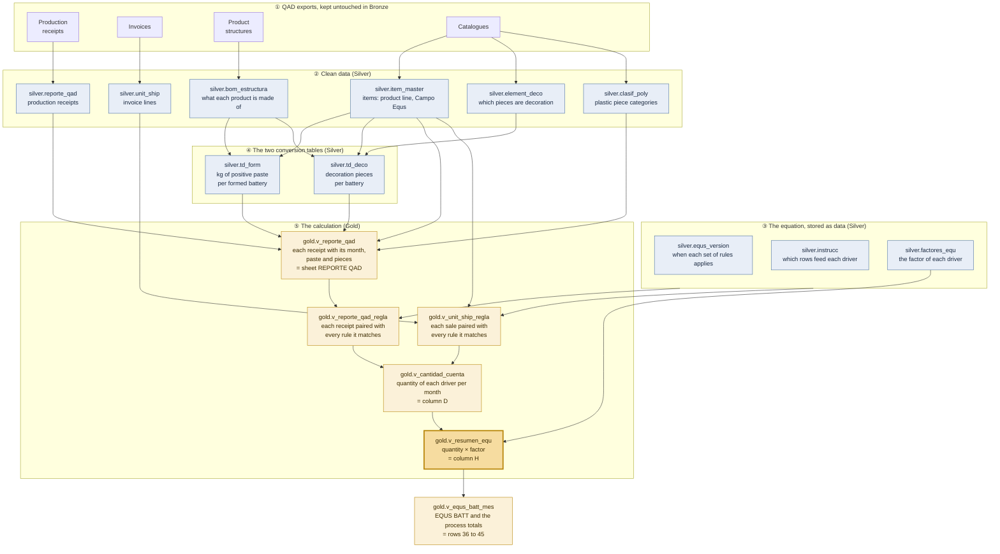
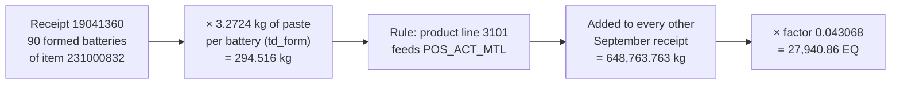

# How the equivalent batteries are calculated

This page is for plant, finance and management readers who know sheet RESUMEN EQU
of the EQUS BATT workbook. It shows, step by step, how the database reaches the
same numbers. You do not need to read code or SQL to follow it.

How the `make resumen` command reaches these numbers is a separate,
technical page: [equs_resumen_call_chain.md](equs_resumen_call_chain.md).

[Versión en español](equs_calculation_explained.es.md).

---

## The short version

The plant's throughput indicator, **EQUS BATT**, adds up the **equivalent
batteries (EQ)** of sixteen drivers. The workbook calls a driver a *cuenta STATS*.
The drivers count kilograms of oxide, grids, plates, assembled batteries, paste
inside formed batteries, decoration pieces and batteries shipped, plus a few
counts that are reported but not added. For each driver and each month:

> **EQ = quantity of the month × factor**
>
> **factor = multiplier ÷ standard per battery × weight of the process**

**Example.** A truck battery counts as 2.15 car batteries, so its multiplier is
2.15. The standard is one assembled battery per standard battery. Assembly is
35.4 % of the plant's conversion cost, so its weight is 0.354. The factor of
`COSPRODU_TRUCK` is therefore 2.15 ÷ 1 × 0.354 = **0.7611**. In September 2026
the plant assembled 16,265 truck batteries: 16,265 × 0.7611 = **12,379.29 EQ**.

In sheet RESUMEN EQU, column D is the quantity, column G the factor and column H
the EQ. The database follows the same steps and ends in **`gold.v_resumen_equ`**,
its column H. The rest of this page walks through those steps.

## Before you start: tables and views

- A **table** stores rows, like a sheet with data pasted into it.
- A **view** stores nothing. It is a saved calculation, like a sheet full of
  formulas: whenever someone reads it, it recalculates from the tables beneath it.
  A view is therefore never out of date. Every step of the calculation is a view.
- Two objects, `td_form` and `td_deco`, are **saved calculations**, like a pivot
  table. They have to be refreshed when the product structures change, exactly
  as a pivot does. `make refresh` refreshes them.
- **Names are in Spanish** because they mirror the workbook: `reporte_qad` is
  sheet REPORTE QAD. The first word of a name is the layer:
  - `bronze.` is the untouched copy of the exports;
  - `silver.` is the clean data;
  - `gold.` is the calculation.

## The whole flow in one picture

Read it from top to bottom. Each box is one table or view, and the numbers ① to ⑤
match the sections below.

## Step by step

### ① The QAD exports, kept untouched (Bronze)

Someone runs the QAD explorations and saves them as workbooks in
`data/raw_excels/`:

- the production receipts;
- the invoices;
- the product structures;
- the catalogues.

The loader copies every row of every sheet into Bronze **exactly as it arrived**.
Nothing is calculated there. Bronze is the evidence: any number further down can
be traced back to the export row it came from.

### ② The clean data (Silver)

Silver turns the exports into clean tables:

- a row exported twice counts once;
- a structure link listed twice counts once;
- dates become real dates;
- item codes stay text, because `21500000A` is a real code.

| Table | One row is | In the workbook | Size (FY26) |
|---|---|---|---|
| `silver.reporte_qad` | One **production receipt**: a production line reported N units (or kg) of an item on a date | Sheet Datos of *Explorar transacciones*, pasted into REPORTE QAD | 138,773 receipts; 12,998 in September 2026 |
| `silver.unit_ship` | One **invoice line**: N batteries of an item sold. A credit note is negative | Sheet Datos of *Unidades facturadas*, pasted into Unit_Ship | 14,458 lines; 1,130 in September 2026 |
| `silver.item_master` | One **item**: its description, its product line (2201 assembled battery, 3101 formed, 3103 decorated…) and its Campo Equs (SLI-S, TRUCK-B, OXIDO…) | The item master and the item columns of every workbook | 13,317 items |
| `silver.bom_estructura` | One **link of a product structure**: "parent X uses N of component Y". Every level is in one list: decorated battery → formed → assembled → plate → paste | Sheets PASTA, PLACAS, BAT ENS, BAT FOR, BAT TERM, and sheet Datos of ESTRUCTURA DECORADO | 45,853 links |
| `silver.element_deco` | One **component**, and whether it counts as a decoration piece | Sheet ELEMENT DECO | 1,751 components |
| `silver.clasif_poly` | One **plastic piece**, with its category and factor. Used only by EQUS POLY, the separate plastic-injection indicator | Sheet Clasif_Poly | 1,752 pieces |

**Which month a row belongs to.** A receipt or an invoice belongs to the month of
its **accounting date** (*Fecha Efectiva*), not to the day it was typed in, as in
the workbook.

### ③ The equation, stored as data (Silver)

In the workbook the numbers of the equation (6.08, 84, 2.15, 0.354…) are typed
inside formulas, sometimes in several cells that do not always agree. Here they
live in three small tables. Each number is written once, and every change leaves
a record.

| Table | What it holds | In the workbook |
|---|---|---|
| `silver.equs_version` | Each **set of rules** and the dates it applies to. Version 1, "STD FY26", applies from October 2025 with no end date | Nothing: the workbook keeps no history |
| `silver.factores_equ` | One row per **driver**: its process, standard per battery, multiplier and weight; the factor calculated from them; what the driver counts; and whether it adds to EQUS BATT | Columns A, B and G of RESUMEN EQU |
| `silver.instrucc` | The **rules** that say which rows feed each driver: the product line, a Campo Equs that must match or must be left out, the start of a production line's name | Sheet INSTRUCC, and the filters of the pivots that feed column D |

Some rules of version 1:

- `OXPROD_KG` takes the receipts whose Campo Equs is `OXIDO`.
- `COSPRODU_SLI` takes product line 2201 **except** Campo Equs `TRUCK-B`;
  `COSPRODU_TRUCK` takes product line 2201 **with** `TRUCK-B`.
- `COMP_DEC` has three rules, for product lines 3102, 3103 and 3104, and they add
  up.
- `LEADPROD` takes the production lines whose name starts with `RCREFI`.

**What a driver counts.** Most drivers count the quantity received. Three are
different:

| Driver | Counts | Taken from |
|---|---|---|
| `POS_ACT_MTL` (formation) | Each battery's kilograms of positive paste | `td_form` (step ④) |
| `COMP_DEC` (decoration) | Each battery's decoration pieces | `td_deco` (step ④) |
| `UNITSHIP` (shipping) | The units invoiced | Invoices, not production |

**How a rule changes.** These three tables were filled once, when the database
was set up, with the values the workbook uses today. They are not reloaded from
Excel. To change a standard or a rule, someone adds a **new version** with the
month it starts. Past months keep their old rules, and the new ones apply from
their start month. Adding rules never changes how an earlier month is
calculated.

### ④ The two conversion tables (Silver)

Two drivers do not count batteries but what is **inside** them. Two tables convert
each battery into those amounts.

**`silver.td_form`: kilograms of positive paste per formed battery.** It walks
the product structure from the bottom up:

1. **Paste per plate.** For example, plate 216000006 uses 0.0636 kg of positive
   paste.
2. **Paste per assembled battery:** plates per battery × paste per plate. For
   example, 36 positive plates × 0.0636 kg = 2.2896 kg.
3. **Paste per formed battery.** Formation adds no paste, so a formed battery
   inherits the paste of the assembled battery it is made from.

The result covers 1,248 formed batteries, from 0.79 to 8.67 kg each, 3.16 kg on
average. It replaces pivot TD_FORM of *BOM BATERIAS FORMADAS*.

**`silver.td_deco`: decoration pieces per battery.** It covers every
semi-decorated, decorated or imported battery (product lines 3102, 3103, 3104).

- **Counted:** labels, terminal caps, terminal covers, post protectors and
  terminal protectors, when the catalogue ELEMENT DECO marks them as decoration.
- **Never counted:** covers (`SOBRECUB`) and handles (`MANIJA`).

The result covers 4,889 batteries, from 0 to 9 pieces each, 4.3 on average. It
replaces column X of sheet Datos and pivot TD of *ESTRUCTURA DECORADO*.

### ⑤ The calculation (Gold)

Five views, each built on the one before.

**`gold.v_reporte_qad`: every production receipt, with its conversions.** This
is sheet REPORTE QAD with its calculated columns. It takes the production
receipts (transaction type `RCT-WO`) and adds to each one:

- the **month**;
- its **product line** and **Campo Equs**: the Campo Equs is the receipt's own,
  or the item master's when the receipt carries none;
- its **active material**: quantity × paste per battery (column AZ);
- its **decoration pieces**: quantity × pieces per battery (column AY);
- for warehouse 1010 only, the plastic category and the EQUS POLY value
  (columns BE, BG and BF).

A receipt of an item that neither conversion table lists gets no paste and no
pieces.

**Which version applies to a month.** This is a rule, not a table: a version
applies to a month when the first day of the month falls within the version's
dates. Every view uses this one rule, so they cannot disagree about it.

**`gold.v_reporte_qad_regla`: each receipt paired with every rule it matches.**
This is what the pivot filters do, done one receipt at a time:

- **Matching.** A receipt is compared with every rule of `instrucc`. A rule
  matches when all of its filled-in conditions hold.
- **One receipt, several drivers.** A formed battery, for example, feeds both
  `POS_ACT_MTL` and `FORM_PRD_SLI`.
- **No match, no row.** A receipt no rule matches does not appear here (a raw
  material, for example).
- **Each pairing carries the amount the driver counts:** the quantity, the
  kilograms of paste or the decoration pieces, as the driver says. It also
  carries whether the rule's version applies in the receipt's month.

**`gold.v_unit_ship_regla`: each sale paired with every rule it matches.** The
same, for invoice lines and the driver that counts them, `UNITSHIP`:

- Only channel *Venta* (sales) counts.
- A credit note subtracts, so shipping is net, as in the workbook.

**`gold.v_cantidad_cuenta`: the quantity of each driver in each month (column
D).** It adds up the amounts of both pairing views, per driver and month. It
replaces the pivots that column D looks up: LINEAS DE PDCTO, TD MAT ACTIVO,
TD COMP DECO and TD_UNIT_Ship. It is calculated under every version, so a month
can be compared under proposed new rules before they are adopted.

**`gold.v_resumen_equ`: the EQ of each driver in each month (column H).** It
keeps the version that applies to each month and multiplies the quantity by the
driver's factor. Each row is one driver in one month and gives:

- its process;
- its quantity (column D);
- its factor (column G);
- its EQ (column H);
- whether it adds to EQUS BATT.

A driver that nothing fed in a month has no row. In September 2026 that was
`GRIDS_REG_POS` and `CARTON_BATT`. `15BATPRD` never has a row, because it has no
rule.

### After column H

- **`gold.v_equs_batt_mes`** adds up column H by process and gives **EQUS BATT**:
  rows 36 to 45 of RESUMEN EQU. Only the drivers that add to the total count.
- **Day by day.** `gold.v_resumen_equ_diario` is column H for each day instead of
  each month. A receipt or an invoice counts on its accounting date, and every
  day uses the rules that apply to its month. The days of a month add up exactly
  to the month: in September 2026 they give the same 215,590.33. `make daily
  MONTH=2026-09` prints one line per day with the EQ of each process.
- **EQUS POLY** (plastic injection, warehouse 1010) is a separate indicator, in
  `gold.inyeccion`. It is never added to EQUS BATT.
- **The official close.** `make close MONTH=2026-09` copies a month of
  `v_resumen_equ` into `gold.resumen_equ` and freezes it, as the workbook's
  "ESTA SE COPIA" column did. Data changed later does not alter a closed month.
  Only a deliberate reclose replaces it, and it keeps the old numbers in a
  history table.
- **Data-quality checks** run before a close. For example, they report
  production that no rule takes, or a formed battery with no paste. They are
  listed in [data_dictionary.md](data_dictionary.md#data-quality-views-equs_context-section-8).

## Following one receipt through the chain

Receipt 19041360 is one formation receipt. On 4 September 2026, formation line
FAFORM02 reported **90 formed batteries** of item 231000832 (*BF 35 6\*5 CN CD
JCI NEG MNEG SELL FORM*), product line 3101, Campo Equs `SLI-S`.

| Step | What happens | Result |
|---|---|---|
| `silver.reporte_qad` | The receipt, cleaned | 90 units on 2026-09-04 |
| `silver.td_form` | The item's structure gives its paste | 3.2724 kg per battery |
| `gold.v_reporte_qad` | The month and the active material are added | Month 2026-09; active material 90 × 3.2724 = 294.516 kg |
| `gold.v_reporte_qad_regla` | Two rules of version 1 match product line 3101 | `POS_ACT_MTL`, which counts paste: 294.516. `FORM_PRD_SLI`, which counts units because the Campo Equs is not `TRUCK-B`: 90 |
| `gold.v_cantidad_cuenta` | Added to the other September receipts | `POS_ACT_MTL` 648,763.763 kg; `FORM_PRD_SLI` 194,846 batteries |
| `gold.v_resumen_equ` | Multiplied by the factor | `POS_ACT_MTL`: 0.146 ÷ 3.39 = 0.043068, so this receipt contributes 294.516 × 0.043068 = 12.68 EQ of the month's 27,940.86. `FORM_PRD_SLI` has factor 0: it is reported, not added |

## September 2026: column H

| Row | Driver | Process | Counts | Quantity (D) | Factor (G) | EQ (H) |
|---|---|---|---|---:|---:|---:|
| 2 | `OXPROD_KG` | OREC | kg of oxide | 1,162,129 | 0.012171 | 14,144.33 |
| 3 | `GRIDS_REG_POS` | OREC | kg of positive strip | nothing produced | 0.032075 | — |
| 4 | `GRIDS_CAST` | OREC | casting grids | 9,761,100 | 0.001805 | 17,618.79 |
| 5 | `GRIDS_NEG` | OREC | kg of negative strip | 264,006 | 0.022270 | 5,879.54 |
| 6 | `PLATEPRD_SLI` | OREC | car plates | 14,859,820 | 0.002119 | 31,488.67 |
| 7 | `PLATEPRD_TRUCK` | OREC | truck plates | 790,407 | 0.002416 | 1,909.40 |
| 8 | `COSPRODU_SLI` | ENSAMBLE | assembled batteries, not `TRUCK-B` | 205,185 | 0.354 | 72,635.49 |
| 9 | `COSPRODU_TRUCK` | ENSAMBLE | assembled `TRUCK-B` batteries | 16,265 | 0.7611 | 12,379.29 |
| 10 | `POS_ACT_MTL` | FORMACION | kg of positive paste in formed batteries | 648,763.763 | 0.043068 | 27,940.86 |
| 14 | `COMP_DEC` | DECORADO | decoration pieces | 896,534 | 0.026340 | 23,615.00 |
| 15 | `CARTON_BATT` | DECORADO | batteries packed in cartons | no rule | 0.337156 | — |
| 16 | `UNITSHIP` | SHIPPING | batteries sold, net of credit notes | 194,609 | 0.041 | 7,978.97 |
| | **EQUS BATT** | | | | | **215,590.33** |

By process:

| Process | EQ |
|---|---:|
| OREC | 71,040.72 |
| ENSAMBLE | 85,014.78 |
| FORMACION | 27,940.86 |
| DECORADO | 23,615.00 |
| SHIPPING | 7,978.97 |
| **EQUS BATT** | **215,590.33** |

The informative drivers have factor 0 and add nothing:

| Driver | Quantity |
|---|---:|
| `FORM_PRD_SLI` | 194,846 |
| `FORM_PRD_TRUCK` | 14,816 |
| `LEADPROD` | 1,806,206 kg |
| `15BATPRD` | 0 (no rule) |

The factors above are rounded to six decimals for display; the EQ uses the exact
factor.

EQUS POLY for the same month is 503,033.19, from 1,737,504 plastic pieces.

## Where the database and the workbook differ

Every row of column H matches the workbook to the cent, except two. Both differ
on purpose, because the workbook has a defect there:

| Driver | Workbook defect | Database | Workbook | EQ difference |
|---|---|---|---|---:|
| `POS_ACT_MTL` | Plate 215000015 is listed twice in sheet PLACAS of *BOM BATERIAS FORMADAS*, which doubles the paste of every battery that uses it. The database counts the link once | 648,763.763 kg → 27,940.86 EQ | 654,835.08 kg → 28,202.34 EQ | −261.48 |
| `COMP_DEC` | From row 29,261 of *ESTRUCTURA DECORADO* on, the workbook's formula stops counting the terminal protectors (`TERM-PRT`, `TERMINAL-PRT`), mostly those of imported batteries. The database counts them | 896,534 pieces → 23,615.00 EQ | 895,564 pieces → 23,589.45 EQ | +25.55 |

EQUS BATT is therefore 215,590.33 in the database against 215,826.26 in the
workbook: 235.93 EQ less. The tests that read the workbooks compare every row of
column H with the workbook, and check each of these two differences at its exact
value.

## What the calculation never does

- **It types no number of the equation.** Every factor, weight, product line and
  Campo Equs comes from the three tables of step ③. The only fixed words are:
  - `RCT-WO`, which marks a production receipt;
  - `Venta`, which marks a sale;
  - warehouse `1010`, which marks plastic injection.
- **It takes no business decision.** The open questions of
  [EQUS_CONTEXT.md](EQUS_CONTEXT.md) §10 stay as the workbook has them today. For
  example, only `TRUCK-B` gets the 2.15 multiplier, and `CARTON_BATT` has no rule.
  Changing either is a new version of the rules.
- **It never changes a closed month** behind anyone's back.

## Further reading

- [data_dictionary.md](data_dictionary.md#the-equs-gold-objects): every view
  and column of Gold, and the data-quality checks.
- [EQUS_CONTEXT.md](EQUS_CONTEXT.md) §4: how the workbook calculates, cell by
  cell.
- [equs_resumen_call_chain.md](equs_resumen_call_chain.md): what runs when you
  type `make resumen`, and how to call it from Python.
