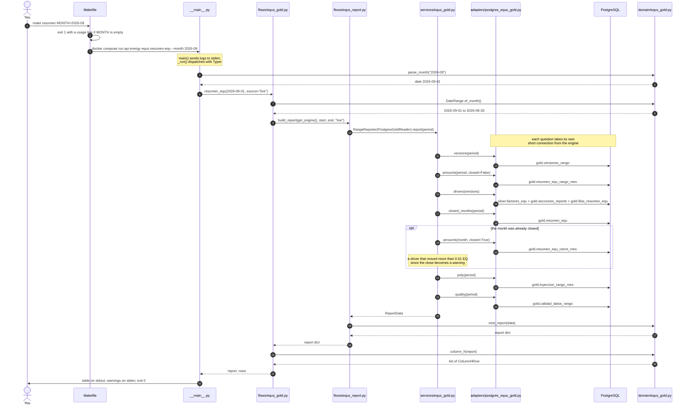
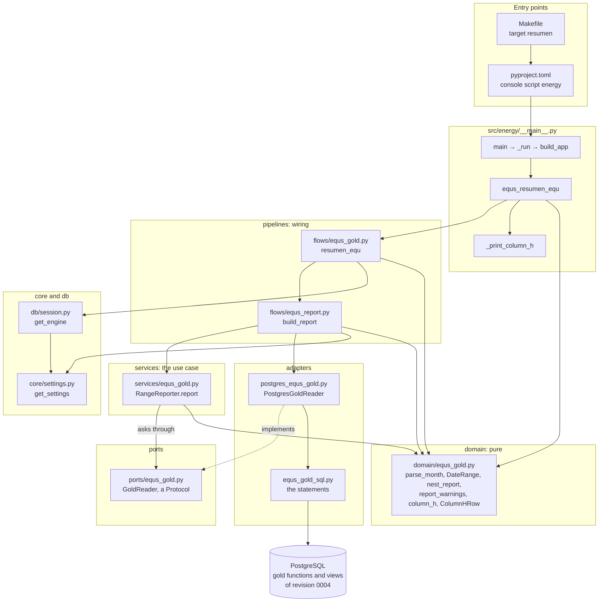
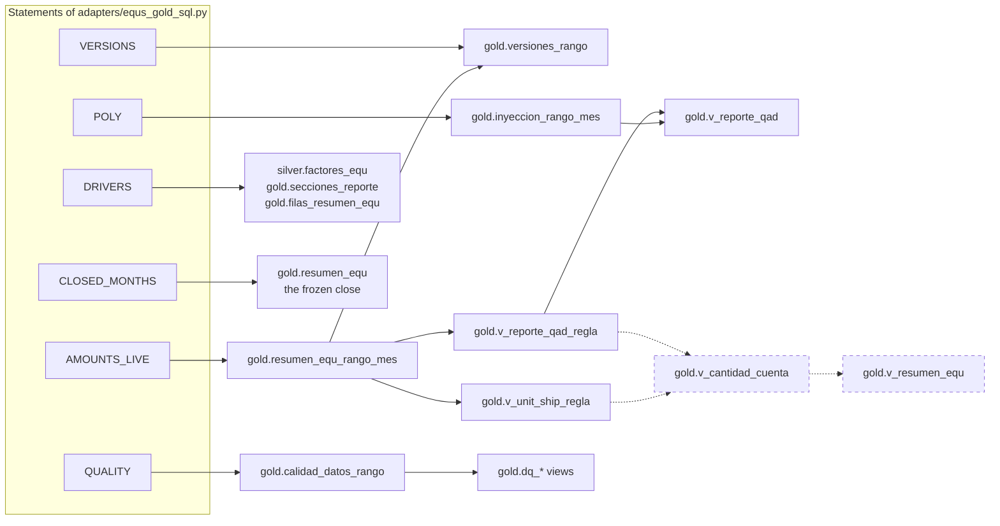

# What `make resumen` runs

`make resumen MONTH=2026-09` prints column H of RESUMEN EQU for one month, in
this order:

1. every driver, with its quantity (column D), factor (G) and EQ (H);
2. the totals of rows 36 to 45;
3. EQUS POLY.

It only reads. This page follows the call from the Makefile to the database and
back, file by file. It then shows how to get the same result from Python without
the command line.

What the numbers mean, step by step and without code, is in
[equs_calculation_explained.md](equs_calculation_explained.md).

---

## The chain at a glance



With `SOURCE=closed` the service asks neither `gold.versiones_rango` nor
`gold.resumen_equ_rango_mes`:

- it first checks, with `closed_months`, that the month is closed, and exits 1
  if it is not;
- it then reads the amounts, and the version each month was closed with, from
  `gold.resumen_equ_cierre_mes`, the frozen close.

EQUS POLY and the data-quality counts are always computed live.

## The files, by layer

The chain crosses every layer of the hexagon in the direction
[architecture.md](architecture.md) allows. The calculation itself is not in
Python: it is in the database functions of revision 0004. Python only asks
questions, arranges the answers and prints them.



### Step by step

| Step | File | Function | What it does |
|---|---|---|---|
| 1 | [Makefile](../Makefile) | `resumen` | Stops with exit 1 when `MONTH` is empty, then runs `$(ENERGY) equs resumen-equ --month $(MONTH)`, adding `--format` and `--source` when `FORMAT` and `SOURCE` are given. `ENERGY` is `docker compose run --rm --no-deps api energy` by default, or `uv run energy` with `RUNNER=host`. |
| 2 | [pyproject.toml](../pyproject.toml) | `[project.scripts]` | The `energy` executable calls `energy.__main__:main`. |
| 3 | [`__main__.py`](../src/energy/__main__.py) | `main`, `_run`, `build_app` | Sends logs to stderr (`configure_from_settings(stream=sys.stderr)`), so stdout carries only the result. Builds the Typer app, where `build_app` registers `resumen-equ`, and runs it. A usage error of the command line exits 1, not Click's 2. |
| 4 | `__main__.py` | `equs_resumen_equ` | Checks `--month` (`parse_month`), `--format` (table, json or csv) and `--source` (live or closed), then calls `resumen_equ`. An `EnergyError` becomes an exit code through `_stop`. |
| 5 | [`pipelines/flows/equs_gold.py`](../src/energy/pipelines/flows/equs_gold.py) | `resumen_equ` | Turns the month into its first and last day (`DateRange.of_month`) and takes the process-wide engine (`get_engine`). Calls `build_report`, then `column_h`. |
| 6 | [`pipelines/flows/equs_report.py`](../src/energy/pipelines/flows/equs_report.py) | `build_report` | Builds a `PostgresGoldReader` with `EQUS_VARIATION_THRESHOLD` and hands it to `RangeReporter`. Stamps `generado_en` in `EQUS_TIMEZONE`, then nests the result with `nest_report`. `equs-report` calls the same function. |
| 7 | [`services/equs_gold.py`](../src/energy/services/equs_gold.py) | `RangeReporter.report` | The use case. Checks that exactly one version of the equation covers each month: none raises `InvalidPeriodError`, two raise `ConfigurationError`. Then gathers amounts, drivers, differences from the close, EQUS POLY and the data-quality counts through the `GoldReader` port. |
| 8 | [`adapters/postgres_equs_gold.py`](../src/energy/adapters/postgres_equs_gold.py) | `PostgresGoldReader` | Implements `GoldReader`. Each method runs one statement on a short connection, turns the rows into domain dataclasses, and wraps any database error in `RepositoryError`. |
| 9 | [`adapters/equs_gold_sql.py`](../src/energy/adapters/equs_gold_sql.py) | `VERSIONS`, `AMOUNTS_LIVE`, `DRIVERS`, `CLOSED_MONTHS`, `POLY`, `QUALITY` | Fixed SQL text. The dates travel as the bound parameters `:desde` and `:hasta`. |
| 10 | [`migrations/versions/0004_create_gold_schema.py`](../migrations/versions/0004_create_gold_schema.py) | `gold.*` functions and views | The calculation: see the next diagram. |
| 11 | [`domain/equs_gold.py`](../src/energy/domain/equs_gold.py) | `nest_report`, `report_warnings` | Arranges the rows as RESUMEN EQU does: plants, then processes, then drivers in their row order. Adds the totals from unrounded values and rounds for JSON: quantities to 6 decimals, factors to 10, EQ to 6. Writes the warnings. |
| 12 | `domain/equs_gold.py` | `column_h` | Flattens the report into `ColumnHRow`s: the drivers by row, then the totals (EQUS BATT, each plant, and the processes of F&A), then the EQUS POLY categories and their total. |
| 13 | `__main__.py` | `_print_column_h` | Prints a table, JSON or CSV on stdout. In table mode the warnings go to stderr. |

### Inside the database

`make resumen` does **not** select from `gold.v_resumen_equ`. It reads the range
function `gold.resumen_equ_rango_mes`, which sums the **same two pairing views**
that `gold.v_cantidad_cuenta`, and through it `v_resumen_equ`, sum. That is how
any range of days can be answered, and why a month and a range covering it can
never disagree. For September 2026 both routes give 215,590.328597.



The dashed boxes are the monthly views of column H. `make resumen` does not read
them, but they sum the same pairings. How the pairing views are built from Silver
is the subject of
[equs_calculation_explained.md](equs_calculation_explained.md#the-whole-flow-in-one-picture).

---

## Options, output and exit codes

| Make variable | CLI option | Values |
|---|---|---|
| `MONTH` (required) | `--month` | `YYYY-MM` |
| `FORMAT` | `--format` | `table` (default), `json`, `csv` |
| `SOURCE` | `--source` | `live` (default): computed now. `closed`: the frozen close, which needs the month to be closed |
| `RUNNER` | | `compose` (default): inside the api container. `host`: `uv run energy` against `DATABASE_URL` |

Abridged output for September 2026:

```text
Column H of RESUMEN EQU, 2026-09 (live)

 row  cuenta STATS      process    plant            quantity (D)     factor (G)         EQ (H)
   2  OXPROD_KG         OREC       OREC                1,162,129   0.0121710526      14,144.33
   3  GRIDS_REG_POS     OREC       OREC                        0   0.0320747143           0.00
   …
  10  POS_ACT_MTL       FORMACION  F&A             648,763.76298   0.0430678466      27,940.86
   …
  16  UNITSHIP          SHIPPING   DESPACHOS             194,609          0.041       7,978.97
  18  LEADPROD                                         1,806,206

Totals
      EQUS BATT                                                                     215,590.33
      …

EQUS POLY (warehouse 1010)
  20  CONTPROD_CAR      CAJA SLI   Componentes            209,790              1     209,790.00
   …
      EQUS POLY                    Componentes          1,631,925                    503,033.19
```

- `FORMAT=json` prints `{mes, fuente, versiones, filas, calidad_datos,
  advertencias}`, where `filas` holds the rows above.
- `FORMAT=csv` prints one line per row with the columns
  `tipo, fila, nombre, proceso, planta, categoria, cantidad, factor, equs`.

| Exit code | Meaning |
|---|---|
| 0 | Printed |
| 1 | Invalid request, for example:<br/>• `MONTH` missing or not `YYYY-MM`<br/>• an unknown format or source<br/>• no version of the equation covers the month<br/>• two versions overlap<br/>• `SOURCE=closed` for a month that is not closed |
| 2 | The database failed or could not be reached |

`resumen-equ` takes no lock: it reads while a refresh or a close runs.

---

## Calling it from Python, without the command line

The command line is a thin shell. The same result is one function call away.
The examples below ran against a database built from the FY26 workbooks, and the
outputs shown are the real ones.

### Where to run it

- **Inside the api container**, where the database is reachable and
  `DATABASE_URL` is already set. Pipe a script into Python:

  ```bash
  docker compose run --rm --no-deps -T api python - < my_script.py
  ```

- **On your machine**, with `uv run python my_script.py`. The database must be
  reachable from the host: copy `docker-compose.override.yml.example` to
  `docker-compose.override.yml`, which publishes PostgreSQL on port 5432. Then
  set, for example,
  `DATABASE_URL=postgresql+psycopg://energy:<password>@127.0.0.1:5432/energy`.
  - Write `127.0.0.1`, not `localhost`: with `localhost` every connection tries
    IPv6 first and is slow.
  - The settings and the engine are created once per process. Set
    `DATABASE_URL` before the first call, or pass your own engine (example 2).
  - Logging is not configured unless you call
    `energy.core.logging.configure_from_settings()` first. Until then, the engine
    announces itself in one debug line.

### 1. The function the command calls

```python
from datetime import date

from energy.pipelines.flows.equs_gold import resumen_equ

report, rows = resumen_equ(date(2026, 9, 1))  # any day of the month
print(report["equs_batt"], report["equs_poly"]["equs"])
for row in rows[:3]:
    print(row.fila, row.nombre, row.cantidad, row.factor, row.equs)
```

```text
215590.328597 503033.19
2 OXPROD_KG 1162129 0.0121710526 14144.333224
3 GRIDS_REG_POS 0 0.0320747143 0
4 GRIDS_CAST 9761100 0.001805 17618.7855
```

- **`rows`** are the 36 `ColumnHRow`s the command prints. `row.as_dict()`
  returns one as JSON values.
- **`report`** is the full dictionary that `equs-report` writes as JSON. Besides
  the numbers, it holds:
  - `plantas`, the plants with their processes and drivers;
  - `informativos`, the drivers that do not add to EQUS BATT;
  - `calidad_datos`, the data-quality counts;
  - `advertencias`, the warnings.

  Its shape is [`equs_report.schema.json`](../src/energy/pipelines/flows/equs_report.schema.json).

### 2. Your own engine, the frozen close, and errors

```python
from datetime import date

from sqlalchemy import create_engine

from energy.domain.exceptions import EnergyError
from energy.pipelines.flows.equs_gold import resumen_equ

engine = create_engine("postgresql+psycopg://energy:<password>@127.0.0.1:5432/energy")

# The frozen close: raises InvalidPeriodError unless September 2026 was closed.
closed, closed_rows = resumen_equ(date(2026, 9, 1), source="closed", engine=engine)

try:
    resumen_equ(date(2024, 9, 1), engine=engine)
except EnergyError as error:
    print(type(error).__name__, error)
```

```text
InvalidPeriodError no version of the equation covers part of the range; the first version starts later, or a gap was left between versions (months=['2024-09'])
```

From Python you get exceptions instead of exit codes. All of them are
`EnergyError`s, from `energy.domain.exceptions`:

| Exception | When | The command's exit code |
|---|---|---|
| `InvalidPeriodError` | A bad month; a month no version covers; `source="closed"` for a month that is not closed | 1 |
| `ConfigurationError` | Two versions of the equation overlap in a month | 1 |
| `RepositoryError` | The database failed or could not be reached | 2 |

### 3. Any range of days

`resumen_equ` is a month. One level down, `build_report` takes any range, both
ends included, and an engine or an open connection:

```python
from energy.domain.equs_gold import column_h
from energy.pipelines.flows.equs_report import build_report

with engine.connect() as connection:  # the engine of example 2
    quarter = build_report(connection, "2025-10-01", "2025-12-31", by_month=True)

print(quarter["equs_batt"], quarter["rango"]["meses"])
quarter_rows = column_h(quarter)  # the same flattening resumen-equ prints
```

```text
621691.077951 ['2025-10', '2025-11', '2025-12']
```

### 4. As a DataFrame

```python
import pandas as pd

frame = pd.DataFrame([row.as_dict() for row in rows])  # the September rows of example 1
drivers = frame[frame["tipo"] == "cuenta"][["fila", "nombre", "cantidad", "factor", "equs"]]
```

```text
   fila         nombre   cantidad    factor          equs
0   2.0      OXPROD_KG  1162129.0  0.012171  14144.333224
1   3.0  GRIDS_REG_POS        0.0  0.032075      0.000000
2   4.0     GRIDS_CAST  9761100.0  0.001805  17618.785500
```

The values are floats rounded for JSON. For exact decimals, query the database
directly.

### Without Python at all

The same numbers in SQL:

```bash
docker compose exec db psql -U energy -d energy -c "
  SELECT cuenta_stats, cantidad, factor, equs
  FROM gold.v_resumen_equ WHERE mes = '2026-09-01' ORDER BY cuenta_stats"
```

To read exactly what `make resumen` reads, for any range:

```bash
docker compose exec db psql -U energy -d energy -c "
  SELECT * FROM gold.resumen_equ_rango_mes('2026-09-01', '2026-09-30')"
```
