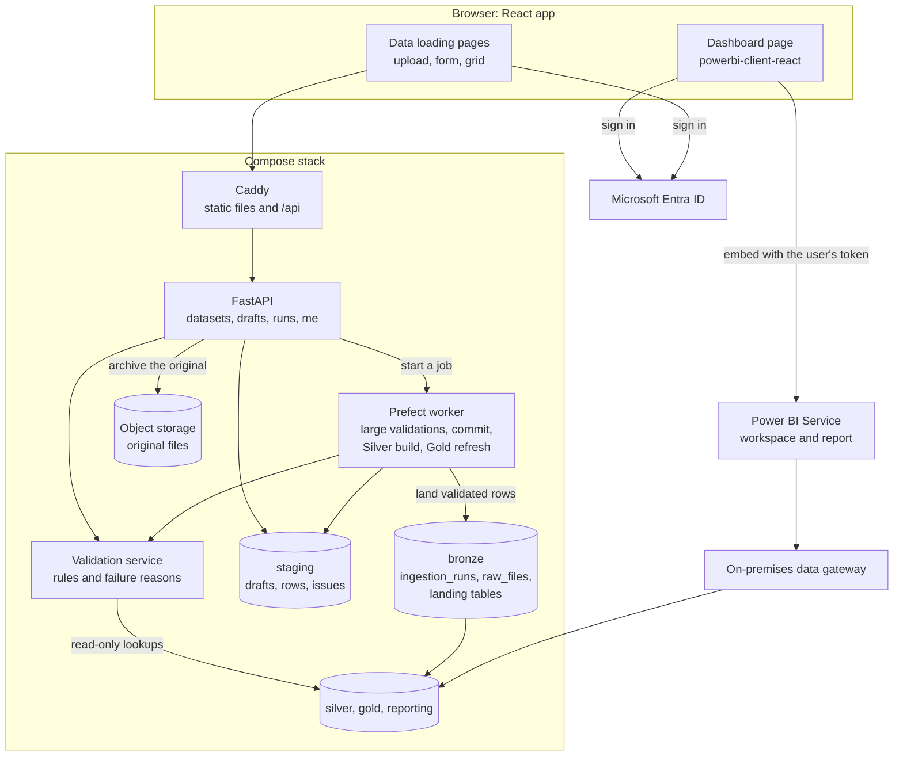

# Frontend plan

**Status:** written 2026-10-11 and built in the increments of section 8.
Increments 0 to 2 are done, all on 2026-10-12:

- **Increment 0, decisions.** The questions of section 9 are answered, and the
  decisions are recorded in
  [ADR 0004](adr/0004-react-spa-entra-and-embedded-power-bi.md) and
  [ADR 0005](adr/0005-api-composition-root.md).
- **Increment 1, the app skeleton.** Built, and green in CI.
- **Increment 2, sign-in and roles.** Built, and checked against the running
  stack up to Microsoft's sign-in page; signing in as each test user is the
  owner's check. Its decisions are in
  [ADR 0006](adr/0006-api-tokens-and-app-roles.md), and
  [docs/sign-in.md](sign-in.md) is the guide.

The work is on the branch `feature/front-end`; the ADRs reach `main` when it is
merged.

One decision was added on 2026-10-13, before any Phase 4 work:
[ADR 0007](adr/0007-figures-reach-people-through-power-bi.md). The API serves no
analytical figure, and its three KPI placeholders are removed when Phase 4
starts. Section 3 says what follows for this plan.

The app has two sections: a **dashboard** that embeds the Power BI report, and a
**data loading** section where users add data that lands in the Bronze layer.

---

## 1. Summary and recommended stack

Build a **React single-page app (TypeScript, Vite)** on top of the **FastAPI
backend that already exists** in this repository, and keep every rule in Python.
Validation, failure reasons and the Bronze write all live in the backend, so the
browser only renders what the API tells it. Users sign in with **Microsoft Entra
ID**; the same sign-in shows the Power BI report through Microsoft's own React
component (the "embed for your organization" model). User-entered data is checked
in a **staging area** first, then lands in Bronze through the **existing landing
port**, as one more `ingestion_runs` row with its load metadata. Plotly Dash stays
in the stack for the Phase 5 energy charts but stops being the app's front door.

## 2. Stack comparison and rationale

### What the repository has today

| Area | State | Where |
|---|---|---|
| Dash | A holding page only; layouts, callbacks and charts are Phase 5 placeholders | `src/energy/dashboards/` |
| API | FastAPI with health endpoints built. The upload and run endpoints are placeholders whose contract is already written (202 plus a run id, duplicate detection by file hash) | `src/energy/api/routers/uploads.py`, `runs.py` |
| Authentication | A placeholder: roles `viewer`, `operator`, `engineer`, `admin`, `device` are defined, nothing is enforced | `src/energy/api/security.py`, `api/deps.py` |
| Bronze loader | Built and tested: archives the file, registers it, opens a run, lands every sheet in one transaction | `src/energy/services/bronze_loader.py`, `ports/bronze_landing.py` |
| Power BI | Power BI Desktop reads schema `reporting` through an opt-in local port. Nothing is published to the Power BI Service | `docs/powerbi.md` |
| JavaScript toolchain | None: no `package.json`, and CI is Python only | `.github/workflows/ci.yml` |
| Proxy | Caddy serves `/` from Dash and `/api` from FastAPI, over plain HTTP | `Caddyfile` |

This table describes the repository on 2026-10-11, before increment 0. Since
then the report has been published to the Power BI Service, increment 1 added
the JavaScript toolchain and put the app at `/`, and increment 2 made the API
check who is calling.

### Comparison

| Criterion | Plotly Dash (keep) | Streamlit | **React SPA + FastAPI** | Next.js + FastAPI |
|---|---|---|---|---|
| Power BI embedding | An iframe works. Microsoft's embedding library (token refresh, events) has no official Dash component, so it needs hand-written JavaScript | An iframe or a community component. Its built-in login cannot request the Power BI scope, so a second login library is needed | Microsoft's official `powerbi-client-react` | Same as React |
| Excel-like grid | `dash-ag-grid` is official, but pasting ranges from Excel is an AG Grid Enterprise feature (paid). The older `DataTable` pastes but is legacy | `st.data_editor` pastes from Excel; little control over per-cell errors | Free choice of grid, with custom cell errors and editors | Same as React |
| File upload and server validation | `dcc.Upload` keeps the file base64-encoded in browser memory. Our largest workbook is 33 MB and files of up to 300 MB must be accepted, so it needs a community uploader or a custom route | Simple uploader; the whole script reruns on each interaction, and long validations block the session | Streams straight to the API with progress, and validation runs as a job | Same as React |
| Authentication and roles | Not in open-source Dash; add an OIDC library on its Flask server, or a proxy | Built-in OIDC login; roles by hand | MSAL in the browser, token checked by FastAPI, mapped to the roles already defined | Same, plus server-side sessions if wanted |
| Integration with our platform | In-process Python, but the layer rule forbids `dashboards` from importing adapters | Would be a new entry point beside `api` and `dashboards` | Uses the `api` layer as designed; the upload contract is already drafted there | Same as React |
| Large files | Weak (see upload) | Medium: files are held in session memory | Strong | Strong |
| Maintainability and team fit | Python only, already deployed | Python only, fastest to prototype | New language and toolchain (TypeScript, Node) for a three-person Python team | The same cost, plus a Node server to run |
| Hosting | Container already in the stack | New container | Static files served by Caddy; no new server | New Node container |

### Why React with FastAPI

The three hardest requirements are all browser work: a grid that behaves like
Excel, Power BI embedding with token refresh, and large uploads with progress.
In Dash or Streamlit each of them means writing JavaScript inside a Python
framework or accepting a weaker result. The cost of React is real: a second
language and a build step for a small Python team. The plan keeps that cost down
in three ways:

- **A thin frontend.** Dataset definitions, validation and messages come from
  the API (section 5). One generic form and one generic grid serve every dataset
  type, so adding a dataset needs no frontend code.
- **No Next.js.** The app sits behind Caddy and talks to FastAPI, so server-side
  rendering buys nothing. A static build needs no extra server.
- **Small, standard libraries** (below).

**What happens to Dash.** It keeps its container for the Phase 5 energy charts,
moved from `/` to `/dash/` (the setting `DASH_URL_BASE_PATHNAME` already exists).
Whether to keep it at all is decided when Phase 5 starts.

**If the team prefers to stay on Dash**, it is workable with these accepted
limits:

- buy AG Grid Enterprise for range paste, or accept one-cell paste;
- replace `dcc.Upload` with a streaming upload route;
- embed Power BI as a plain iframe, without token control;
- add an OIDC library for sign-in.

The backend plan in sections 5 to 7 is the same either way.

### Chosen components

| Need | Choice | Note |
|---|---|---|
| App | React, TypeScript, Vite | Static build served by Caddy |
| Routing | React Router | `/dashboard` and `/loads` |
| Data fetching | TanStack Query | Polling for jobs comes with it |
| UI kit | Mantine | Stepper, dropzone, forms and notifications in one library |
| Texts | i18next with `react-i18next` | Spanish, in `frontend/src/i18n/es.json` |
| Sign-in | `@azure/msal-browser` | Microsoft Entra ID. Used alone, behind an interface of the app's own ([ADR 0006](adr/0006-api-tokens-and-app-roles.md)); the plan first named `@azure/msal-react` |
| Power BI | `powerbi-client-react` | Microsoft's official component |
| Grid | Decided by a short spike in increment 6 | See below |
| Format and lint | Biome | One tool for both, as ruff is on the Python side |
| Tests | Vitest with Testing Library | Runs in `make frontend-check` and in CI |
| Packages and runtime | npm with a committed lockfile; Node 24 LTS | Pinned in `frontend/.nvmrc` |

**Grid options.** The grid must paste a block from Excel, show an error on a
cell, offer dropdowns and date and number formats, and scroll smoothly.

- **Glide Data Grid** and **RevoGrid** are MIT-licensed and support range
  selection and paste. One of them is the default, because it costs nothing.
- **Handsontable** is the most Excel-like, but is free only for non-commercial
  use. A commercial licence is needed if the app serves the plant's operation.
- **AG Grid Community** is ruled out: its clipboard is an Enterprise feature.

## 3. Architecture overview

### The parts

- **Frontend** (`frontend/`, new). It holds no business rule. It asks the API
  which dataset types exist and what their columns are, and draws the form and
  the grid from the answer.
- **API** (`src/energy/api/`). New routers: `datasets` (the specs), `drafts`
  (upload, edit, validate, commit), `me` (who is signed in and what they may
  do) and `config` (the settings the app needs before sign-in). The `uploads`
  and `runs` placeholders are implemented for history and status. The `kpis`
  placeholders are not: no page of this plan calls them, and Phase 4 removes
  them (see "One source for figures" below).
- **Validation layer.** Pure rules and reason detectors in `domain/`, a
  `ValidationService` in `services/`, and lookups against existing data through
  a new port. Details are in section 5.
- **Staging** (new schema `staging`, a new migration). It holds a load while the
  user is fixing it. It is a working area, not a medallion layer, and is purged
  after a retention period. Nothing reaches Bronze from here until the user
  confirms.
- **Bronze write path.** The existing port `BronzeLandingRepository.land()`
  takes rows from any source, so a confirmed draft lands exactly as a workbook
  does: one run, one transaction. Details are in section 6.
- **Jobs.** Small inputs (a form row, a pasted grid, a file of up to 5 MB) are
  validated inside the request. Larger files are validated by a Prefect flow in
  the worker, and the page polls for progress. The commit and the Silver and
  Gold refresh are also flows. The same service code runs in both cases. The
  5 MB line comes from the memory a workbook needs (see "Files up to 300 MB" in
  section 6).

### The API's composition root

The layer rule (`tests/unit/test_architecture.py`) forbids `api` from importing
`adapters`, yet `api/deps.py` describes itself as the place where adapters are
bound to ports. Checking a token and validating inside a request both need that
binding. [ADR 0005](adr/0005-api-composition-root.md) decides it: `api/deps.py`,
and no other module of `api`, may import adapters, as `pipelines/flows` already
does. The test changed with the first binding, in increment 2: the adapter that
checks sign-in tokens. The rejected alternative was to run every validation as
a Prefect job, which adds seconds of delay to each form submission.

### Power BI embedding

The report is published to a workspace in the Power BI Service, and the Service
reaches the `reporting` views through an on-premises data gateway on the machine
that hosts the stack (answered 2026-10-12). [docs/powerbi.md](powerbi.md)
records the gateway, its connection and what a refresh needs.

| | Embed for your organization | Embed for your customers |
|---|---|---|
| Who signs in to Power BI | Each user, with their Entra ID account | Nobody; the app uses a service principal |
| Licences | Each viewer needs Power BI Pro or Premium Per User, unless the workspace is on a capacity that lets free users view | Viewers need none; a paid capacity is required in production |
| Backend work | None: the browser gets the token | An endpoint that asks Power BI for a short-lived embed token |
| Who controls access | Power BI workspace permissions | The app |
| Tenant setting | App registration with delegated Power BI permission | An admin must allow service principals |

**Recommendation: embed for your organization.** The users are plant and finance
staff of one company, and the app already signs them in with Entra ID. It needs
no capacity purchase and no secret on the server, and access follows the
workspace permissions people already manage.

- **Token refresh.** MSAL acquires the Power BI token silently. Before it
  expires, the page calls `report.setAccessToken()` with a fresh one, so a report
  left open does not go blank.
- **When to switch models.** If viewers have no Power BI licence, the customers
  model applies instead. It adds a `GET /api/powerbi/embed-token` endpoint, a
  service principal whose secret stays on the server, and a capacity.
- **Data freshness.** The dataset uses Import mode, as today. It is refreshed on
  a schedule and after each load (increment 10).
- **Licences, and one risk.** In production the viewers have Power BI Pro.
  Development runs on a 60-day Microsoft Fabric free trial that started around
  2026-10-12, so it ends around **2026-12-11**. The report's workspace is an
  ordinary Pro workspace, not on the trial capacity, so what ends is each
  account's trial licence: after that, an account without a Pro licence can no
  longer open the report.
  [ADR 0004](adr/0004-react-spa-entra-and-embedded-power-bi.md) records the risk
  and what to do before that date.

### One source for figures

Every figure a person sees in the app comes from the embedded report: Gold,
then the views of schema `reporting`, then Power BI. The app draws no chart of
its own and asks the API for no figure.
[ADR 0007](adr/0007-figures-reach-people-through-power-bi.md) decides it
(2026-10-13).

- **The KPI endpoints go.** `/api/kpis`, `/api/kpis/summary` and
  `/api/kpis/{plant_code}/coverage` are placeholders of the Phase 1 scaffold.
  No page of this plan calls them. Serving the same figures there and in the
  report would give them two levels of freshness and two access models. Phase
  4 removes them and delivers the energy KPIs as `reporting` views instead.
- **What a load did is asked by run.** The one thing the report cannot show is
  the effect of a load before its next refresh. The wizard holds a run ID, so
  that feedback belongs to `/api/runs/{run_id}`.
- **A figure is as fresh as the last refresh.** On shared capacity, where the
  workspace is, Microsoft allows a model eight refreshes a day, counting the
  scheduled ones and those started through the REST API together. The refresh
  of increment 10 draws on the same eight.
- **A viewer needs two grants:** the app role, for the dashboard section to
  appear, and access to the Power BI workspace, for the report to open. They
  are given separately.
- **Still to design, in increment 3:** the "data as of" line of the dashboard
  page. No endpoint provides it today.

## 4. Pages and user flows

| Page | Who | What it does |
|---|---|---|
| Sign in | Everyone | Redirects to Entra ID |
| Dashboard | viewer and above | The embedded report, full width, with a "data as of" line and a link to open it in Power BI |
| Data loading: new load | operator and above | The wizard below |
| Data loading: history | operator and above | Every load: who, when, dataset type, input mode, file name, rows, state, warnings accepted. Opens the detail of a load |
| Load detail | operator and above | The confirmation summary, the issues found, a download of the original file. `engineer` can void the load |

### The loading wizard

1. **Choose the dataset type.** The choice fixes the expected columns and the
   rules. The page shows a short description, the template to download, and when
   this dataset was last loaded.
2. **Provide the data**, in one of three ways:
   - **Upload** one or more `.xlsx` files of up to 300 MB each, by drag and
     drop, with progress. A larger file is refused before it is sent.
   - **Form:** one row, with one field per column, typed and with dropdowns.
   - **Grid:** an editable table with the template's columns in the template's
     order. Rows can be typed or pasted from Excel.
3. **Validate.** The server checks the data and returns a summary (rows read,
   rows with errors, rows with warnings) and the list of issues.
4. **Fix.** The grid opens on the rows that have issues. Each bad cell is marked;
   selecting it shows the rule, the likely reasons and the suggested fix. The
   user edits cells and presses **Revalidate**. Nothing is uploaded again.
5. **Confirm.** A summary shows what will be written: rows accepted, rows
   rejected, warnings, and for a catalogue the difference from the current
   version (rows added, changed, removed). Warnings must be ticked to proceed.
6. **Done.** The page shows the load ID, the rows written, and a button to
   update the figures (Silver build and Gold refresh), with its progress.

Two rules shape the three input modes:

- **Large exports are upload-only.** The production receipts are 138,773 rows
  in a 33 MB file, and a file may be up to 300 MB, which is a full Excel sheet
  of that shape (a million rows). After validation the grid shows only the rows with
  issues, paged by the server, never the whole file. A file over 5 MB is
  validated as a job, so the wizard shows its progress and can be left and
  reopened.
- **Catalogues are saved whole.** See "Snapshots" in section 6. For a catalogue,
  the grid opens with the current version already filled in, and the form adds
  one row to it.

## 5. Validation design

### Dataset types

Each maps to an existing Bronze target; none needs a new table.

| Dataset type | Bronze target | Kind | Size in FY26 | Input modes |
|---|---|---|---|---|
| Production receipts | `qad_rct_wo`, sheet `Datos` | Movement, dated by *Fecha Efectiva* | 138,773 rows, 33 MB | Upload |
| Invoice lines | `qad_facturas`, sheet `Datos` | Movement | 14,458 rows | Upload |
| Product structures, formed | `qad_product_struc`, sheets `PASTA`, `PLACAS`, `BAT ENS`, `BAT FOR`, `BAT TERM` | Snapshot | 16,568 rows | Upload |
| Product structures, decorated | `qad_product_struc`, sheet `Datos` | Snapshot | 31,907 rows | Upload |
| Item master | `item_master` | Snapshot | Not delivered yet | Upload |
| Plastic classification | `manual_sheets`, `clasif_poly` | Snapshot | 1,753 rows | Upload, grid, form |
| Decoration elements | `manual_sheets`, `element_deco` | Snapshot | 1,751 rows | Upload, grid, form |
| Production lines | `manual_sheets`, `lineas_produccion` | Snapshot | 64 rows | Upload, grid, form |
| Lines by plant area | `manual_sheets`, `comparativo_lineas` | Snapshot | 50 rows | Upload, grid, form |
| Conversion cost (new) | `manual_sheets`, new key `costo_conversion` | Movement, by month | None yet: `silver.costo_conversion` is empty | Grid, form |

Notes on this list:

- **Conversion cost** is the one new dataset. It needs no Bronze change, but the
  Silver build must learn to read it (increment 12).
- **Left out on purpose:** sheet `INSTRUCC`, which holds notes (the rules of the
  equation are versioned in Silver and are never loaded from a file), and the
  optional sheet `L.PRODUCCION`.

### How rules are configured

One YAML file per dataset type, in `config/datasets/`, loaded and checked at
startup as `config/sources.yaml` is. It declares:

- the Bronze target (`source_key`, sheets or `dataset_key`, header row);
- the kind (snapshot or movement), the natural key and the date column;
- the input modes allowed;
- each column: header text exactly as in the template, type, required or not,
  format, allowed values (a list or a named lookup), range;
- the checks that apply, each with its severity and parameters.

The API serves the same file to the frontend (`GET /api/datasets`), so the form,
the grid columns and the downloadable template are generated from it. Changing a
rule is an edit to YAML and a test, with no frontend change.

### Rule catalog

| Group | Rule | Default severity |
|---|---|---|
| File | The file is at most 300 MB, and its content unpacks to no more than the limit of section 6 | Error |
| File | The sheet exists; it is not a calculated sheet (`REPORTE QAD` and `Unit_Ship` are already refused by `domain/landing.py`); the header row is where the spec says | Error |
| Schema | Required columns are present (compared ignoring case, spaces and accents) | Error |
| Schema | A column the spec does not know | Info |
| Schema | Type: whole number, decimal, date, text, boolean | Error |
| Schema | Format: a pattern for codes, a date order, a number of decimals | Error |
| Schema | Required value is empty | Error |
| Schema | Value is not in the allowed list or lookup | Error or warning, by column |
| Within the load | Two rows share the natural key | Warning |
| Existing data | Rows already landed with identical content (Bronze `content_hash`) | Info |
| Existing data | Same natural key already exists with different values: a correction, or a mistake | Warning |
| Existing data | Referential: the item, production line, warehouse or customer is unknown | Warning |
| Existing data | A quantity far outside the item's or line's history; a month total that moves more than `EQUS_VARIATION_THRESHOLD` | Warning |
| Dates | Outside the stated period, or in the future | Warning |
| Dates | The period overlaps, or leaves a gap after, earlier loads of the same source (`ingestion_runs.window_start` / `window_end`) | Warning |
| Dates | The rows fall in a month that is already closed (`gold.resumen_equ`) | Warning |
| Snapshot | The new version removes more than a set share of the current rows | Warning |
| Downstream | Rows that would trip a Gold data-quality check at the next close (no rule matches, no conversion, line without plant area) | Warning |

**Errors block the write. Warnings do not, but each must be acknowledged, and
the acknowledgement is stored with the load.** This "load with warnings" option
is needed, not optional. The QAD exports contain defects that Silver already
tolerates and reports, such as a header row pasted inside `PLACAS`, 741 junk
rows in the decorated structures, and lines without a plant area. Blocking on
them would stop every monthly load. The monthly close already works this way
(`close-month --accept-warnings`).

**The list of issues is capped; the counts are not.** A large file in which one
column is wrong on every row would otherwise produce a million issues. Each rule
stores its first 1,000 issues per column, and the summary always gives the exact
number of rows affected.

### How failure reasons are generated

Every issue carries the row, the column, the rule, the value found and a list of
**likely reasons with a fix**. Reasons come from small deterministic detectors,
each a pure function in `domain/` that looks at the raw cell text and its
neighbours. No model is involved, so the same input always gives the same
explanation and each detector has a unit test.

| What the detector sees | Reason shown | Suggested fix |
|---|---|---|
| A date column holding text like `10/12/2025` | The cell is text, not a date | Format the column as Date in Excel and re-enter, or fix it here |
| A date column holding a number like `45992` | The cell lost its date format | Format the cell as Date |
| A number written `1.234,56` or `12,5` | Decimal comma typed as text | Remove thousands separators and use a real number cell |
| An item code like `2.31E+08`, or ending in `.0` | Excel turned a code into a number | Format the column as Text before pasting |
| A value that differs from an allowed one only by case, spaces or accents | Probably meant the allowed value | Offer the closest allowed value |
| Leading or trailing spaces, or non-breaking spaces | Invisible characters from a copy and paste | Trim |
| A required header missing while a similar one exists | The header differs by an accent or a space | Rename the column, or map it |
| Text like `Descripción` | The file was saved in another encoding | Save as UTF-8, or upload the `.xlsx` |
| A row whose cells repeat the headers | A header row pasted inside the data | Delete the row |

### Keeping the validator honest

The validator must read a value exactly as the Silver build will. Otherwise a
row could pass in the app and arrive empty in Silver. Two measures:

- It works on the same payload text that Bronze stores, produced by the existing
  `row_payload` rules in `domain/landing.py`.
- A contract test runs the same rows through the validator and the Silver build
  and compares the typed results.

## 6. Bronze-layer write design

### What does not change

- **Storage format.** One row per source row in the existing landing tables,
  with the row as untyped JSON in `payload`. The original file goes to object
  storage under `{plant}/{source_key}/{YYYY}/{MM}/{DD}/{hash}.{ext}`.
- **Bronze does not parse or repair.** Validation happens before, in staging.
  The CLI loader (`make equs-load`) keeps working as today, without the gate.
- **Partitioning.** The landing tables are plain tables whose key already
  includes `ingested_at`, so they can become hypertables later. At about 200,000
  rows a year there is no reason to change that now.

### The write path

1. At upload, the original file is archived and registered in `bronze.raw_files`
   before anything else, so the evidence is kept even if the load is abandoned.
   It is streamed to object storage and never held in memory (see "Files up to
   300 MB" below).
2. Its rows are parsed once into `staging.draft_rows`, as payloads built by the
   existing rules. Edits made in the grid change the staged row and keep the
   original value beside it.
3. On confirm, the commit:
   1. when the rows did not come unchanged from a file, writes them as a
      workbook that mirrors the template and archives it. For a form or grid
      entry this is the only file; for an edited upload it sits beside the
      original. An unedited upload needs none: its rows point at the original;
   2. opens a run in `bronze.ingestion_runs`;
   3. lands the staged rows through `BronzeLandingRepository.land()`, which
      inserts the rows and completes the run in one transaction.

If the commit fails, no row is landed and the run is marked `failed`, exactly as
the loader behaves today.

### Load metadata

No new Bronze column is needed.

| Required | Stored in |
|---|---|
| Batch or load ID | `ingestion_runs.run_id`, carried by every row as `ingestion_run_id` |
| Uploaded by | `raw_files.uploaded_by` and `ingestion_runs.parameters.uploaded_by` |
| Timestamp | `raw_files.uploaded_at`, `ingestion_runs.started_at` / `finished_at`, and `ingested_at` on each row |
| Original file name | `raw_files.filename` |
| Dataset type | `ingestion_runs.source_key`, plus `sheet_name` or `dataset_key` on each row |
| Source: file, form or grid | New key `input_mode` in `ingestion_runs.parameters` (JSON, so no migration) |
| Validation result and accepted warnings | New key `validation` in `parameters`: counts, and who accepted which warnings |
| Link to the draft and to the original file | New keys `draft_id` and `original_content_hash` in `parameters` |

### Idempotency

- **A draft commits once.** The draft moves through fixed states (uploaded,
  validated, committing, committed), and its run ID is unique. A double click or
  a retried request returns the first result.
- **A file is known by its hash.** `raw_files.content_hash` is unique, and the
  loader already skips sheets a completed run has landed from the same file.
- **Rows are known by their hash.** Validation reports rows that are already in
  Bronze before anything is written.
- **One commit per dataset at a time**, by an advisory lock, as refresh and
  close already do.

### Snapshots and movements

This distinction already exists in the Silver build and decides what a small
entry means.

- **Movements** (receipts, invoices, costs) add up. Silver keeps the newest copy
  of each natural key, so one corrected row replaces the old one.
- **Snapshots** (structures, catalogues) are replaced whole: Silver reads only
  the latest completed load of each sheet. A load of one row would become the
  entire catalogue. So for a snapshot, the form and the grid always submit the
  full table, and the confirmation shows the difference from the current
  version.

### Rollback

Bronze rows are never updated or deleted by the app: they are the evidence.

- **Voiding a load** sets its run to `cancelled`, a state `ingestion_runs`
  already allows, and records who voided it and why.
- **Snapshots** then revert by themselves: the next Silver build uses the
  previous completed load.
- **Movements** need one new Silver rule: remove the rows whose
  `source_run_id` belongs to a cancelled run, then rebuild from the remaining
  loads. This is increment 11.
- **Closed months** never change: `gold.resumen_equ` is frozen. Voiding a load
  that fed a closed month shows up as a difference between the live figures and
  the close, which the reports already flag.

### After the write

Landing rows changes nothing in the dashboard until Silver is rebuilt and Gold
refreshed. The "update the figures" button runs the existing
`refresh_gold(with_silver=True)` as a job, under the existing lock, and then
asks Power BI to refresh the dataset.

### Files up to 300 MB

A file may be up to 300 MB (answered 2026-10-12). The figures below were
measured that day on a development PC, reading the largest workbook we have the
way the loader reads it, with `python-calamine`.

| | Receipts workbook, measured | 300 MB, estimated |
|---|---|---|
| File | 33.1 MB: 138,773 rows of 49 columns | A full Excel sheet of that shape: about a million rows |
| Content once unpacked | 274 MB | About 2.5 GB |
| Peak memory to read it | 540 MB | About 4.8 GB |
| Time to read it | 6.5 seconds | About 1 minute |

The estimates scale the measurement in a straight line. Increment 12 replaces
them with a measurement on a generated 300 MB workbook.

What follows from them:

| Place | Design |
|---|---|
| Limit | 300 MB per file, checked three times: by the browser before sending; by Caddy (`request_body max_size`, 310 MB on the upload route to leave room for the form envelope, 10 MB on every other route); and by the API, which counts the bytes as they arrive and answers 413. Only the API's check cannot be bypassed |
| Upload | One streamed request. The API never holds the file: it hands it to object storage in 16 MB parts and computes the SHA-256 on the way. If uploads prove fragile on the plant network, the fallback is an upload in resumable pieces; it is not built unless needed |
| Object storage | The object is written under a temporary key, then copied to its final key, which contains the hash, once the hash is known. It is read back as a stream to a file, with the hash verified on the way |
| Code that changes | `ObjectStorage.put()` and `get()`, `LoadRequest.data` and `WorkbookReader.open_workbook()` all pass the whole file as `bytes` today. Each gains a streaming variant; the existing ones stay for the command line |
| Validation memory | A workbook needs about 16 MB of memory for each MB of file. The API validates files of up to 5 MB itself (about 80 MB of memory). The worker validates larger ones, one at a time, with a 6 GB limit on its container. Staged rows are written in batches, never held whole |
| Content size | A file whose content unpacks to more than 4 GB is refused before it is read. The size is read from the archive's own directory |
| Reader | It stays `python-calamine`. The way a cell becomes text decides every `content_hash` (`domain/landing.py`), so a lighter, streaming reader is not a drop-in replacement |
| Timeouts | Caddy allows 30 minutes to receive a request body. A validation job may run 30 minutes, and one that reports no progress for 5 minutes is marked failed. The commit lands in one transaction, as today; its duration is measured in increment 12 |
| Targets | 1 minute to validate today's 33 MB file and 10 minutes for a 300 MB file. Both are assumed until increment 12 measures them |
| Sizing | The server needs about 16 GB of memory. Docker on the development PC has 8.3 GB, too little to validate a 300 MB file beside the database. An edited upload stores a generated file of similar size beside the original, written row by row. At the limit, two 300 MB exports a month, each edited once, add 1.2 GB of storage a month |

## 7. Security and access control

- **Sign-in.** Microsoft Entra ID, in the project's dedicated tenant (single
  tenant), through the app registration "Clarios dash". Built in increment 2;
  [docs/sign-in.md](sign-in.md) is the guide.
  - The browser signs the user in with MSAL (authorization code flow with PKCE,
    no secret) and obtains an **access token** for the scope the registration
    exposes, `access_as_user`.
  - The API checks that token on every request: its signature, validity
    period, issuer, tenant, audience and scope. It then builds the `Principal`
    of `api/security.py`.
  - The app reads the tenant, the client ID and the scope from the API
    (`GET /api/config`), which reads them from `.env`. They are in neither the
    repository nor the app's build.
- **Redirect URIs.** The app registration has three, on two platforms:

  | URI | Platform | Used by |
  |---|---|---|
  | `http://localhost:8080/redirect.html` | Single-page application | The app, after sign-in. MSAL Browser v5 needs a dedicated redirect page for every flow; with Vite it is `redirect.html` beside `index.html` |
  | `http://localhost:8080/signed-out` | Single-page application | The app, after sign-out. An ordinary app page with a sign-in button |
  | `http://localhost:8080/auth/callback` | Web | Nothing today. It belongs to a server-side flow with the client secret. Caddy answers `/auth/*` itself, so the app never receives it |

  - Entra ID ignores the port of a `localhost` URI, so the first two also
    cover the Vite development server on port 5173. Never register two
    `localhost` URIs that differ only by port; tell them apart by path.
  - The redirect page must not be served with a
    `Cross-Origin-Opener-Policy` header.
  - The deployed server adds `https://<host name>/redirect.html` and
    `https://<host name>/signed-out`.
  - `ENTRA_CLIENT_SECRET` stays in `.env`. The app holds no secret, and no
    container receives this one until something needs it.
- **Roles.** Entra app roles map onto the roles already in the code:

  | Role | May |
  |---|---|
  | `viewer` | See the dashboard |
  | `operator` | Load data, accept warnings, see the history |
  | `engineer` | Void a load, start the update of the figures |
  | `admin` | Manage dataset specs and access |

  - A user with no role is signed in and may do nothing: the app shows a
    no-access page. Nothing is granted by default.
  - An endpoint asks for a **permission**, and one table in `api/security.py`
    says which roles grant it. Two exist so far: `dashboard:view` (every role)
    and `loads:write` (`operator` and above). Each later increment adds the
    permissions of its own endpoints.
  - `dashboard:view` makes the app show the dashboard section. It does not
    decide who sees a figure: Power BI does, by access to the workspace
    ([ADR 0007](adr/0007-figures-reach-people-through-power-bi.md)).
  - The API enforces the permission on each route. The app receives the
    user's permissions from `GET /api/me` and only hides what they cannot do;
    it holds no rule about roles.
  - A route is protected unless it is listed as public, and a test fails for a
    route that answers a caller without a token.
- **Plant scope.** `Principal.plant_scope` already exists. Today there is one
  plant (`1515`); the check is written once so more plants need no redesign.
- **Uploads.**
  - A size limit of 300 MB per file, enforced by the browser, by Caddy and by
    the API, and a limit on what a file may unpack to (section 6, "Files up to
    300 MB").
  - The real format is read from the file's first bytes, not from its name.
  - Workbooks are read as values only: no formula or macro is executed.
  - Staging is purged after a set time.
- **Power BI.** With the recommended model the server holds no Power BI secret,
  and the report shows only what the user's own account may see. The `powerbi`
  database login of `docs/powerbi.md` stays for Power BI Desktop and the gateway;
  the app never uses it.
- **Transport.** Caddy serves plain HTTP today. Entra ID sign-in and embedding
  need HTTPS outside `localhost`. The app will run as the same stack on an
  internal server with a host name and HTTPS (answered 2026-10-12); Caddy
  provides the certificate.
- **Audit.** Every load is a row in `ingestion_runs` with who, when, what and
  which warnings were accepted. Staged edits keep the original value. Voids are
  recorded on the run.

## 8. Build roadmap

Each increment is small enough to review and has one test of "done".

| # | Increment | Done when |
|---|---|---|
| 0 | **Decisions and prerequisites.** Answer the blocking questions of section 9; write the ADRs (stack, API composition root); register the Entra app; publish the report to a workspace. **Closed 2026-10-12:** the app registration issues a token with its client credentials, a test user signed in and reached `/auth/callback`, and the report is published. The Power BI REST API confirmed the workspace, the report, its binding to the gateway and a completed refresh that day ([docs/powerbi.md](powerbi.md)). The ADRs are committed on `feature/front-end` and reach `main` with that branch | Both ADRs are merged, a test user can sign in to the Entra app, and the report opens in the Power BI Service |
| 1 | **App skeleton.** `frontend/` with Vite, React and TypeScript; Caddy serves it at `/`; Dash moves to `/dash/`; a CI job lints, type-checks, tests and builds it. **Done 2026-10-12:** verified against the running stack, and green in CI | `make up` shows the shell with two empty sections at `:8080`, and CI is green |
| 2 | **Sign-in and roles.** MSAL in the app; token check and role mapping in the API; `GET /api/me`. Also `GET /api/config`, the permission table, and the rule that a route is protected unless listed as public ([ADR 0006](adr/0006-api-tokens-and-app-roles.md)). **Built 2026-10-12** and checked against the running stack: every guarded route answers 401 without a token and to forged ones, and a signed-out browser is sent to Microsoft with the registered redirect page and the API's scope. That a viewer is kept out of data loading and an operator let in is proved by tests of the API and of the app, with stand-ins for Entra ID; the same check by the two test users in a browser is the owner's | Without a token the API answers 401; a `viewer` cannot open data loading and an `operator` can |
| 3 | **Dashboard page.** The embedded report with token refresh | A signed-in user sees the report; it still works after the first token expires; a user without workspace access gets a clear message |
| 4 | **Dataset specs.** YAML for two pilots, one catalogue (`lineas_produccion`) and one export (`qad_facturas`); `GET /api/datasets`; template download | Specs load at startup and fail loudly when malformed; the downloaded template has exactly the headers of the spec |
| 5 | **Staging, upload and schema checks.** Migration for `staging`; a streaming upload endpoint with the 300 MB limit enforced by the browser, Caddy and the API; streaming variants of the storage and reader ports; file and schema rules; the issues list. A file over 5 MB is archived but answers "not built yet" to validation until increment 12 | A deliberately broken file shows every failure with row, column and rule; the original is archived; Bronze is unchanged; a 300 MB file uploads through Caddy with progress while the API's memory stays flat, and a larger one is refused with a clear message |
| 6 | **Reasons, grid and revalidation.** Reason detectors; the grid spike and choice; cell editing | Each defect of the table in section 5 yields its reason and fix; fixing a cell and revalidating clears it without a new upload |
| 7 | **Commit and history.** The write path of section 6; the confirmation summary; the history and detail pages | A validated draft lands with all the metadata of section 6; a double submit creates one run; the row counts match |
| 8 | **Checks against existing data.** Duplicates, key conflicts, references, ranges, periods, closed months; acknowledging warnings | Each rule has a test on the synthetic data of `tests/integration/test_equs_gold_rules.py`; a load with warnings cannot be written until they are accepted, and the acceptance is stored |
| 9 | **Form and grid entry.** The single-row form; pasting into the grid; whole-snapshot saves with the difference shown | 500 rows pasted from Excel arrive intact; a row added to a catalogue produces a complete new version that the Silver build reads |
| 10 | **Update the figures.** The job for Silver and Gold with its progress; the Power BI dataset refresh | After a load, the dashboard shows the new data with no command line |
| 11 | **Rollback.** Voiding a load; the Silver rule for movements | A voided load no longer affects Silver or the live Gold figures after a refresh; its Bronze rows remain; closed months are unchanged |
| 12 | **Remaining datasets and large files.** Specs for every type of section 5; validation as a job in the worker, with progress and a memory limit (the worker runs the stock Prefect image today and must run this project's); CSV if still wanted | Every dataset type has a spec and tests; the 33 MB receipts file validates within 1 minute and a generated 300 MB workbook within 10 minutes, inside the worker's memory limit and with progress shown; the measured figures replace the estimates of section 6 |
| 13 | **Hardening.** End-to-end tests in a browser; accessibility; the runbook and user guide | The end-to-end suite passes against `make up`, and the guide covers each flow |

## 9. Decisions on the open questions

Every question was answered on 2026-10-12. Questions 5 to 15 and 17 were
confirmed as the plan had assumed them; question 16 changed, from 100 MB to
300 MB. The decisions that shape the architecture are also in
[ADR 0004](adr/0004-react-spa-entra-and-embedded-power-bi.md) and
[ADR 0005](adr/0005-api-composition-root.md). Three more were taken with
increment 2 and are in [ADR 0006](adr/0006-api-tokens-and-app-roles.md): the
app uses `@azure/msal-browser` alone, a user without a role gets a no-access
page, and the owner makes every change to the app registration.

| # | Question | Decision | Affects |
|---|---|---|---|
| 1 | How do users sign in? Do they have Microsoft Entra ID accounts in one tenant, and can we register an app there? | Microsoft Entra ID, in a tenant dedicated to the project (single tenant). Test users exist in it. The app registration "Clarios dash" is done and verified (section 8, increment 0) | 0, 2 |
| 2 | Do the viewers have Power BI Pro licences, or is there a capacity? | In production the viewers will have Pro, so "embed for your organization" applies. Development runs on a 60-day Microsoft Fabric free trial started around 2026-10-12; its end, around 2026-12-11, is a project risk (ADR 0004) | 3, 10 |
| 3 | Can the report be published to the Power BI Service, with a gateway to the database? | Yes. The report is published, with a gateway to the database that runs on the machine hosting the stack | 0, 3, 10 |
| 4 | Where will the app be hosted? Today it is docker compose on one PC over HTTP | The same stack on an internal server with a host name and HTTPS | 1, 2 |
| 5 | Which dataset types are in scope, and which may be typed by hand? | The table in section 5: exports are upload-only, catalogues allow form and grid | 4, 9, 12 |
| 6 | Should exports loaded through the app pass the validation gate? The CLI loads them ungated today | Yes: errors block, known tolerated defects are warnings; the CLI is unchanged | 5, 8 |
| 7 | Is saving a catalogue as a whole new version acceptable? | Yes, because Silver already reads snapshots that way | 9 |
| 8 | Is there a budget for a grid licence? Does the app serve commercial operation? | No budget, so an MIT-licensed grid | 6 |
| 9 | Which language is the interface in? The repository rule is English only | Spanish labels and messages from translation files; code and docs in English | 1, 6 |
| 10 | May `api/deps.py` import adapters, as an exception to the layer rule? | Yes, by ADR 0005; the alternative was to run every validation as a job | 0, 2, 5 |
| 11 | Are energy readings in scope? `ingestion_runs.source_key` accepts only the five EQUS keys | No, EQUS data only for now | 4 |
| 12 | Who may void a load, and how far back? | `engineer`, any load, with a reason | 11 |
| 13 | Are the current workbooks the templates users expect, header for header? | Yes: the sheet headers are the payload keys Silver already reads | 4 |
| 14 | Is CSV needed? CSV carries no cell types, so dates and numbers arrive as text and need the spec to interpret them | Not in the first release; `.xlsx` only until increment 12 | 12 |
| 15 | Which object storage holds the originals? MinIO's public image stopped being downloadable this month | MinIO stays for now; the image source is fixed separately | 0 |
| 16 | How large may a file be, and how often is data loaded? | **300 MB at most** (the plan had assumed 100 MB); monthly, around the close. Section 6, "Files up to 300 MB", gives what follows from it | 5, 12 |
| 17 | How long are abandoned drafts kept? | 30 days | 5 |

Two figures in this plan are still assumptions, both to be settled by
measurement in increment 12: the time allowed to validate a file, and the
memory the worker needs for a 300 MB one.

One decision came after these answers, on 2026-10-13, and is not one of the
seventeen questions: the app shows figures through the embedded report only,
and the API's KPI endpoints are removed in Phase 4
([ADR 0007](adr/0007-figures-reach-people-through-power-bi.md); "One source for
figures" in section 3). It leaves one question for Phase 4 to ask the plant:
how fresh must energy figures be? If the answer is "within minutes", that
decision is reopened before anything is built.

## References

- AG Grid, clipboard (Enterprise): <https://www.ag-grid.com/react-data-grid/clipboard/>
- Handsontable licence key and non-commercial licence: <https://handsontable.com/docs/tutorial-license-key.html>
- Power BI embedded analytics: <https://learn.microsoft.com/azure/power-bi-embedded/>
- MSAL Browser v5, the redirect bridge page: <https://learn.microsoft.com/en-us/entra/msal/javascript/browser/redirect-bridge>
- Entra ID redirect URI restrictions (the `localhost` port rule): <https://learn.microsoft.com/en-us/entra/identity-platform/reply-url>
- Microsoft Fabric trial: <https://learn.microsoft.com/en-us/fabric/fundamentals/fabric-trial>
- Dash `dcc.Upload` and large files: <https://community.plotly.com/t/dash-upload-component-decoding-large-files/8033>
- Streamlit authentication: <https://docs.streamlit.io/develop/concepts/connections/authentication>
- Entra ID access tokens and how an API validates them: <https://learn.microsoft.com/en-us/entra/identity-platform/access-tokens>
- Entra ID app roles: <https://learn.microsoft.com/en-us/entra/identity-platform/howto-add-app-roles-in-apps>
- In this repository: `docs/sign-in.md`, `docs/powerbi.md`,
  `docs/data_dictionary.md` (Bronze),
  `docs/architecture.md` (layer rule), `docs/EQUS_CONTEXT.md` (the columns of
  each workbook).
