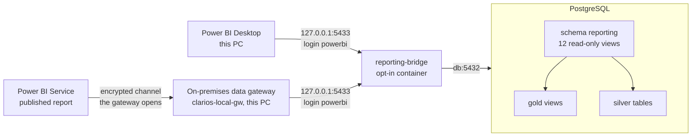
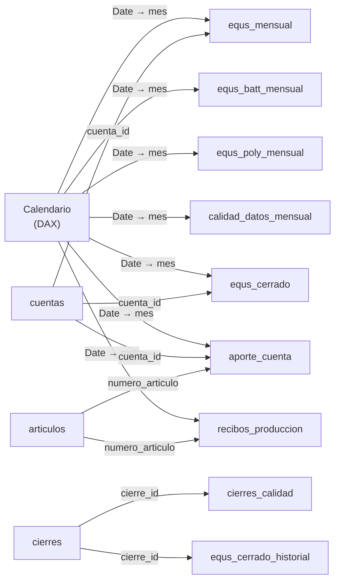

# Connecting Power BI to the database

Power BI reads the equivalent batteries straight from PostgreSQL, in two ways:

- **Power BI Desktop**, on the machine that runs the stack, connects directly.
- **The Power BI Service**, where the report is published, connects through an
  on-premises data gateway installed on that same machine.

Both use one login of their own, `powerbi`, which can read the views of schema
`reporting` and nothing else.



The stack normally publishes no database port: only Caddy, for the web pages, is
reachable. The **bridge** is a small container that relays one port to the
database. It is opt-in: `make powerbi` starts it and `make powerbi-down` removes
it. What arrives through it is decided by the database: the `powerbi` login can
read the `reporting` views, its sessions are read-only, and Bronze, Silver and
Gold refuse it. Desktop and the gateway both reach the database through this
bridge, so neither works while it is down.

---

## One-time setup

1. **Choose a password** for the Power BI login and put it in `.env`:

   ```bash
   REPORTING_DB_USER=powerbi
   REPORTING_DB_PASSWORD=<a password of your choice>
   REPORTING_BIND_ADDRESS=127.0.0.1
   REPORTING_PORT=5433
   ```

   Only the password is required; the other three are the defaults.
   [`.env.example`](../.env.example) explains each one.

2. **Bring the stack and the database up to date:**

   ```bash
   make up            # rebuilds the api image, which carries the command below
   make db-upgrade    # creates the reporting schema (revision 0006)
   ```

   A database migrated **before EQUS Gold existed** is already at revision
   `0005`, so `make db-upgrade` would try to add the reporting views on top of a
   Gold that has none and fail. Go down to Silver first; this keeps Bronze and
   Silver:

   ```bash
   make db-downgrade
   make db-downgrade
   make db-upgrade
   ```

3. **Create the login and open the port:**

   ```bash
   make powerbi
   ```

   It prints what to type into Power BI:

   ```text
   Created the reporting login 'powerbi': it reads the 12 views of schema reporting, and nothing else.

   Connect Power BI Desktop with Get data > PostgreSQL database:
     Server     127.0.0.1:5433
     Database   energy
     Mode       Import
     User       powerbi   (Database credentials)
     Password   REPORTING_DB_PASSWORD from .env
   ```

   `make powerbi` can be run again at any time: it renews the password from
   `.env` and leaves everything else as it was.

## Connecting from Power BI Desktop

1. **Home → Get data → More… → Database → PostgreSQL database → Connect.**
   Power BI Desktop ships the PostgreSQL driver; nothing else needs installing.
2. **Server:** `127.0.0.1:5433`. **Database:** `energy`.
   **Data Connectivity mode:** **Import**. Leave the advanced options empty.
   Type the server exactly so, not `localhost:5433`: once the report is
   published, the Power BI Service finds the gateway's connection by these two
   names (see [the published report](#the-published-report-power-bi-service-and-the-gateway)).
3. **Credentials:** choose the **Database** tab (not *Windows*), user `powerbi`
   and the password from `.env`. Apply them to `127.0.0.1:5433`.
4. Power BI may say it **could not connect with an encrypted connection** and
   offer an unencrypted one. Accept it. The database speaks no TLS, and the
   bridge listens only on this PC, so the data never leaves the machine.
5. **Navigator:** expand `energy` and pick the views under **`reporting`**: they
   are the only data the login may read. Select the views you need (see the
   table below) and choose **Load**.

   The Navigator also lists TimescaleDB's own catalogs (`_timescaledb_catalog`,
   `timescaledb_information` and similar). The extension makes them readable by
   every role, and they describe the database's storage, not the plant: ignore
   them. Bronze, Silver and Gold do not appear at all.

### What to load

Load the ones your report needs; `cuentas` is worth loading whenever a fact
table is.

| View | One row per | Use it for |
|---|---|---|
| `equs_mensual` | month × driver (cuenta STATS), every driver of the version in force, 0 included | Column H of RESUMEN EQU: quantity, factor, EQ by driver, process and plant |
| `equs_batt_mensual` | month | EQUS BATT and the EQ of each process, as rows 36–45 |
| `equs_poly_mensual` | month × plastic category | EQUS POLY: pieces, pieces with EQ, factor, EQ |
| `calidad_datos_mensual` | month × data-quality check, 0 included | How many rows each check finds; `bloqueante` marks the checks that stop a close |
| `cierres` | close or reclose | Who closed which month, when, and whether warnings were accepted; `vigente` marks the close in force |
| `cierres_calidad` | close × check | The data-quality counts each close saw |
| `equs_cerrado` | closed month × driver | The official, frozen numbers |
| `equs_cerrado_historial` | row a reclose replaced | What a reclose changed |
| `recibos_produccion` | production receipt (about 139,000 per fiscal year) | Drill-down: quantity, paste, decoration pieces, plant area, plastic category |
| `aporte_cuenta` | receipt or invoice line × driver it fed | Drill-down from a driver to the rows behind it; it adds up exactly to `equs_mensual` |
| `cuentas` | version × driver | Dimension: description, process, plant, row of RESUMEN EQU, unit, the three terms of the factor |
| `articulos` | item | Dimension: description, product line, Campo Equs |

Every month-based view carries `mes` (the first day of the month) and
`anio_fiscal` (`FY26` is October 2025 to September 2026). Column by column, the
views are in [data_dictionary.md](data_dictionary.md#reporting--read-only-views-for-bi-tools).

## A model that works

Power BI relates tables on one column, so every view keyed by a driver carries
`cuenta_id` (`version:cuenta_stats`, for example `1:OXPROD_KG`).



Every arrow is one-to-many, with single-direction filtering, from the table at
its tail. Leave `recibos_produccion` and `aporte_cuenta` unrelated to each other:
both already reach `articulos` and the calendar, and a third path would make
Power BI deactivate one. To go from a receipt to its drivers, use
`numero_de_transaccion` in a drill-through instead.

**A calendar with the fiscal year.** *Modeling → New table*:

```DAX
Calendario =
ADDCOLUMNS (
    CALENDARAUTO ( 9 ),
    "Mes", DATE ( YEAR ( [Date] ), MONTH ( [Date] ), 1 ),
    "Año fiscal", "FY" & FORMAT ( MOD ( YEAR ( EDATE ( [Date], 3 ) ), 100 ), "00" )
)
```

`CALENDARAUTO ( 9 )` makes whole fiscal years that end in September. Mark it as
a date table, and relate `Calendario[Date]` to the `mes` column of each view
(`mes` is always the first day of a month).

**Starter measures.** *Modeling → New measure*:

```DAX
EQUS BATT =
CALCULATE ( SUM ( equs_mensual[equs] ), equs_mensual[suma_eq] = TRUE () )

EQUS POLY = SUM ( equs_poly_mensual[equs] )

EQUS BATT closed =
CALCULATE ( SUM ( equs_cerrado[equs] ), equs_cerrado[suma_eq] = TRUE () )

Live minus closed = [EQUS BATT] - [EQUS BATT closed]

Blocking data-quality rows =
CALCULATE ( SUM ( calidad_datos_mensual[filas] ), calidad_datos_mensual[bloqueante] = TRUE () )
```

- `[EQUS BATT]` by `cuentas[proceso]` or `cuentas[planta]` gives the EQ of each
  process or plant.
- **Do not add `cantidad` across drivers:** each driver counts in its own unit
  (kg of oxide, plates, batteries, decoration pieces).
- The four informative drivers (`suma_eq` false) have factor 0. They are
  reported, never added, and the measure above leaves them out.

## The published report: Power BI Service and the gateway

The report is published to a workspace in the Power BI Service. The Service
cannot reach this machine's database by itself, so an **on-premises data
gateway** runs here and fetches the data for it.

The setup was checked on 2026-10-12. The last column says how each fact is
known:

- **API**: read that day from the Power BI REST API.
- **Owner**: recorded from the description of the person who set it up, because
  the API does not return it.

| Item | Value | How we know |
|---|---|---|
| Workspace | `Clarios Energy`, not on a dedicated capacity | API |
| Report and semantic model | Both named `test`. The report is built on the model, which is in Import mode | API |
| Gateway | `clarios-local-gw`, version 3000.334.9, status `Live` when checked | API |
| Gateway mode | On-premises data gateway, standard mode | Owner. The API reports its type as `Resource` and a shareable connection on it, which agrees |
| Installed on | The machine that runs the stack | API: the machine name it reports is this machine's |
| Administered by | The gateway admin account in the tenant | API: that account's session lists the gateway |
| Connection | `clarios-reporting`, type PostgreSQL | API |
| Server and database | `127.0.0.1:5433` and `energy` | API |
| Authentication | Basic | API |
| Credentials | User `powerbi`, password `REPORTING_DB_PASSWORD` from `.env` | Owner. The API never returns credentials |
| Privacy level | Organizational | API |
| Encrypted connection | Not encrypted | Owner. The API does not return this setting; see below |
| Semantic model | Bound to `clarios-local-gw` through `clarios-reporting` | API |
| Latest refresh | On demand, completed on 2026-10-12 at 15:59 UTC, in 12 seconds | API |
| Scheduled refresh | Disabled | API |
| The report opens in the Service | Yes | Owner. The API confirms that the report exists, not that it renders |
| A refresh needs the bridge | `127.0.0.1:5433` is the port that `make powerbi` opens | Owner. `docker-compose.yml` publishes that port from `reporting-bridge` only |

**How this was checked.** With read-only `GET` calls to the Power BI REST API
(`https://api.powerbi.com/v1.0/myorg`), made with the session of the gateway
admin account. Nothing was changed and no refresh was triggered. To check again,
repeat them:

```text
GET /groups
GET /groups/{workspace}/reports
GET /groups/{workspace}/datasets
GET /groups/{workspace}/datasets/{model}/Default.GetBoundGatewayDataSources
GET /groups/{workspace}/datasets/{model}/datasources
GET /groups/{workspace}/datasets/{model}/refreshes?$top=5
GET /groups/{workspace}/datasets/{model}/refreshSchedule
GET /gateways
GET /gateways/{gateway}
GET /gateways/{gateway}/datasources
```

Identifiers, account names and tokens are deliberately not written in this
repository.

**One loose end, seen on 2026-10-12.** The API lists a second data source bound
to the model: also PostgreSQL at `127.0.0.1:5433` and `energy`, but on a gateway
the admin account does not administer. The model's own list of data sources
shows only `clarios-reporting`. It is probably a connection left over from
publishing the report, which was not confirmed: look for it under **Manage
connections and gateways**.

**Why the connection is not encrypted.**

1. **The database speaks no TLS.** `SHOW ssl` answers `off` (checked on
   2026-10-12), so no client can encrypt its connection to it, and the refresh
   above can only have run unencrypted.
2. **The hop from the gateway to the bridge never leaves the host.** The bridge
   listens on `127.0.0.1`.
3. **The hop from the gateway to the Power BI Service is encrypted.** The
   gateway opens it outwards, so no port of this machine has to be reachable
   from outside.

### What a refresh needs

A refresh in the Service works only while all three run on this machine:

1. Docker, with the stack up (`make up`): the data is in the `db` container.
2. The bridge (`make powerbi`). It comes back with Docker after a restart, until
   `make powerbi-down` removes it.
3. The gateway's Windows service, **On-premises data gateway service**.

With the machine off, the published report still opens. It shows the data of its
last refresh, because the model is in Import mode.

### Rules that are easy to break

- **The names must match exactly.** The Service links a semantic model to a
  connection by server and database name. The model says `127.0.0.1:5433` and
  `energy`, and so does the connection. A model built with `localhost:5433`
  would not find it.
- **Leave `REPORTING_BIND_ADDRESS` and `REPORTING_PORT` at their defaults.** The
  gateway dials `127.0.0.1:5433`. If the bridge stops listening there, every
  refresh of the published report fails.
- **Publishing again drops the link.** After publishing the report from Desktop
  again, map the semantic model to the connection again (step 3 below).
- **A new password goes in four steps**, listed under [Security](#security).
- **Keep the gateway up to date.** Microsoft releases a version every month and
  supports only the last six.
- **Keep the recovery key.** It was chosen when the gateway was installed and is
  needed to move or restore the gateway. It is not stored in this repository.

### Setting it up again

On another machine, or after losing the gateway:

1. Install the on-premises data gateway, **standard mode**, on the machine that
   runs the stack, and sign in with the gateway's account. Register a new
   gateway, or give the recovery key to take over `clarios-local-gw` with its
   connections.
2. In the Power BI Service, open **Settings → Manage connections and gateways →
   New → On-premises** and fill in:

   | Field | Value |
   |---|---|
   | Gateway cluster name | The gateway of step 1 |
   | Connection name | `clarios-reporting` |
   | Connection type | PostgreSQL |
   | Server | `127.0.0.1:5433` |
   | Database | `energy` |
   | Authentication method | Basic, with user `powerbi` and the password of `.env` |
   | Encrypted connection | Not encrypted |
   | Privacy level | Organizational |

   Then choose **Create**.
3. Open the semantic model's **Settings**. Under **Gateway and cloud
   connections** (older screens call it *Gateway connections*), map its data
   source to `clarios-reporting` and apply.
4. Check that the bridge is running (`make powerbi`), then refresh the semantic
   model once.

Only people added to the connection, under **Manage users**, can map a model to
it.

### Scheduled refresh

None is configured: the published report changes only when someone refreshes it
by hand (next section). When a schedule is added, in the semantic model's
settings, the machine, the stack, the bridge and the gateway must all be running
at those times. Increment 10 of [the frontend plan](frontend-plan.md) makes the
app ask for a refresh after each load.

## Refreshing

The views are always current: Power BI reads whatever Silver and Gold hold when
it refreshes. Power BI Desktop and the Power BI Service each keep their own
imported copy of the data, so refreshing one does not update the other.

After new workbooks arrive:

1. `make refresh-all` (land the workbooks, rebuild Silver, refresh Gold);
2. in Power BI Desktop, **Home → Refresh**, to update the local file;
3. in the Power BI Service, open the workspace and choose **Refresh now** on the
   semantic model, to update the published report.

The bridge must be running for either refresh, and the gateway as well for the
Service's. The bridge stays up across restarts of Docker until
`make powerbi-down`. With the FY26 data, every view answers in well under a
second, except `calidad_datos_mensual`, which runs the six data-quality checks
over the whole history and takes about 3 seconds.

Use **Import**, not DirectQuery: a few of the views compute over the whole
history, and every DirectQuery visual would run them again. Each query of the
login is stopped after 10 minutes.

## Closing the port

```bash
make powerbi-down
```

It removes the bridge, so nothing listens on 5433 any more; the login and the
views stay. `make powerbi` opens it again.

While the port is closed, the Power BI Service cannot refresh the published
report either. The report keeps opening, with the data of its last refresh.

## Security

- **What the login can do.**
  - It can read the `reporting` views, and nothing else: Bronze, Silver and Gold
    answer *permission denied*.
  - Every session it opens is read-only.
  - It may hold at most 10 connections, and each query is stopped after 10
    minutes. Power BI Desktop and the gateway share the login, so they share
    these limits.
  - It is a member of the role `reporting_reader`, which revision 0006 created
    and granted the views to.
- **What `make powerbi` refuses.** It never turns a role that may do more than
  read into the reporting login. That includes a superuser, the application's
  own role, and any owner of a schema or table.
- **The password** is hashed (SCRAM) before it leaves the command, so the plain
  text reaches neither the server nor its logs. To change it:
  1. edit `REPORTING_DB_PASSWORD` in `.env`;
  2. run `make powerbi`;
  3. in Power BI Desktop, **File → Options and settings → Data source settings
     → 127.0.0.1:5433 → Edit Permissions**;
  4. in the Power BI Service, **Settings → Manage connections and gateways →
     `clarios-reporting`**, and enter the new password. Until this step, every
     refresh of the published report fails.
- **Where the password is kept.** In `.env`, in Power BI Desktop's data source
  settings, and with the `clarios-reporting` connection. The Power BI Service
  stores that last copy encrypted, in a form only the gateway's machine can
  decrypt.
- **No TLS.** The connection to the database is not encrypted. That is why the
  bridge listens on `127.0.0.1` by default.
  - **The gateway** runs on this machine, so its unencrypted hop to the bridge
    stays here. Its link to the Power BI Service is encrypted.
  - **Other PCs:** set `REPORTING_BIND_ADDRESS` to this machine's LAN address,
    and only on a network you trust. Open the port in the Windows firewall too.
    The bridge then stops listening on `127.0.0.1`, which is where the gateway
    dials, so the published report can no longer refresh.
- **Who can use the gateway's connection.** Only the people added to
  `clarios-reporting` under **Manage users**. Whoever is added can read the
  `reporting` views through it, with the limits above.

## Troubleshooting

| Symptom | Cause | Fix |
|---|---|---|
| `make powerbi`: *REPORTING_DB_PASSWORD is not set* | No password in `.env` | Add it (step 1) |
| `make powerbi`: *the reporting schema or its reader role is missing* | The database is not at revision 0006 | `make db-upgrade`; for a database from before Gold, see step 2 |
| `make powerbi`: *names a role that may do more than read* | `REPORTING_DB_USER` is the application's own user, or another privileged role | Choose another name, such as the default `powerbi` |
| `make powerbi`: *port is already allocated* | Something else listens on 5433 | Set `REPORTING_PORT` to a free port and run `make powerbi` again |
| `make powerbi` fails with *No such command 'reporting'* | The api image predates the command | `make up`, which rebuilds it |
| Power BI: *No connection could be made* or *connection refused* | The bridge is not running | `make powerbi`; check with `docker compose --profile reporting ps` |
| Power BI: *password authentication failed* | The password in Power BI is not the one in `.env`, or `make powerbi` was not run after changing it | Run `make powerbi`, then edit the credentials in Data source settings |
| Power BI: *permission denied for schema …* | A native query names a Bronze, Silver or Gold object | Query the `reporting` views only |
| Power BI: *canceling statement due to statement timeout* | DirectQuery, or a very heavy native query | Use Import mode |
| New views missing from the Navigator | A later revision added them | `make db-upgrade`, then refresh the Navigator: the revision that adds a view grants it to the reader role |
| Power BI Service: the refresh fails and the gateway shows as offline | This machine is off, or the gateway's Windows service is stopped | Start **On-premises data gateway service** in Windows Services |
| Power BI Service: the refresh cannot connect to `127.0.0.1:5433` | The bridge or the stack is not running, or `REPORTING_BIND_ADDRESS` / `REPORTING_PORT` were changed | `make up`, then `make powerbi`; restore the defaults |
| Power BI Service: *password authentication failed* | The password changed in `.env` but not in the connection | Enter it in `clarios-reporting` (Security, step 4) |
| Power BI Service: the semantic model's settings offer no gateway | The report was published again, or its server and database are not exactly `127.0.0.1:5433` and `energy` | Map the model to `clarios-reporting` again; if the names differ, fix them in Desktop and publish |
| *too many connections for role "powerbi"* | Desktop and the Service refreshed at the same time: the login may hold 10 connections | Let one finish, then refresh the other |
