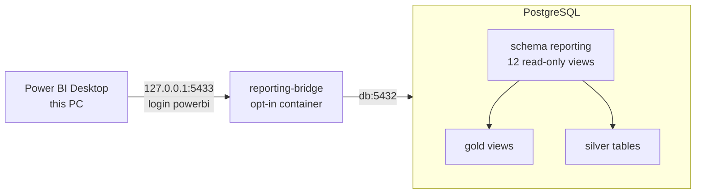
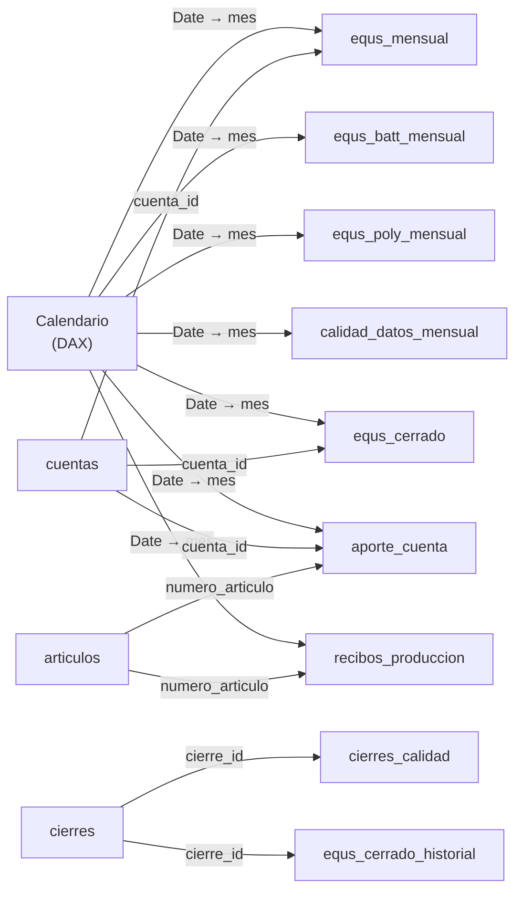

# Connecting Power BI to the database

Power BI Desktop, on the machine that runs the stack, reads the equivalent
batteries straight from PostgreSQL. It connects with a login of its own that can
read the views of schema `reporting`, and nothing else.



The stack normally publishes no database port: only Caddy, for the web pages, is
reachable. The **bridge** is a small container that relays one port to the
database. It is opt-in: `make powerbi` starts it and `make powerbi-down` removes
it. What arrives through it is decided by the database: the `powerbi` login can
read the `reporting` views, its sessions are read-only, and Bronze, Silver and
Gold refuse it.

---

## One-time setup

1. **Choose a password** for the Power BI login and put it in `.env`:

   ```bash
   REPORTING_DB_USER=powerbi
   REPORTING_DB_PASSWORD=<a password of your choice>
   REPORTING_BIND_ADDRESS=127.0.0.1
   REPORTING_PORT=5433
   ```

   Only the password is required; the other three are the defaults.
   [`.env.example`](../.env.example) explains each one.

2. **Bring the stack and the database up to date:**

   ```bash
   make up            # rebuilds the api image, which carries the command below
   make db-upgrade    # creates the reporting schema (revision 0006)
   ```

   A database migrated **before EQUS Gold existed** is already at revision
   `0005`, so `make db-upgrade` would try to add the reporting views on top of a
   Gold that has none and fail. Go down to Silver first; this keeps Bronze and
   Silver:

   ```bash
   make db-downgrade
   make db-downgrade
   make db-upgrade
   ```

3. **Create the login and open the port:**

   ```bash
   make powerbi
   ```

   It prints what to type into Power BI:

   ```text
   Created the reporting login 'powerbi': it reads the 12 views of schema reporting, and nothing else.

   Connect Power BI Desktop with Get data > PostgreSQL database:
     Server     127.0.0.1:5433
     Database   energy
     Mode       Import
     User       powerbi   (Database credentials)
     Password   REPORTING_DB_PASSWORD from .env
   ```

   `make powerbi` can be run again at any time: it renews the password from
   `.env` and leaves everything else as it was.

## Connecting from Power BI Desktop

1. **Home → Get data → More… → Database → PostgreSQL database → Connect.**
   Power BI Desktop ships the PostgreSQL driver; nothing else needs installing.
2. **Server:** `127.0.0.1:5433`. **Database:** `energy`.
   **Data Connectivity mode:** **Import**. Leave the advanced options empty.
3. **Credentials:** choose the **Database** tab (not *Windows*), user `powerbi`
   and the password from `.env`. Apply them to `127.0.0.1:5433`.
4. Power BI may say it **could not connect with an encrypted connection** and
   offer an unencrypted one. Accept it. The database speaks no TLS, and the
   bridge listens only on this PC, so the data never leaves the machine.
5. **Navigator:** expand `energy` and pick the views under **`reporting`**: they
   are the only data the login may read. Select the views you need (see the
   table below) and choose **Load**.

   The Navigator also lists TimescaleDB's own catalogs (`_timescaledb_catalog`,
   `timescaledb_information` and similar). The extension makes them readable by
   every role, and they describe the database's storage, not the plant: ignore
   them. Bronze, Silver and Gold do not appear at all.

### What to load

Load the ones your report needs; `cuentas` is worth loading whenever a fact
table is.

| View | One row per | Use it for |
|---|---|---|
| `equs_mensual` | month × driver (cuenta STATS), every driver of the version in force, 0 included | Column H of RESUMEN EQU: quantity, factor, EQ by driver, process and plant |
| `equs_batt_mensual` | month | EQUS BATT and the EQ of each process, as rows 36–45 |
| `equs_poly_mensual` | month × plastic category | EQUS POLY: pieces, pieces with EQ, factor, EQ |
| `calidad_datos_mensual` | month × data-quality check, 0 included | How many rows each check finds; `bloqueante` marks the checks that stop a close |
| `cierres` | close or reclose | Who closed which month, when, and whether warnings were accepted; `vigente` marks the close in force |
| `cierres_calidad` | close × check | The data-quality counts each close saw |
| `equs_cerrado` | closed month × driver | The official, frozen numbers |
| `equs_cerrado_historial` | row a reclose replaced | What a reclose changed |
| `recibos_produccion` | production receipt (about 139,000 per fiscal year) | Drill-down: quantity, paste, decoration pieces, plant area, plastic category |
| `aporte_cuenta` | receipt or invoice line × driver it fed | Drill-down from a driver to the rows behind it; it adds up exactly to `equs_mensual` |
| `cuentas` | version × driver | Dimension: description, process, plant, row of RESUMEN EQU, unit, the three terms of the factor |
| `articulos` | item | Dimension: description, product line, Campo Equs |

Every month-based view carries `mes` (the first day of the month) and
`anio_fiscal` (`FY26` is October 2025 to September 2026). Column by column, the
views are in [data_dictionary.md](data_dictionary.md#reporting--read-only-views-for-bi-tools).

## A model that works

Power BI relates tables on one column, so every view keyed by a driver carries
`cuenta_id` (`version:cuenta_stats`, for example `1:OXPROD_KG`).



Every arrow is one-to-many, with single-direction filtering, from the table at
its tail. Leave `recibos_produccion` and `aporte_cuenta` unrelated to each other:
both already reach `articulos` and the calendar, and a third path would make
Power BI deactivate one. To go from a receipt to its drivers, use
`numero_de_transaccion` in a drill-through instead.

**A calendar with the fiscal year.** *Modeling → New table*:

```DAX
Calendario =
ADDCOLUMNS (
    CALENDARAUTO ( 9 ),
    "Mes", DATE ( YEAR ( [Date] ), MONTH ( [Date] ), 1 ),
    "Año fiscal", "FY" & FORMAT ( MOD ( YEAR ( EDATE ( [Date], 3 ) ), 100 ), "00" )
)
```

`CALENDARAUTO ( 9 )` makes whole fiscal years that end in September. Mark it as
a date table, and relate `Calendario[Date]` to the `mes` column of each view
(`mes` is always the first day of a month).

**Starter measures.** *Modeling → New measure*:

```DAX
EQUS BATT =
CALCULATE ( SUM ( equs_mensual[equs] ), equs_mensual[suma_eq] = TRUE () )

EQUS POLY = SUM ( equs_poly_mensual[equs] )

EQUS BATT closed =
CALCULATE ( SUM ( equs_cerrado[equs] ), equs_cerrado[suma_eq] = TRUE () )

Live minus closed = [EQUS BATT] - [EQUS BATT closed]

Blocking data-quality rows =
CALCULATE ( SUM ( calidad_datos_mensual[filas] ), calidad_datos_mensual[bloqueante] = TRUE () )
```

- `[EQUS BATT]` by `cuentas[proceso]` or `cuentas[planta]` gives the EQ of each
  process or plant.
- **Do not add `cantidad` across drivers:** each driver counts in its own unit
  (kg of oxide, plates, batteries, decoration pieces).
- The four informative drivers (`suma_eq` false) have factor 0. They are
  reported, never added, and the measure above leaves them out.

## Refreshing

The views are always current: Power BI reads whatever Silver and Gold hold when
it refreshes. After new workbooks arrive:

1. `make refresh-all` (land the workbooks, rebuild Silver, refresh Gold);
2. **Home → Refresh** in Power BI.

The bridge must be running for a refresh. It stays up across restarts of Docker
until `make powerbi-down`. With the FY26 data, every view answers in well under
a second, except `calidad_datos_mensual`, which runs the six data-quality checks
over the whole history and takes about 3 seconds.

Use **Import**, not DirectQuery: a few of the views compute over the whole
history, and every DirectQuery visual would run them again. Each query of the
login is stopped after 10 minutes.

## Closing the port

```bash
make powerbi-down
```

It removes the bridge, so nothing listens on 5433 any more; the login and the
views stay. `make powerbi` opens it again.

## Security

- **What the login can do.**
  - It can read the `reporting` views, and nothing else: Bronze, Silver and Gold
    answer *permission denied*.
  - Every session it opens is read-only.
  - It may hold at most 10 connections, and each query is stopped after 10
    minutes.
  - It is a member of the role `reporting_reader`, which revision 0006 created
    and granted the views to.
- **What `make powerbi` refuses.** It never turns a role that may do more than
  read into the reporting login. That includes a superuser, the application's
  own role, and any owner of a schema or table.
- **The password** is hashed (SCRAM) before it leaves the command, so the plain
  text reaches neither the server nor its logs. To change it:
  1. edit `REPORTING_DB_PASSWORD` in `.env`;
  2. run `make powerbi`;
  3. in Power BI, **File → Options and settings → Data source settings →
     127.0.0.1:5433 → Edit Permissions**.
- **No TLS.** The connection is not encrypted. That is why the bridge listens on
  `127.0.0.1` by default.
  - **Other PCs:** set `REPORTING_BIND_ADDRESS` to this machine's LAN address,
    and only on a network you trust. Open the port in the Windows firewall too.
  - **Power BI Service** (scheduled refresh on powerbi.com) needs an on-premises
    data gateway and TLS. Neither is set up here.

## Troubleshooting

| Symptom | Cause | Fix |
|---|---|---|
| `make powerbi`: *REPORTING_DB_PASSWORD is not set* | No password in `.env` | Add it (step 1) |
| `make powerbi`: *the reporting schema or its reader role is missing* | The database is not at revision 0006 | `make db-upgrade`; for a database from before Gold, see step 2 |
| `make powerbi`: *names a role that may do more than read* | `REPORTING_DB_USER` is the application's own user, or another privileged role | Choose another name, such as the default `powerbi` |
| `make powerbi`: *port is already allocated* | Something else listens on 5433 | Set `REPORTING_PORT` to a free port and run `make powerbi` again |
| `make powerbi` fails with *No such command 'reporting'* | The api image predates the command | `make up`, which rebuilds it |
| Power BI: *No connection could be made* or *connection refused* | The bridge is not running | `make powerbi`; check with `docker compose --profile reporting ps` |
| Power BI: *password authentication failed* | The password in Power BI is not the one in `.env`, or `make powerbi` was not run after changing it | Run `make powerbi`, then edit the credentials in Data source settings |
| Power BI: *permission denied for schema …* | A native query names a Bronze, Silver or Gold object | Query the `reporting` views only |
| Power BI: *canceling statement due to statement timeout* | DirectQuery, or a very heavy native query | Use Import mode |
| New views missing from the Navigator | A later revision added them | `make db-upgrade`, then refresh the Navigator: the revision that adds a view grants it to the reader role |
