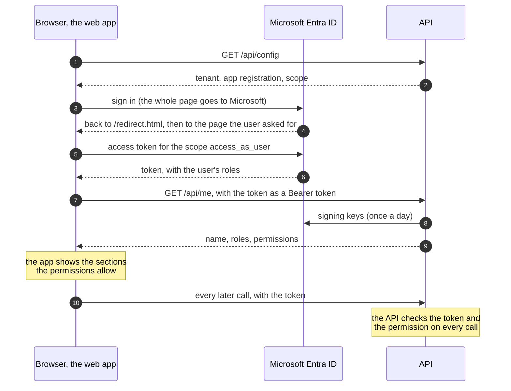

# Sign-in and roles

Users sign in to the web app with their Microsoft Entra ID account. The app
never sees a password, and the stack holds no secret for sign-in. What a user
may do depends on the **role** an administrator assigned them in Entra ID.



The browser hides what a user may not open. The API is what refuses: it checks
the token and the permission on every request, whatever the browser shows.

[ADR 0006](adr/0006-api-tokens-and-app-roles.md) records why it is built this
way.

---

## Roles

| Role | May |
|---|---|
| `viewer` | See the dashboard |
| `operator` | The above, and load data, accept its warnings, and see the history of loads |
| `engineer` | The same as `operator` today. Later: void a load, start the update of the figures |
| `admin` | The same as `operator` today. Later: manage dataset specifications |

A user with **no role** can sign in and sees a page saying they have no access.
Nothing is granted by default.

In the code a role is never checked directly. Each endpoint asks for a
**permission**, and one table says which roles grant it:

| Permission | Granted to | Protects |
|---|---|---|
| `dashboard:view` | `viewer`, `operator`, `engineer`, `admin` | `/api/kpis/*`, the dashboard section |
| `loads:write` | `operator`, `engineer`, `admin` | `/api/datasets/*`, `/api/drafts/*`, `/api/loads/*`, the data-loading section |

The table is `GRANTS` in
[`src/energy/api/security.py`](../src/energy/api/security.py), and it is the
only place where a role is given a meaning. The app asks `GET /api/me` and
receives the permissions; it holds no rule of its own.

### Giving someone access

In the Entra admin center:

1. **Entra ID > Enterprise apps > Clarios dash > Users and groups.**
2. **Add user/group**, choose the user, choose the role, **Assign**.

To change a role, edit the assignment. To take access away, remove it.

A change takes effect with the user's **next token**: after they sign out and
in, or within about 90 minutes.

---

## The app registration

One registration, "Clarios dash", in the project's dedicated tenant (single
tenant). It is both the app that signs users in and the API their token is for.
These are the settings the code depends on:

| Where in the Entra admin center | Setting | Value |
|---|---|---|
| Authentication, platform **Single-page application** | Redirect URIs | `http://localhost:8080/redirect.html` and `http://localhost:8080/signed-out` |
| Authentication, platform **Web** | Redirect URI | `http://localhost:8080/auth/callback`. Nothing uses it; Caddy answers `/auth/*` itself |
| Authentication | Implicit grant: access tokens, ID tokens | Both off |
| Expose an API | Application ID URI | `api://` followed by the client ID |
| Expose an API | Scope | `access_as_user`, enabled, admins and users may consent |
| Manifest | `requestedAccessTokenVersion` | `2` |
| App roles | Values | `viewer`, `operator`, `engineer`, `admin`, for users |
| API permissions | Power BI Service, delegated | `Report.Read.All`, with admin consent granted. The dashboard uses it to show the report with the user's own Power BI token ([powerbi.md](powerbi.md#the-report-inside-the-web-app)) |
| API permissions | Microsoft Graph, delegated | `User.Read`, which a registration has from the start. Admin consent granted |
| Enterprise apps > Properties | Assignment required | No. A user without a role then reaches the app's own no-access page |

They were read back with the Azure CLI, read-only, and matched this table: on
2026-10-12, and on 2026-10-13 for the two rows of API permissions.

**To add the Power BI permission again** (after registering the app anew, for
example): **API permissions > Add a permission > Microsoft APIs > Power BI
Service > Delegated permissions > Report > `Report.Read.All` > Add
permissions**, then **Grant admin consent** on the same page. The permission
does not require an administrator: a user may consent to it. Admin consent is
granted so that nobody is asked.

Four rules are easy to break:

- **The role values are exact.** `Operator` or `operators` grants nothing.
- **Sign-in asks for the Power BI permission too,** so that its consent is
  given on the same screen as the app's own. Removing `Report.Read.All` from
  the registration while `POWERBI_*` is set in `.env` can therefore stop
  sign-in for everyone, in a tenant where users may not consent themselves.
- **Never register two `localhost` URIs that differ only by port.** Entra ID
  ignores the port of a `localhost` URI, so the two above already cover the dev
  server on port 5173. Tell URIs apart by their path.
- **The token version must stay 2.** With the default, Entra ID issues version 1
  tokens, which name another issuer and another audience, and the API refuses
  them.

### On a server with a host name

Add two more URIs to the Single-page application platform:
`https://<host name>/redirect.html` and `https://<host name>/signed-out`.
Outside `localhost`, browsers allow sign-in only over HTTPS.

---

## Configuration

Two variables in `.env`, copied from the registration's **Overview** page:

```bash
ENTRA_TENANT_ID=<Directory (tenant) ID>
ENTRA_CLIENT_ID=<Application (client) ID>
```

- Both are identifiers, not secrets: a browser shows them in the address of the
  sign-in page. They are still kept out of the repository, so `.env` is the only
  place they are written.
- The API reads them, and hands them to the app at `GET /api/config`. The app's
  build contains neither.
- After changing them, run `make up`: the API reads its environment at start.
- With either one empty, the stack starts, the API answers 503 to a request
  that carries a token, and the app says that sign-in is not configured.
- `ENTRA_CLIENT_SECRET` and `ENTRA_REDIRECT_URI` belong to the unused Web
  platform. Nothing reads them, and no container receives the secret.

The API container must be able to reach `login.microsoftonline.com`, to fetch
the keys Entra ID signs with. It keeps them for a day.

---

## Using it

- **Open the app as `http://localhost:8080`,** not `127.0.0.1`. The app builds
  its redirect address from the address bar, and only `localhost` is registered.
- **First visit:** the browser goes to Microsoft and comes back to the page you
  asked for.
- **The sign-out button** in the header signs out of the app and of Microsoft,
  and returns to a page with a sign-in button. Use it on a shared computer.
- **A new tab** signs in again by itself, without a prompt while your Microsoft
  session is alive. Tokens are kept per tab and are gone when the tab closes.
- **The dev server** (`make frontend-dev`, port 5173) signs in the same way.

---

## What the API checks

On every request to a protected route the API checks the token: that Entra ID
signed it, that it is still valid, and that it was issued by this tenant, for
this app registration, to a person. It then compares the route's permission
with the person's roles.

[The API](api.md#5-checking-the-token) lists each check in order, what the API
answers when one fails, and the routes that need no token.

A refusal never says which check failed. The reason is in the API's log, and
the troubleshooting table below names the reasons that point at a setting:

```bash
docker compose logs api | grep "caller not authenticated"
```

---

## Adding a protected endpoint

1. If no existing permission fits, add one to `Permission` and a row to `GRANTS`
   in `src/energy/api/security.py`, with a test in
   `tests/unit/test_api_security.py`.
2. Mount the router in `src/energy/api/main.py` with
   `dependencies=[Depends(requires(Permission.…))]`.
3. A handler that needs to know who is calling takes `principal: PrincipalDep`.

A router mounted without a permission, and not listed as public, fails
`tests/unit/test_api_auth.py`.

In the app, a new section is a row in `frontend/src/sections.ts` with the
permission it needs, and a route wrapped in `RequirePermission`.

---

## Security

- **No secret.** The app signs in with the authorization code flow and PKCE.
  The API checks tokens with public keys.
- **The token lives in the browser tab.** A script running in the page could
  read it, so the app loads no third-party script. A content security policy
  is planned with the hardening increment.
- **Only `/api` is protected by this sign-in.** `/dash/`, `/prefect/` and
  `/minio/` are served by Caddy without it. That is acceptable on `localhost`
  and must be closed before the stack runs on a shared host.
- **Never add a `Cross-Origin-Opener-Policy` header to `/redirect.html`** in the
  Caddyfile. Microsoft's library stops working with it.

---

## Troubleshooting

The app's texts are Spanish. They are named here by their key in
`frontend/src/i18n/es.json`.

| Symptom | Cause | Fix |
|---|---|---|
| Microsoft shows `AADSTS50011`, the redirect URI does not match | The app was opened under an address that is not registered, such as `127.0.0.1` or a host name | Open it as `http://localhost:8080`, or register the address (see "On a server with a host name") |
| Microsoft shows `AADSTS50105`, the user is not assigned to a role | "Assignment required" was switched on for the enterprise app | Assign the user a role, or switch it off |
| Microsoft shows `AADSTS65001`, consent is needed | The scope does not allow users to consent, or the tenant forbids it | Grant admin consent for `access_as_user` under API permissions |
| Microsoft shows `AADSTS90094` or asks for an administrator's approval | Consent for the Power BI permission is missing, and users may not give it | Grant admin consent under API permissions ("The app registration", above) |
| The dashboard asks to continue with Microsoft (`dashboard.problem.authorize`) | Microsoft will not issue the Power BI token without the user | Press the button. [powerbi.md](powerbi.md#what-the-messages-mean) lists the causes |
| The app says that sign-in is not configured (text `problem.notConfigured`) | `ENTRA_TENANT_ID` or `ENTRA_CLIENT_ID` is empty in `.env`, or the API was not restarted after it changed | Fill both, then `make up` |
| The app shows its no-access page (`noAccess`) to a user who was given a role | The user's token is older than the assignment, or the role value is misspelt | Sign out and in. Check the role's value in the registration |
| The app says the session was not accepted (`problem.sessionRefused`) | The API refused the token. The log says why | See the next three rows |
| Log reason `wrong_version` | The manifest's `requestedAccessTokenVersion` is not `2` | Set it to `2`, then sign out and in |
| Log reason `wrong_audience`, `wrong_issuer` or `wrong_tenant` | `.env` names another registration or tenant than the one the user signed in to | Correct `.env`, then `make up` |
| Log reason `expired` or `not_yet_valid` right after sign-in | The clock of the machine that runs the stack is off by more than a minute | Synchronise the clock |
| The app says the service is unavailable (`problem.unreachable`) and the API answers 503 `identity_provider_unavailable` | The API container cannot reach `login.microsoftonline.com` | Restore outbound access. The API tries again after 30 seconds |
| The page returns from Microsoft and says sign-in could not be completed (`signIn.failed`) | Sign-in was cancelled, or the browser blocks the tab's storage | Press the button. In a private window, allow site data |
| Sign-in works on `localhost` and not from another computer | The address is plain HTTP | Deploy with a host name and HTTPS |

---

## Related documents

- [The API](api.md) — what it is in plain words, every endpoint, the token
  check, the errors, and how the app calls it.
- [ADR 0004](adr/0004-react-spa-entra-and-embedded-power-bi.md),
  [ADR 0006](adr/0006-api-tokens-and-app-roles.md) and
  [ADR 0008](adr/0008-embedding-the-report-in-the-dashboard.md) — the
  decisions.
- [frontend-plan.md](frontend-plan.md) — section 7, and increments 2 and 3.
- [powerbi.md](powerbi.md) — the report users open with the same sign-in, and
  what a viewer needs besides a role.
- Microsoft, access tokens: <https://learn.microsoft.com/en-us/entra/identity-platform/access-tokens>
- Microsoft, app roles: <https://learn.microsoft.com/en-us/entra/identity-platform/howto-add-app-roles-in-apps>
- Microsoft, the redirect page of MSAL Browser 5: <https://learn.microsoft.com/en-us/entra/msal/javascript/browser/redirect-bridge>
